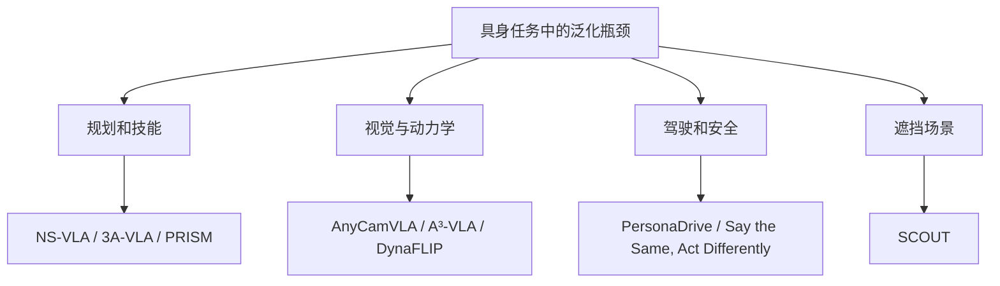

# 2026 年 11 月上半月具身智能研究趋势：九篇技术地图

> 来源：多模空间公众号风向标（2026-11-20）。**206 篇**为原作者对其样本的统计；本文没有完整文章图表和去重样本，不能复核该数字。

## 一句话定义
按**训练期语义监督、技能路由、表征学习、驾驶风格条件化、语言动作失配诊断与遮挡世界模型**给九篇论文定位；作者的 206 篇样本量仍未独立验证。

## 英文缩写速查
| 缩写 | 英文全称 | 简要说明 |
|---|---|---|
| VLA | Vision-Language-Action | 视觉语言动作模型 |
| VLM | Vision-Language Model | 视觉语言骨干 |
| OOD | Out of Distribution | 分布外 |
| MCTS | Monte Carlo Tree Search | 树搜索 |

## 为什么重要
九篇论文研究问题不同：有些改训练时感知，有些改技能路由或任务层计划，还有些检查“文字解释与真实动作不一致”以及“看不见目标如何行动”。把它们放到统一任务榜单会误导。

## 按问题找论文
| 研究问题 | 官方论文版本 | 唯一知识节点 |
|---|---|---|
| NS-VLA | [2603.09542v4](https://arxiv.org/abs/2603.09542v4) | [查看](../entities/paper-ns-vla-2603-09542.md) |
| 3A-VLA | [2602.02212v2](https://arxiv.org/abs/2602.02212v2) | [查看](../entities/paper-3a-vla-2602-02212.md) |
| PRISM | [2611.08917v1](https://arxiv.org/abs/2611.08917v1) | [查看](../entities/paper-prism-2611-08917.md) |
| AnyCamVLA | [2603.05868v3](https://arxiv.org/abs/2603.05868v3) | [查看](../entities/paper-anycam-vla.md) |
| A³-VLA | [2611.06447v2](https://arxiv.org/abs/2611.06447v2) | [查看](../entities/paper-a3-vla-attention-alignment.md) |
| DynaFLIP | [2605.30350v2](https://arxiv.org/abs/2605.30350v2) | [查看](../entities/paper-dynaflip-2605-30350.md) |
| PersonaDrive | [2606.12616v2](https://arxiv.org/abs/2606.12616v2) | [查看](../entities/paper-personadrive-2606-12616.md) |
| Say the Same, Act Differently | [2611.04166v1](https://arxiv.org/abs/2611.04166v1) | [查看](../entities/paper-say-the-same-act-differently-2611-04166.md) |
| SCOUT | [2611.01600v1](https://arxiv.org/abs/2611.01600v1) | [查看](../entities/paper-scout-2611-01600.md) |

## 核心机制

这是便于阅读的**知识分类图**，不是九篇论文共同使用的训练框架。

## 工程实践
- **已找到官方可运行代码入口（静态核验、未实际执行）：** [NS-VLA](../entities/paper-ns-vla-2603-09542.md)、[DynaFLIP](../entities/paper-dynaflip-2605-30350.md)、[PersonaDrive](../entities/paper-personadrive-2606-12616.md)；附各自实际入口的静态 Mermaid 调用时序图。
- **已有节点复用：** [AnyCamVLA](../entities/paper-anycam-vla.md)、[A³-VLA](../entities/paper-a3-vla-attention-alignment.md) 已在仓库，**本次不重复创建**；既有节点记录的全文版本与本次用户列示的 v3/v2 不完全一致，后续需专题审校。
- 入口：[VLA 纵深路线 Stage 5](../../roadmap/depth-vla.md)；优先按自己关心的任务与模块选读。

## 局限与风险
- **206 篇、分类图、真机品牌图**来自公众号描述而非可复算原始表格；没有把它们当作可验证统计结果。
- 三维游戏、CARLA 驾驶、桌面操作、真机货架与对抗诊断不是同一评测任务，成功率和可靠性不能横比。
- 本次已完成七篇新节点的指定版本原文与必要附录核对；现有 AnyCamVLA/A³-VLA 节点保持原有单篇版本记录，**未把它们旧版实验数值称为本期指定的新版本复核**。

## 选读路径
### 规划、技能与动作抽象
[NS-VLA](../entities/paper-ns-vla-2603-09542.md) → [3A-VLA](../entities/paper-3a-vla-2602-02212.md) → [PRISM](../entities/paper-prism-2611-08917.md)。区别神经符号指针、游戏语义抽象与技能适配器路由。

### 视觉感知与动态表征
[AnyCamVLA](../entities/paper-anycam-vla.md) → [A³-VLA](../entities/paper-a3-vla-attention-alignment.md) → [DynaFLIP](../entities/paper-dynaflip-2605-30350.md)。依次对照测试期视角合成、训练期注意力监督与动力学三模态表示。

### 驾驶、行为诊断与探索
[PersonaDrive](../entities/paper-personadrive-2606-12616.md) → [Say the Same, Act Differently](../entities/paper-say-the-same-act-differently-2611-04166.md) → [SCOUT](../entities/paper-scout-2611-01600.md)。三篇分别属于风格条件化、语言行为偏移诊断与遮挡下规划，任务并不一致。

## 关联页面
- [VLA 方法总览](../methods/vla.md)
- [机器人操作](../tasks/manipulation.md)
- [VLA 纵深路线](../../roadmap/depth-vla.md)

## 参考来源
- [多模空间公众号资料索引](../../sources/blogs/duomo_embodied_2026_11_first_half.md)
- [公众号原始链接](https://mp.weixin.qq.com/s/v-PpSCF-c7qHQXzlSYXyMw)
- 九篇原始 arXiv 版本及节点上方表格逐一列出；**七篇新建论文已核对原文和附录**，既有 AnyCamVLA/A³-VLA 仍按原节点核对版本引用；公众号原图及其 206 篇的完整样本**未取得**。

## 推荐继续阅读
- [VLA](../methods/vla.md)
- [VLA 纵深路线](../../roadmap/depth-vla.md)
