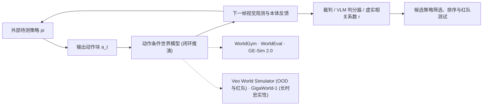

# 具身世界模型六路线 · 评估主导型

> **分类页**：对应 [六路线综述](https://mp.weixin.qq.com/s/mmIJRp9g6NqblMCjd9D5GQ) 的 **评估主导型** 段；总地图见 [embodied-wm-six-routes-technology-map](./embodied-wm-six-routes-technology-map.md)。

## 一句话定义

**评估主导型世界模型不直接充当日常执行控制器，而是作为动作条件下的可微分或高保真虚拟考场，在部署真机前低成本完成候选策略筛选、相对排序与安全红队测试。**

## 英文缩写速查

| 缩写 | 英文全称 | 简要说明 |
|------|----------|----------|
| WM | World Model | 预测未来状态/观测的内部模型 |
| WAM | World Action Model | 联合未来与动作的具身策略 |
| MPC | Model Predictive Control | 模型内滚动搜索动作 |
| OOD | Out-of-Distribution | 超出训练分布的未见场景或扰动 |

## 为什么重要

- **替代昂贵的真机大批量排雷：** 随着 VLA 与多任务策略迭代加速，每次改权重都在真机跑全套测评成本极高；评估主导型 WM 能先淘汰明显失效的 checkpoint，大幅收缩实机评测规模。
- **补足静态离线误差与真机成功率的断层：** 单纯验证集动作 MSE/L1 无法反映长视域闭环累积漂移，闭环 rollout 世界模型可直接暴露执行期碰撞、卡死与 OOD 退化。

## 核心原理与本组工作

综述将评估主导型路径归纳为「固定外部待测策略 \(\pi\)、以世界模型驱动多视角/长时序闭环推演」：待测策略输出动作块 \(a_t\)，世界模型据此推演下一帧视觉观测与本体状态反馈，再由裁判/VLM 判分器或虚实相关系数 \(r\) 衡量跨版本策略优劣。

| 工作 | Wiki 实体 | 文内角色 |
|------|-----------|----------|
| WorldGym | [paper-shenlan-wm-15-worldgym](../entities/paper-shenlan-wm-15-worldgym.md) | 外部策略在 WM 闭环 rollout，用相对排序减少真机筛选。 |
| Veo World Simulator | [paper-veo-world-simulator-policy-testing](../entities/paper-veo-world-simulator-policy-testing.md) | 视频基础模型改造为机器人测试场：OOD 与安全红队。 |
| GE-Sim 2.0 | [ge-sim-2](../entities/ge-sim-2.md) | 动作条件多视角视频+本体反馈的闭环策略评测模拟器。 |
| WorldEval | [paper-sa-2505-19017-worldeval-world-model-as-real-world-robot-polici](../entities/paper-sa-2505-19017-worldeval-world-model-as-real-world-robot-polici.md) | 轻量策略条件世界模型评估。 |
| GigaWorld-1 | [paper-gigaworld-1-policy-evaluation](../entities/paper-gigaworld-1-policy-evaluation.md) | 系统比较世界模型与动作表示；强调长时动作忠实性。 |

## 工程实践

- **用相对排序相关性（如 Spearman/Pearson \(r\)）校验评估器本身：** 先用已标定真机成功率的少量策略做虚实相关性校准，确认世界模型不会因为画面「脑补」把失败策略判成成功。
- **区分评估用途与动作生成用途的动作忠实性要求：** 训练评测世界模型时需重点监督反例（off-expert / failure trajectories）与精确相机/关节约束，防止模型自动把错误动作「纠偏」成成功视频。

## 常见误区或局限

- **长视域误差累积与幻觉偏置：** 视频或潜空间世界模型在多轮自回归后易产生物体凭空出现或接触穿模，高画质不等于物理动力学保真。
- **分布内校准不等同 OOD 泛化：** 若世界模型训练集缺乏失败模式或新物体组合，策略进入长尾姿态时可能给出乐观失真分数。

## 架构与路线图

## 推荐继续阅读

- [具身世界模型六路线技术地图](./embodied-wm-six-routes-technology-map.md)
- [世界模型动作后果分类 04：训练与评估闭环](./wm-action-consequence-category-04-eval-posttrain.md)

## 关联页面

- [六路线技术地图](./embodied-wm-six-routes-technology-map.md)
- [Generative World Models](../methods/generative-world-models.md)

## 参考来源

- [wechat_embodied_ai_lab_wm_six_routes_survey_2026-08-25.md](../../sources/blogs/wechat_embodied_ai_lab_wm_six_routes_survey_2026-08-25.md)
