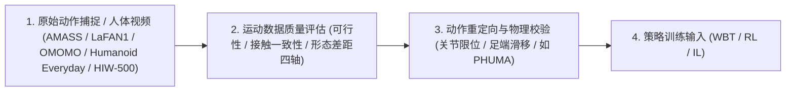

# 训练数据管线（知识链汇总）

> **知识链汇总**：本页是相关概念/方法的统一入口；对应策展纵深见图谱 [路线视图](../../docs/graph.html?depth=imitation-learning) 与 [路线页](../../roadmap/depth-imitation-learning.md)。

## 一句话定义

**训练数据管线知识链** 关注人形策略训练的**上游数据链路**：从原始动作捕捉 / 人体视频，经**质量评估**与**重定向**，到 RL/IL **策略可用的训练输入**。

## 英文缩写速查

| 缩写 | 英文全称 | 简要说明 |
|------|----------|----------|
| MoCap | Motion Capture | 光学/惯性动作捕捉 |
| IL | Imitation Learning | 模仿学习训练范式 |
| RL | Reinforcement Learning | 强化学习训练范式 |
| WBT | Whole-Body Tracking | 全身参考动作跟踪 |
| morphology gap | — | 人/机器人形态差距，决定重定向必要性 |

## 为什么重要

- **数据 ≠ 可训练数据**：原始 MoCap / 视频常缺接触/力信息或存在形态差距，需经质量评估与重定向方可入策略。
- **选型贯通全链**：参考运动来源、重定向方案、训练范式三层互相约束，单点最优≠全链最优。
- **V25 知识链**：本库把分散的数据集实体页、质量与重定向页收成单一图谱视图。

## 本知识链覆盖什么

| 层次 | 典型问题 | 站内入口 |
|------|----------|----------|
| Query | 端到端选型决策树 | [Humanoid Training Data Pipeline](../queries/humanoid-training-data-pipeline.md) |
| 概念 | 数据质量四轴 | [Motion Data Quality](../concepts/motion-data-quality.md) |
| 概念 | 动作重定向 | [Motion Retargeting](../concepts/motion-retargeting.md) |
| 对比 | 参考运动数据集选型 | [Humanoid Reference Motion Datasets](../comparisons/humanoid-reference-motion-datasets.md) |

## 架构与路线图

## 与其他知识链的关系

- **[动作重定向](./hub-motion-retargeting.md)**：重定向是数据管线的第③段，把参考动作映射到机器人骨架。
- **[WBT](./hub-wbt.md)**：训练数据管线产出的参考动作直接喂给全身跟踪训练。
- **[IL/RL](./hub-learning.md)**：训练范式层决定数据输入形态与质量门槛。

## 核心原理

- **端到端数据转换链路**：原始人体 MoCap / 第一视角视频 → 物理质量评估（可行性、接触一致性、形态差距）→ 骨骼/动力学重定向 → 对齐到目标机器人 RL/IL 策略输入格式。

## 工程实践

- **先定目标范式再选数据源**：全身跟踪（WBT）优先选用已重定向好的机器人轨迹（如 [PHUMA](../entities/dataset-bfm-phuma.md)），端到端操作则优先考虑真机多模态集（如 [Humanoid Everyday](../entities/humanoid-everyday-dataset.md)）。
- **质量阈值前置**：在重定向前后分别做关节限位、足端滑移与接触力校验，避免把采集端噪声带入策略训练。

## 局限

- **知识链枢纽定位**：本页侧重链路串联与选型导航，具体重定向算法参数与数据集许可细节需跳转各子页面核对。

## 关联页面

- [AMASS](../entities/amass.md)
- [LaFAN1](../entities/lafan1-dataset.md)
- [OMOMO](../entities/omomo-dataset.md)
- [PHUMA](../entities/dataset-bfm-phuma.md)
- [Humanoid Everyday](../entities/humanoid-everyday-dataset.md)
- [HIW-500](../entities/hiw-500-dataset.md)

## 参考来源

- 本库归纳自 [Humanoid Training Data Pipeline](../queries/humanoid-training-data-pipeline.md)、[Motion Data Quality](../concepts/motion-data-quality.md)
- 知识链定义：[docs/depth-filters.js](../../docs/depth-filters.js)（`data-pipeline` 命中规则）
- 上游原始资料（本链概念页共同的 ingest 来源）：[AMASS 动捕数据集](../../sources/sites/amass-dataset.md)、[PHUMA：物理可靠人形运动数据集](../../sources/repos/phuma.md)、[Humanoid Everyday](../../sources/sites/humanoideveryday.md)

## 推荐继续阅读

- [具身数据纵深路线（Embodied Data）](../../roadmap/depth-embodied-data.md) — Stage 0–5 工程化展开
- [人形训练数据管线选型指南](../queries/humanoid-training-data-pipeline.md) — 决策树与选型对照
