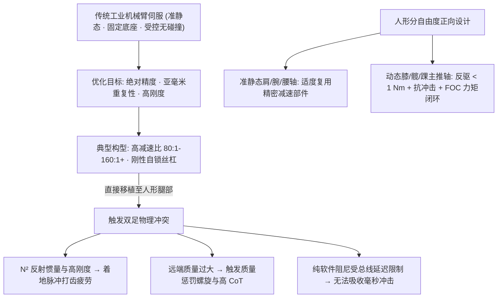

# Actuator 102 · 06：工业执行器陷阱

> **分类页**：**IX 传统工业执行器为何失效**。

## 一句话定义

传统工业机械臂伺服执行器为准静态、受控环境下的绝对位置精度与重复定位而优化，若直接搬运到需要高冲击吸收、低反射惯量、高反向驱动性与热限管理的双足人形腿部，会触发平方律级刚性冲击失效、质量螺旋与能效崩盘。

## 英文缩写速查

| 缩写 | 英文全称 | 简要说明 |
|------|----------|----------|
| CoT | Cost of Transport | 单位重量与距离能耗的无量纲移动效率指标 |
| DoF | Degree of Freedom | 自由度，机器人的独立运动轴数 |
| QDD | Quasi-Direct Drive | 准直驱，低减速比、高透明度的力控作动方案 |
| FOC | Field-Oriented Control | 磁场定向控制，支持高频电流与力矩闭环 |

## 为什么重要

许多新入局人形机器人的工程团队会本能地认为"电机加减速器加驱动器即可采购现成货架工业伺服"，但在腿部工况中，物理规律会惩罚一切隐性多余惯量与不可退让约束：买得越精确、刚性越强、减速比越大的工业关节，在每一次着地冲击与动态摆腿时反而损毁越快。识别"为什么不能买货架工业伺服"是启动自研或定制执行器决策的物理前提。

## 核心原理与结论

表面相似（关节+电机+驱动），两者却运行在截然不同的**物理体系（Physics Regime）**：

| 维度 | 传统工业机械臂 | 人形机器人腿部 |
|------|--------------|--------------|
| 工况特征 | 准静态轨迹、底座固定、受控无意外碰撞 | 动态冲击接触、机身悬浮无固定底座、不可预测地形 |
| 核心优化目标 | 绝对位置精度、亚毫米重复性、高刚度 | 冲击生存、低反射惯量、力矩透明性、CoT 能效 |
| 传动与反向驱动 | 高减速比、高刚度、允许自锁滚珠丝杠 | 需低反向驱动力矩与抗峰值冲击额定，禁止卡死冲击传递 |
| 质量预算 | 底座承重不敏感 | 远端质量触发 [质量惩罚螺旋](./humanoid-actuator-102-load-and-mass-spiral.md) |

原文核心判断：**目前不存在可直接采购的「现成商用人形腿执行器」**，因为工业伺服供应链围绕"刚性定位机台"优化，而双足动态行走是彻头彻尾的物理冲击与能量管理问题。

### 与 N² / 平方律的耦合

第九章与第四章形成闭环：工业伺服普遍采用 **高减速比（80:1–160:1+）** 配小型高速伺服电机来换取静态大扭矩，但由于电机转子反射惯量随减速比呈 $N^2$ 放大（见 [减速与反射惯量](./humanoid-actuator-102-gear-reflected-inertia.md)），摆动腿加减速与着地瞬间会产生平方级冲击扭矩与热损，使标准工业伺服齿轮箱在行走循环中迅速疲劳打齿或过热降额。

## 工程实践

- **立项采购红线**：切勿在腿部膝/髋/踝关键承力关节中直接套用工业协作臂的一体化高减速模组（如通用 100:1 以上工业谐波伺服套件）来做高频动态跑跳验证。
- **按自由度剥离供应链复用边界**：非冲击、准静态的肩腕/腰部旋转或末端低频位置轴可适度借鉴工业精密部件，但膝踝与髋主推轴必须按足式动态冲击载荷重新设计齿轮强度、轴承游隙与热路径。
- **先算反射惯量再看额定转矩**：在器件选型表格中增加反射惯量 $N^2 J_m$ 与反向驱动力矩阈值（$< 1\,\mathrm{Nm}$），而非仅对比静态保持扭矩与定位精度。

## 常见误区或局限

- **误区：工业伺服"皮实耐用"所以一定能扛住走路冲击** — 工业耐用指连续平稳载荷下的万小时寿命，而非毫秒级着地脉冲力矩；高减速比伴随的极大等效刚度会把地面阶跃速度直接转换成齿面毁灭性峰值应力。
- **误区：靠软件位置环降增益就能弥补机械高惯量** — 纯软件阻尼无法在伺服环延迟窗口内消解反射惯量本身带来的瞬时冲击动量。
- **边界说明**：本页核心论证聚焦动态双足腿部关节；若工况仅限轮式底盘或静态陈列展示机，工业货架模组仍具备成本与供货周期优势。

## 架构与路线图

## 关联页面

- [Actuator 102 技术地图](./humanoid-actuator-102-technology-map.md)
- [减速与反射惯量](./humanoid-actuator-102-gear-reflected-inertia.md)
- [决策与物种](./humanoid-actuator-102-decision-species.md)
- [负载与质量螺旋](./humanoid-actuator-102-load-and-mass-spiral.md)

## 推荐继续阅读

- [Actuator 102 · 04：热学与力矩控制](./humanoid-actuator-102-thermal-and-control.md) — 工业脉冲带宽转向 FOC 电流/力矩闭环
- [Actuator 102 · 05：柔顺与感知反馈](./humanoid-actuator-102-compliance-sensing.md) — 如何在腿部实现高透明力感知

## 参考来源

- [wechat_human_five_humanoid_actuator_102.md](../../sources/blogs/wechat_human_five_humanoid_actuator_102.md)
- [wechat_humanoid_actuator_102_2026-06-02.md](../../sources/raw/wechat_humanoid_actuator_102_2026-06-02.md)（第九章）
