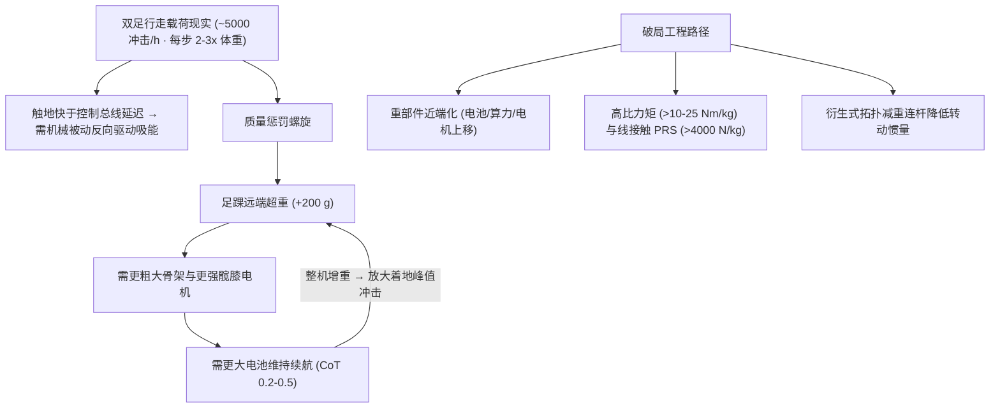

# Actuator 102 · 01：负载与质量螺旋

> **分类页**：**I 行走难题** + **II 质量惩罚螺旋**；总地图见 [Humanoid 执行器 102](./humanoid-actuator-102-technology-map.md)。

## 一句话定义

负载与质量螺旋是指双足行走中的高频接地冲击（每小时约 5000 次、2–3 倍体重）与远端质量引发的能耗非线性放大机制：远端关节每超重数克都会沿杠杆迫使髋膝配备更大电机和电池，进而推高整机运输成本（CoT）与冲击载荷，形成指数级恶化的设计死循环。

## 英文缩写速查

| 缩写 | 英文全称 | 简要说明 |
|------|----------|----------|
| CoT | Cost of Transport | 单位重量与距离能耗的无量纲移动效率指标 |
| QDD | Quasi-Direct Drive | 准直驱，依托低减速比吸收亚毫秒冲击的方案 |
| PRS | Planetary Roller Screw | 行星滚柱丝杠，通过线接触承受高轴向冲击载荷 |

## 为什么重要

许多初次从协作机械臂转向双足开发的团队不理解为何足式关节寿命往往在几周内崩塌：双足运动既没有固定底座分担反作用力，也没有轮式滚动支撑；每次足跟着地都是一次瞬态坠落接住整机质量，因此冲击响应速度门槛和远端质量控制直接决定系统能否走出实验室。

## 核心原理与机理

### 为什么工业额定执行器在人形腿上数周失效（第 I 章）

| 物理机制 | 原文参考量级 | 工程物理含义 |
|----------|--------------|--------------|
| **步频×工作时长** | ~84 步/分 → **~5000 次冲击/小时**；8 小时班 **> 4 万次** | 单班次累计冲击超过多数工业丝杠静态验证基数 |
| **落地冲击幅值** | 每步 **2–3× 体重**；heel strike **50–100 ms** 内产生 **1400–2100 N**（70 kg 级） | 瞬时等效载荷数倍于静态站立重力 |
| **力学响应窗口** | 地面触碰尖峰快于传感-总线-计算控制环延迟 | 必须靠**机械被动反向驱动**先退让吸能，否则齿轮剪断 |
| **运输效率 CoT** | 双足 **0.2–0.5** vs 轮式 **0.01–0.05** | 双足移动能耗天然高一个数量级，对多余死重极其敏感 |

### 静态额定 vs 动态冲击额定

- 传统工业滚珠丝杠和机械臂关节按**准静态平滑轨迹**标定疲劳额定值；人形腿实质是在高频周期性地**接住下落重物**。
- 滚珠丝杠依靠**点接触**承载，在高频脉冲碰撞下钢球极易在滚道表面打出塑性**布氏压痕（Brinelling）**，随后迅速剥落失效；而行星滚柱丝杠的**线接触**结构则将接触峰值压应力显著分散。

### 比力矩 / 比力核心门槛

- **主旋转关节**：比力矩至少 **> 10 Nm/kg**（具备一线工程竞争力的整机模组常要求 **> 25 Nm/kg** 峰值比力矩）。
- **辅助/直线作动**：比力需达到 **> 4000 N/kg** 量级以兼顾小腿纤细空间与足底推力。

### 质量惩罚螺旋（第 II 章）

远端超重执行器 → 需要更粗大骨架与更强髋部电机 → 更重电池才能维持同等级续航 → **CoT 与着地峰值冲击同步放大** → 形成**指数级质量耦合恶化**：文中指出仅在足踝端超重 **200 g**，经整条摆腿杠杆放大后就会等效为髋、膝设计预算中**数公斤级的驱动代价**。

## 工程实践

- **重部件坚决近端化（Mass Centralization）**：尽量将电池、主算力以及膝/踝重型电机移往躯干与大腿近髋端，利用轻量化拉杆、连杆或肌腱驱动小腿与脚踝。
- **执行器选型优先考察峰值/质量比而非绝对峰值**：同等输出转矩下，质量轻 `200 g` 的模组在整机闭环中所节省的关联结构与电池质量远超组件本身的差价。
- **连杆衍生式结构减重**：结合机构动力学仿真对大腿、小腿连杆做拓扑与衍生式减重优化（参考 [动力学仿真驱动的人形下肢衍生式设计](../entities/paper-humanoid-leg-generative-design-dynamics.md)），降低转动惯量以直接换取跳跃高度与抗冲击裕度。

## 常见误区或局限

- **误区：把安全系数全堆在加厚齿轮、外壳和轴承上就能更耐用** — 盲目加厚刚性零件恰恰最容易引爆质量惩罚螺旋：零件更重 → 落地震动能量更高 → 对加厚齿面产生更大绝对冲击力。
- **误区：只要电机和驱动能算得足够快就能用软件主动卸荷替代机械反向驱动** — 着地瞬间的机械弹性波传递在微秒至亚毫秒级完成，通信延迟在毫秒级的总线环永远来不及靠“看清碰撞再让开”保护齿面。

## 架构与路线图

## 关联页面

- [Actuator 102 技术地图](./humanoid-actuator-102-technology-map.md)
- [旋转-直线分离架构](./humanoid-actuator-102-split-architecture.md)
- [Humanoid Hardware 101 · 集成执行器](./humanoid-hardware-101-integrated-actuators.md)
- [动力学仿真驱动的人形下肢衍生式设计](../entities/paper-humanoid-leg-generative-design-dynamics.md) — 大/小腿连杆减重后跳跃高度提升的仿真闭环例证

## 推荐继续阅读

- [Actuator 102 · 03：减速与反射惯量](./humanoid-actuator-102-gear-reflected-inertia.md) — 质量之外的另一维平方级恶化因子（惯量 $N^2 J_m$）
- [Actuator 102 · 06：工业执行器陷阱](./humanoid-actuator-102-industrial-actuator-trap.md) — 工业静态额定思维的失效汇总

## 参考来源

- [wechat_human_five_humanoid_actuator_102.md](../../sources/blogs/wechat_human_five_humanoid_actuator_102.md)
- [wechat_humanoid_actuator_102_2026-06-02.md](../../sources/raw/wechat_humanoid_actuator_102_2026-06-02.md)（第一、二章）
- [人形下肢衍生式设计论文归档](../../sources/papers/humanoid_leg_generative_design_hust_j_260645.md)
