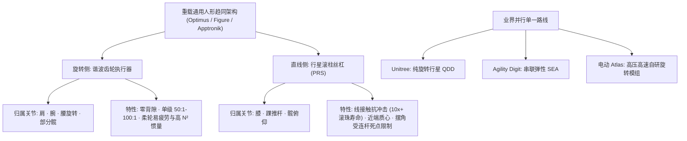

# Actuator 102 · 02：旋转-直线分离架构

> **分类页**：**III 趋同解法**。

## 一句话定义

重载通用人形机器人的"旋转-直线分离架构"是指在上肢（肩、腕等大转角关节）采用谐波减速器配合旋转执行器，而在高冲击、受限摆角但需极大峰值推力的下肢膝/踝关节改用行星滚柱丝杠直线执行器，以在接触寿命、反射惯量与功率密度间达成系统级最优。

## 英文缩写速查

| 缩写 | 英文全称 | 简要说明 |
|------|----------|----------|
| SEA | Series Elastic Actuator | 串联弹性执行器，在电机与负载间引入弹性元件 |
| PRS | Planetary Roller Screw | 行星滚柱丝杠，依靠滚柱线接触传递大推力 |
| QDD | Quasi-Direct Drive | 准直驱，低减速比、高透明度的旋转作动架构 |
| RoM | Range of Motion | 关节有效工作运动角度范围 |

## 为什么重要

若整机无差别地"全用谐波旋转"或"全用滚柱直线"，都会在局部自由度撞上物理瓶颈：全谐波方案在膝踝着地瞬态冲击下柔轮极易疲劳、发热并放大反射惯量；全直线方案则难以胜任肩部 $180^\circ+$ 连续大摆角旋转。理解"为什么不同关节趋同分流"，是从整机层面对接具体电机与传动器件选型的核心枢纽。

## 核心原理与结构

Tesla Optimus、Figure、Apptronik 等**重载通用人形**独立趋同于这一混动路线：**旋转谐波**（肩、腕、部分髋旋转）+ **直线行星滚柱丝杠（PRS）**（膝、踝等高冲击关节）。但该架构并非唯一答案：Unitree 走纯旋转准直驱/高动态行星路线；Agility Digit 坚持 **SEA**；Boston Dynamics 电动 Atlas 采用高压高速自研旋转模组。

### 旋转侧：谐波齿轮（Harmonic Drive）

- 依靠柔轮受波发生器激发产生弹性变形实现啮合，天然**零背隙**、单级可达 **50:1–100:1** 减速比、单位体积静态力矩密度极高。
- 代价在于**效率低于行星齿轮**、持续大扭矩下柔轮交变弯曲应力导致温升与疲劳（参见 [热学与控制](./humanoid-actuator-102-thermal-and-control.md) 与 [膝/腿主承力链为何避开谐波](../concepts/humanoid-knee-harmonic-drive-limits.md)）。

### 直线侧：行星滚柱丝杠（PRS）

- 以**螺旋滚柱线接触**取代滚珠丝杠的**点接触** → 同样载荷下接触面积显著增大，峰值赫兹应力约低一个数量级。
- 步行反复撞击工况下，滚珠丝杠滚道极易出现**布氏压痕（Brinelling）**剥落失效；滚柱丝杠在冲击疲劳循环寿命上可达**一个数量级以上（10×+）**的优势。
- 此外，丝杠配合偏心摇臂可将重型电机上移至大腿/小腿近端，大幅降低远端摆动惯量，并天然利用几何力臂非线性实现不同屈膝角度的刚度匹配。

### 策略性分离对比

| 执行器构型 | 核心优势 | 物理短板 | 典型归属关节 |
|------------|----------|----------|--------------|
| 谐波旋转执行器 | 零背隙、单级大减速比、大转角紧凑 | 耐高频冲击疲劳差、效率低、高 $N^2$ 惯量 | 肩部、手腕、腰部旋转 |
| 滚柱直线执行器 | 线接触高推力、耐落地冲击、近端质心布局 | 摆角行程受限（连杆死点）、高成本 | 膝关节、踝关节推杆、髋俯仰 |

尽管直线模组在下肢备受青睐，全机主关节数量上仍以**旋转执行器**为主体；其余线性单元则下沉至手指肌腱、头部俯仰或躯干辅助自由度。

## 工程实践

- **膝踝四连杆死点规避**：设计行星滚柱丝杠连杆机构时，务必校核全行程内的力臂变化曲线，避免伸直或深蹲极限角靠近几何死点导致驱动扭矩崩溃与横向侧弯力暴增。
- **质量预算近端集中**：利用直线执行器安装轴线自由度，将电机体朝髋骨与大腿根部回缩，缩短小腿/足端回转半径。
- **避免滚珠替代滚柱的伪降本**：在原型验证期可以用滚珠丝杠低成本跑通功能，但进入整机动态落地与跑步载荷验证前必须切换为定制行星滚柱丝杠或高比强度行星 QDD。

## 常见误区或局限

- **误区：线性执行器全面优于旋转执行器** — 线性执行器受限于行程长度和摆角上限（一般 $\le 120^\circ\text{--}140^\circ$），绝对无法覆盖肩关节全空间旋转。
- **误区：PRS 就是标配万能解** — 行星滚柱丝杠研磨精度极高、加工与装配供应链极其昂贵，且丝杠自锁角与反向驱动摩擦需仔细匹配，并非高动态敏捷跳跃机器人的首选（后者常偏爱低比行星 QDD）。

## 架构与路线图

## 关联页面

- [Actuator 102 技术地图](./humanoid-actuator-102-technology-map.md)
- [减速与反射惯量](./humanoid-actuator-102-gear-reflected-inertia.md)
- [Hardware 101 · 直线与轴承](./humanoid-hardware-101-linear-transmission-bearings.md)
- [传动与感知链](./humanoid-hardware-101-actuation-sensing-chain.md)
- [膝/腿主承力链为何通常避开谐波](../concepts/humanoid-knee-harmonic-drive-limits.md) — 冲击谱载、柔轮疲劳与力流判据
- [人形腿部 PRS 直线驱动](../concepts/planetary-roller-screw-humanoid-leg-actuation.md) — 膝踝直线侧机制展开

## 推荐继续阅读

- [Actuator 102 · 04：热学与力矩控制](./humanoid-actuator-102-thermal-and-control.md) — 谐波发热与直线模组散热策略
- [Actuator 102 · 07：决策与物种](./humanoid-actuator-102-decision-species.md) — 三类主流整机物种如何分配上述构型

## 参考来源

- [wechat_human_five_humanoid_actuator_102.md](../../sources/blogs/wechat_human_five_humanoid_actuator_102.md)
- [wechat_humanoid_actuator_102_2026-06-02.md](../../sources/raw/wechat_humanoid_actuator_102_2026-06-02.md)（第三章）
- [wechat_zanehub_humanoid_leg_knee_why_not_harmonic.md](../../sources/blogs/wechat_zanehub_humanoid_leg_knee_why_not_harmonic.md) — 膝侧避开谐波的工程判据补充
