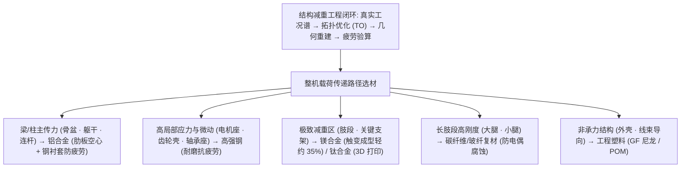

# Humanoid Hardware 101 · 01：机身与材料

> **分类页**：对应 [human five · Hardware 101](https://mp.weixin.qq.com/s/10hYwFzC1EuCypFVzC6QGQ) **机身骨架** 章；总地图见 [Humanoid Hardware 101 技术地图](./humanoid-hardware-101-technology-map.md)。

## 一句话定义

**机身骨架与材料选型的核心不是寻找单一「最轻最强」材质，而是沿整机载荷传递路径为不同部位分别匹配铝合金、高强钢、镁/钛合金、碳纤维复材与工程塑料。**

## 英文缩写速查

| 缩写 | 英文全称 | 简要说明 |
|------|----------|----------|
| GF | Glass Fiber | 玻璃纤维增强材料 |
| POM | Polyoxymethylene | 聚甲醛工程塑料（俗称赛钢/Delrin） |
| TO | Topology Optimization | 按工况载荷分布做结构减重的拓扑优化 |

## 为什么重要

- **结构质量与刚度直接决定腿足运动性能与热耗：** 肢段过重会放大远端转动惯量，模态刚度不足则会压缩控制带宽并带来长期紧固疲劳。
- **多材料混合决定可制造性与 BOM 成本：** 铝合金、镁触变成型、钢衬套与复材胶接的工艺差异极大，错选材料常导致量产良率与装配维护失控。

## 核心原理与按载荷分功能选材

承重结构应按 **载荷路径** 分功能选材，而非把机身当作单一整体。

| 功能类 | 典型部件 | 材料倾向 |
|--------|----------|----------|
| 梁/柱传力 | 骨盆、躯干、连杆 | **铝合金**（比强度、可加工肋板/空心结构） |
| 高局部应力 | 电机座、齿轮箱壳、轴承座 | **钢**（耐磨、抗交变疲劳） |
| 极致减重 | 肢段、关键支架 | **镁合金**（轻 ~35% vs 铝，消防与供应链集中在中国）、**钛**（3D 打印友好、加工难） |
| 长肢段刚度 | 大腿、小腿 | **碳纤维/玻纤**（各向异性、与金属连接电偶腐蚀） |
| 非承力 | 外壳、线束导向 | **工程塑料**（GF 尼龙、POM 等） |

## 设计权衡（文内）

- 铝合金长期疲劳需 **圆角、钢衬套螺纹孔**；钢用于齿轮/轴/轴承等 **数百万次微动** 部位。
- 镁：**触变注射成型** 可降低液态燃烧风险；全球产能高度集中中国。
- 复材与金属连接是 **薄弱节点**；多用于对轻量化极敏感的长肢段。
- **拓扑优化/生成式设计** 在铝合金/钛/增材支架上系统减重时，须走完整 **工况谱→TO→重建→疲劳验证** 链，见 [人形结构拓扑优化工具链](../concepts/humanoid-topology-optimization-toolchain.md)（Zane Hub，2026-09-26）。

## 工程实践

- **按载荷路径分级加固：** 铝合金螺纹孔配钢丝螺套与退刀圆角防疲劳裂纹；高微动接触区（轴承室、电机座）优先镶钢件。
- **拓扑优化绑定真实工况谱：** 减重结构件需按行走/跳跃冲击载荷与模态频率约束走完整 TO→几何重建→疲劳验算，避免只按静载削肉。

## 常见误区或局限

- **忽视碳纤维与铝合金的电偶腐蚀与异向性：** 碳纤–金属连接节点易受层间剪切与腐蚀失效，不适合反复拆装的高频紧固区。
- **只看比强度忽略镁合金阻燃与工艺约束：** 镁合金虽比铝轻约 35%，但加工与铸造消防要求及供应链集中度限制了其随意替代范围。

## 架构与路线图

## 关联页面

- [Humanoid Hardware 101 技术地图](./humanoid-hardware-101-technology-map.md)
- [人形整机机械布局设计](../concepts/humanoid-mechanical-layout-design.md) — 材料之上的构型、惯量分布与刚度公差决策
- [集成执行器](./humanoid-hardware-101-integrated-actuators.md)
- [产业与成本地缘](./humanoid-hardware-101-supply-chain-economics.md)
- [动力学仿真驱动的人形下肢衍生式设计](../entities/paper-humanoid-leg-generative-design-dynamics.md) — Ti6Al4V 增材大/小腿连杆减重与模态验证案例
- [人形结构拓扑优化工具链](../concepts/humanoid-topology-optimization-toolchain.md) — 商用/开源 TO 选型与六步工程流

## 参考来源

- [wechat_human_five_humanoid_hardware_101.md](../../sources/blogs/wechat_human_five_humanoid_hardware_101.md)
- [wechat_humanoid_hardware_101_2026-06-01.md](../../sources/raw/wechat_humanoid_hardware_101_2026-06-01.md)
- [人形下肢衍生式设计论文归档](../../sources/papers/humanoid_leg_generative_design_hust_j_260645.md)

## 推荐继续阅读

- [Humanoid Hardware 101 技术地图](./humanoid-hardware-101-technology-map.md)
- [人形结构拓扑优化工具链](../concepts/humanoid-topology-optimization-toolchain.md)
