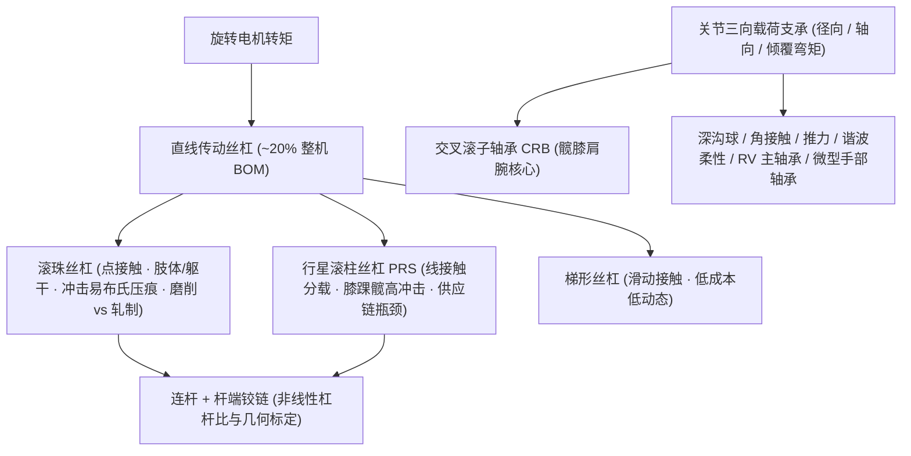

# Humanoid Hardware 101 · 03：直线传动与轴承

> **分类页**：**丝杠、轴承** 章；旋转电机→直线推力的「机械肌肉」，以及关节 **三向载荷** 支承。

## 一句话定义

**直线传动丝杠与交叉滚子/减速机专用轴承共同构成人形「电机转矩 → 线性推力与三向联合支承」的机械转换枢纽，同时也是整机 BOM 成本与抗冲击寿命的核心瓶颈之一。**

## 英文缩写速查

| 缩写 | 英文全称 | 简要说明 |
|------|----------|----------|
| BOM | Bill of Materials | 物料清单，硬件零部件列表 |
| PRS | Planetary Roller Screw | 线接触分载、适于膝踝等高冲击关节的行星滚柱丝杠 |
| CRB | Crossed Roller Bearing | 同时承受径向/轴向/倾覆弯矩的交叉滚子轴承 |

## 为什么重要

- **丝杠占比与产能约束显著：** 仅丝杠即占当前人形 BOM 约 **~20%**，高承载行星滚柱丝杠长期处于产能与成本瓶颈区。
- **轴承承受真实运行的三向倾覆载荷：** 人形落地撞击与悬臂操作产生叠加弯矩，交叉滚子、谐波柔性及 RV 主轴承选型直接决定关节寿命与背隙演化。

## 核心原理：丝杠与轴承选型

### 丝杠

| 类型 | 机理 | 人形角色 | 瓶颈 |
|------|------|----------|------|
| **滚珠丝杠** | 滚珠滚动、效率高 | 肢体/躯干直线执行器 | 点接触，跳跃冲击易 **布氏压痕** |
| **行星滚柱丝杠** | 线接触分散载荷 | 膝踝髋高性能关节 | **供应链紧、成本高**（文内称行业显著瓶颈） |
| **梯形丝杠** | 滑动 | 低成本/低动态 | 效率与寿命受限 |

- 丝杠约占当前 BOM **~20%**；欧日主导磨削滚珠丝杠，中国 **轧制** 丝杠降本推动规模化兴趣。
- 滚珠丝杠腿关节需 **连杆+杆端**，系统复杂度高于旋转关节直驱方案。

## 轴承

- 深沟球、角接触、推力等按载荷选型；**交叉滚子轴承** 同时抗径向/轴向/弯矩，用于髋膝肩腕等核心关节。
- 手部微型高精度轴承难享大宗规模效应。
- **深度选型：** 谐波柔性轴承、RV 主轴承、载荷谱寿命与预紧配合见 [机器人关节轴承选型](../concepts/robot-joint-bearing-selection.md)（Zane Hub，2026-09-17）。

## 工程实践

- **按冲击谱区分滚珠 vs 行星滚柱：** 承受跳跃/奔跑瞬时冲击的膝踝直线关节优先考察行星滚柱丝杠线接触分载，避免普通滚珠丝杠滚道产生布氏压痕。
- **按载荷谱核定交叉滚子轴承预紧：** 连杆+杆端铰链的装配同轴度偏差会放大附加弯矩，须结合等效动静载荷估算 L10h 寿命与游隙预紧量。

## 常见误区或局限

- **把「轧制丝杠降本」等同于直接替代磨削：** 轧制工艺在导程精度、背隙与反向效率上仍有取舍，高动态力控脚踝需验证反向摩擦漂移。
- **忽略连杆传动链的几何奇异与额外维护：** 直线执行器通过四连杆驱动角度时，杠杆比随关节角度非线性变化，增加标定与结构件公差约束。

## 架构与路线图

## 关联页面

- [Humanoid Hardware 101 技术地图](./humanoid-hardware-101-technology-map.md)
- [传动与感知链](./humanoid-hardware-101-actuation-sensing-chain.md)
- [集成执行器](./humanoid-hardware-101-integrated-actuators.md)
- [产业与成本地缘](./humanoid-hardware-101-supply-chain-economics.md)

## 参考来源

- [wechat_human_five_humanoid_hardware_101.md](../../sources/blogs/wechat_human_five_humanoid_hardware_101.md)
- [wechat_humanoid_hardware_101_2026-06-01.md](../../sources/raw/wechat_humanoid_hardware_101_2026-06-01.md)
- [wechat_zanehub_robot_joint_bearing_selection.md](../../sources/blogs/wechat_zanehub_robot_joint_bearing_selection.md)

## 推荐继续阅读

- [机器人关节轴承选型](../concepts/robot-joint-bearing-selection.md)
- [Humanoid Hardware 101 技术地图](./humanoid-hardware-101-technology-map.md)
