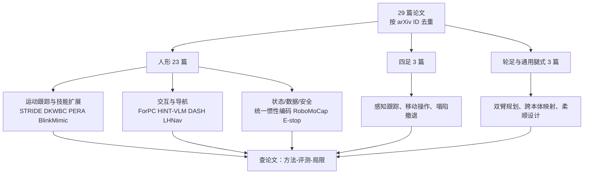

# 人形／四足前沿 29 篇：2026-11-09—11-13 论文阅读坐标

## 一句话定义

本页将具身运控lab 的 29 篇论文周报变成可追溯的研究路线索引：**先按 arXiv 唯一身份去重，再按真实任务、控制接口及实验证据选读**。

## 英文缩写速查

| 缩写 | 英文全称 | 简要说明 |
|---|---|---|
| RL | Reinforcement Learning | 通过环境反馈训练全身控制与运动策略 |
| WBC | Whole-Body Control | 协调四肢、基座和接触约束的全身控制 |
| VLA | Vision-Language-Action | 从视觉和语言条件生成机器人动作 |
| MPC | Model Predictive Control | 用有限时域优化规划足步、导航或群体动作 |
| CBF | Control Barrier Function | 对候选控制指令施加安全滤波 |
| IMU | Inertial Measurement Unit | 运动状态估计及加速度奖励的惯性传感器 |

## 为什么重要

同一周报混合了仿真训练、真机部署、理论分析、数据集及安全工程，**不能以论文数量或标题关键词比较成熟度**。例如 [STRIDE](../entities/paper-stride-acceleration-locomotion.md) 的分钟级训练是仿真样本量；[Runtime Safety](../entities/paper-runtime-safety-graduated-force-authority.md) 讨论的是真机急停失稳；[PERA](../entities/paper-pera-plugin-experts.md) 的 126 项旧动作保持发生在仿真评测中。它们分别回答训练效率、部署安全和持续技能扩展问题。

## 核心原理

### 按技术问题筛选

### 研究判断

1. **训练效率与实机可靠性分开读**：强化学习样本效率、GPU 耗时和真实机器人部署都需要不同的验证。
2. **控制接口是主要差别**：DKWBC 的关节力矩残差、STRIDE 的关节位置目标、PERA 的 MoE 专家扩展，不应统称同一个「RL 运控算法」。
3. **安全是独立闭环**：安全层检测到关节限位、状态超时并触发断力，未必让主动平衡机器人进入真正安全状态。
4. **数据/参考/控制的分工**：RoboMoCap 提供数据，MotionSkill 和单图重定向研究参考映射，DASH、LHNav 分别面向系统时延及长时规划。

## 29 篇索引

| # | 类型 | 论文／研究问题 | arXiv | 入库 |
|---|---|---|---|---|
| 01 | 人形 | [ForPC：力感知全身推车控制](../entities/paper-forpc-cart-pushing.md) | [2611.08664](https://arxiv.org/abs/2611.08664) | 已有或本次新建 |
| 02 | 人形 | [STRIDE：基于 IMU 加速度奖励的高样本效率行走](../entities/paper-stride-acceleration-locomotion.md) | [2611.08857](https://arxiv.org/abs/2611.08857) | 已有或本次新建 |
| 03 | 人形 | [SUGARv2：合成交互参考训练视觉移动操作](../entities/paper-sugarv2-humanoid-interaction-reference.md) | [2611.09266](https://arxiv.org/abs/2611.09266) | 已有或本次新建 |
| 04 | 人形 | [DKWBC：逆动力学跟踪与 RL 平衡解耦](../entities/paper-dkwbc.md) | [2611.09605](https://arxiv.org/abs/2611.09605) | 已有或本次新建 |
| 05 | 人形 | [Unified Inertial Encoder：人体与人形的统一惯性编码](../entities/paper-unified-inertial-encoder.md) | [2611.10137](https://arxiv.org/abs/2611.10137) | 已有或本次新建 |
| 06 | 人形 | Capturability-Aware MPC：安全走廊中的递归可行足步规划 | [2611.10169](https://arxiv.org/abs/2611.10169) | 待全文核对 |
| 07 | 人形 | [DreamVLA：人体运动生成与人形 VLA 蒸馏](../entities/paper-dreamvla.md) | [2611.10872](https://arxiv.org/abs/2611.10872) | 已有或本次新建 |
| 08 | 人形 | [RoboMoCap：带第一视角视觉的全身动捕数据集](../entities/paper-robomocap.md) | [2611.10994](https://arxiv.org/abs/2611.10994) | 已有或本次新建 |
| 09 | 人形 | Festival-to-Stage：从节庆视频到长时真机舞蹈的部署阶梯 | [2611.11127](https://arxiv.org/abs/2611.11127) | 待全文核对 |
| 10 | 人形 | [Kimodo-Policy：以全身运动生成先验构建运动学动作模型](../entities/paper-kimodo-policy.md) | [2611.11554](https://arxiv.org/abs/2611.11554) | 已有或本次新建 |
| 11 | 人形 | HINT-VLM：具身可移动性校正的崎岖地形交互导航 | [2611.11665](https://arxiv.org/abs/2611.11665) | 待全文核对 |
| 12 | 人形 | [DASH：慢速 VLM 与快速动作头异步解耦](../entities/paper-dash-async-humanoid-vla.md) | [2611.11854](https://arxiv.org/abs/2611.11854) | 已有或本次新建 |
| 13 | 人形 | [LHNav：多速率长时人形语言导航](../entities/paper-lhnav.md) | [2611.12136](https://arxiv.org/abs/2611.12136) | 已有或本次新建 |
| 14 | 人形 | [AHEADance：流式音乐的预判式动作生成](../entities/paper-aheadance.md) | [2611.13370](https://arxiv.org/abs/2611.13370) | 已有或本次新建 |
| 15 | 人形 | [ReACT：非对称负载下镜像一致速度跟踪](../entities/paper-react-asymmetric-load-tracking.md) | [2611.13929](https://arxiv.org/abs/2611.13929) | 已有或本次新建 |
| 16 | 人形 | [RedirectMimic：局部动作内容替换而非简单取消跟踪](../entities/paper-redirectmimic.md) | [2611.14049](https://arxiv.org/abs/2611.14049) | 已有或本次新建 |
| 17 | 人形 | Can I Join You?：社会力、MPC 与 CBF 群体重定位 | [2611.14853](https://arxiv.org/abs/2611.14853) | 待全文核对 |
| 18 | 人形 | Single RGB to Robot：场景尺度对齐与接触引导重定向 | [2611.14981](https://arxiv.org/abs/2611.14981) | 待全文核对 |
| 19 | 人形 | [ILA：冻结跟踪器的接口级柔顺适配](../entities/paper-ila-interface-level-adapter.md) | [2611.14985](https://arxiv.org/abs/2611.14985) | 已有或本次新建 |
| 20 | 人形 | [Runtime Safety and E-stop：全尺寸人形运行时安全与急停反思](../entities/paper-runtime-safety-graduated-force-authority.md) | [2611.15928](https://arxiv.org/abs/2611.15928) | 已有或本次新建 |
| 21 | 人形 | [PERA：冻结基础策略的可插拔技能专家](../entities/paper-pera-plugin-experts.md) | [2611.16188](https://arxiv.org/abs/2611.16188) | 已有或本次新建 |
| 22 | 人形 | BlinkMimic：单卡分钟级全身动作跟踪训练 | [2611.16422](https://arxiv.org/abs/2611.16422) | 待全文核对 |
| 23 | 人形 | FORGE：多粒度命令与力感知移动操作 | [2611.17142](https://arxiv.org/abs/2611.17142) | 待全文核对 |
| 24 | 四足 | [DobotTrack：目标身份约束的具身行人跟踪](../entities/paper-dobottrack.md) | [2611.09041](https://arxiv.org/abs/2611.09041) | 已有或本次新建 |
| 25 | 四足 | PolyMorphWBC：四足移动操作跨机械臂形态末端轨迹控制 | [2611.15117](https://arxiv.org/abs/2611.15117) | 待全文核对 |
| 26 | 四足 | Collapse-Reactive Retreat：坍塌地形的内存高效并行强化学习 | [2611.16337](https://arxiv.org/abs/2611.16337) | 待全文核对 |
| 27 | 轮足/腿式 | [Bimanual Planning–Execution：语言双臂任务规划与执行验证](../entities/paper-bridging-planning-execution-bimanual.md) | [2611.12409](https://arxiv.org/abs/2611.12409) | 已有或本次新建 |
| 28 | 轮足/腿式 | MotionSkill：从双足视频到跨本体运动策略 | [2611.16346](https://arxiv.org/abs/2611.16346) | 待全文核对 |
| 29 | 轮足/腿式 | Softness / Compliance：柔顺踝被动行走的信息度量 | [2611.13779](https://arxiv.org/abs/2611.13779) | 待全文核对 |

> **状态说明：** 本次去重首次检索到已有详情 15 篇，本 PR 对另外 3 篇完成全文核对后新建详情；余下 11 篇先保留原文链接，未被标记「原文已读完」，不把周报阅读当论文深读。

## 工程实践

- **控制训练**：优先比较动作输出空间、控制频率、所需状态估计，以及样本量的计数方式。
- **Sim2Real**：将论文中的仿真成功率与真机演示分开记；没有完整部署数据时不要自行推测真机泛化。
- **安全评估**：记录急停后是否保持主动平衡、是否有物理限位/安全绳，及故障监控所在的进程边界。
- **待进一步入库的论文**：本页表中的「待全文核对」应按各论文的完整方法、实验、结论逐篇补建唯一详情节点，再运行健康度脚本。

## 局限与风险

- 29 篇的总体列表来自**二手周报**；本页不是逐篇原文深读完成证明。单篇新建页中注明自己核对的 arXiv 版本与章节。
- 领域分类供检索使用，不等于论文方法、开源状态或定量效果经过同口径测评。
- 未核对源码项目页与可运行入口时，不绘制臆造的运行时序图。

## 关联页面

- [人形机器人运动控制](../tasks/humanoid-locomotion.md)
- [Whole-Body Control](../concepts/whole-body-control.md)
- [强化学习 / PPO](../methods/ppo.md)
- [11 月 10 日相关论文阅读坐标](./embodied-station-2026-11-10-22-papers-technology-map.md)

## 参考来源

- [具身运控lab 的 29 篇周报全文归档](../../sources/blogs/wechat_locomotion_lab_2026_11_16_humanoid_quadruped_29.md)
- [微信公众号原文](https://mp.weixin.qq.com/s/FDFjMgTbvwmgsm0tWUpm6w)

## 推荐继续阅读

- [STRIDE：论文原文与实验证据](https://arxiv.org/html/2611.08857)
- [Runtime Safety：运行时安全与急停](https://arxiv.org/html/2611.15928)
- [PERA：可插拔专家技能扩展](https://arxiv.org/html/2611.16188)
