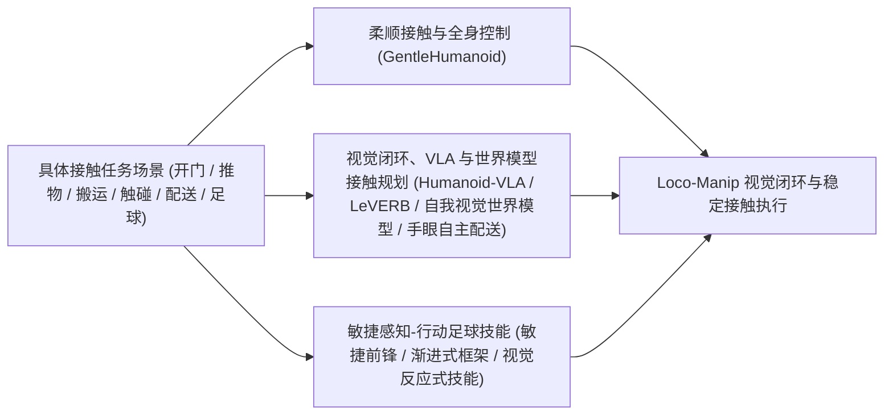

# Loco-Manip 161 分类 06：特殊任务、接触规划与视觉闭环

> **分类页**：**06 特殊任务、接触规划与视觉闭环**；总地图见 [人形 Loco-Manip 161 篇技术地图](./humanoid-loco-manip-161-papers-technology-map.md)。

## 英文缩写速查

| 缩写 | 英文全称 | 简要说明 |
|------|----------|----------|
| Loco-Manip | Loco-Manipulation | 行走与操作动力学耦合的全身任务 |
| WBC | Whole-Body Control | 协调全身关节满足多任务/约束的控制层 |
| VLA | Vision-Language-Action | 视觉-语言-动作多模态策略 |
| WM | World Model | 学习环境动态以供想象/规划的世界模型 |
| RL | Reinforcement Learning | 通过与环境交互最大化长期回报来学习策略 |

## 核心问题

开门、推物、搬运、触碰等具体接触任务

## 本组论文（8 篇）

| # | 工作 | Wiki 实体 |
|---|------|-----------|
| 120 | GentleHumanoid | [paper-loco-manip-161-120-gentlehumanoid](../entities/paper-gentlehumanoid.md) |
| 121 | Humanoid-VLA | [paper-loco-manip-161-121-humanoid-vla](../entities/paper-loco-manip-161-121-humanoid-vla.md) |
| 122 | LeVERB | [paper-loco-manip-161-122-leverb](../entities/paper-bfm-36-leverb.md) |
| 123 | 从嘈杂的感官输入中学习人形足球机器人的敏捷前锋技能 | [paper-loco-manip-161-123-n123](../entities/paper-loco-manip-161-123-n123.md) |
| 124 | 学习人形机器人的足球技能：渐进式感知-行动框架 | [paper-loco-manip-161-124-n124](../entities/paper-loco-manip-161-124-n124.md) |
| 125 | 学习人形机器人视觉驱动的反应式足球技能 | [paper-loco-manip-161-125-n125](../entities/paper-loco-manip-161-125-n125.md) |
| 126 | 手眼自主配送 | [paper-loco-manip-161-126-n126](../entities/paper-loco-manip-161-126-n126.md) |
| 127 | 用于人形接触规划的自我视觉世界模型 | [paper-loco-manip-161-127-n127](../entities/paper-hrl-stack-33-ego-vision-world-model-for-humanoid.md) |

## 架构与路线图

## 关联页面

- [人形 Loco-Manip 161 篇技术地图](./humanoid-loco-manip-161-papers-technology-map.md)
- [Loco-Manipulation 任务页](../tasks/loco-manipulation.md)

## 参考来源

- [wechat_embodied_ai_lab_humanoid_loco_manip_161_survey.md](../../sources/blogs/wechat_embodied_ai_lab_humanoid_loco_manip_161_survey.md)
- [humanoid_loco_manip_161_catalog.md](../../sources/papers/humanoid_loco_manip_161_catalog.md)

## 推荐继续阅读

- [运动小脑 64 篇技术地图](./humanoid-motion-cerebellum-technology-map.md)
