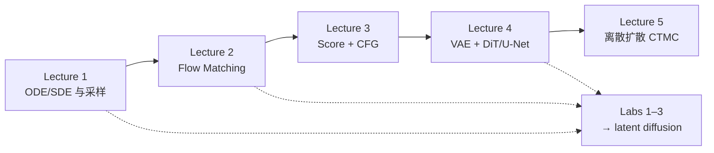

# MIT 6.S184：Flow Matching & Diffusion Models（2026）

> **本页定位**：为 [MIT CSAIL 2026 课程站](https://diffusion.csail.mit.edu/2026/index.html) 提供 **按理论–Lab–机器人应用** 组织的阅读坐标。2026-11-07 已对照官方 2026 版讲义 PDF（84 页）核实各讲要点；Lab 以 [iap-diffusion-labs](https://github.com/eje24/iap-diffusion-labs/tree/2026) 为准，notebook 本身尚未逐段核查。

## 一句话定义

**一门把随机微分方程、概率路径与神经网络生成组件（VAE、DiT、CTMC）串成完整 latent diffusion 管线的 IAP 课——适合作为本库扩散/flow 形式化与机器人生成式策略的上游系统课。**

## 英文缩写速查

| 缩写 | 英文全称 | 简要说明 |
|------|----------|----------|
| SDE | Stochastic Differential Equation | 含随机项的微分方程；扩散采样核心 |
| ODE | Ordinary Differential Equation | 确定性常微分方程；概率流 / flow 采样 |
| FM | Flow Matching | 直接回归速度场的生成式训练范式 |
| CFG | Classifier-Free Guidance | 无分类器引导的条件生成技巧 |
| DiT | Diffusion Transformer | Transformer 骨干的扩散模型 |
| VAE | Variational Autoencoder | 潜空间编码器–解码器；latent diffusion 前置 |
| CTMC | Continuous-Time Markov Chain | 离散扩散的连续时间马尔可夫链形式 |

## 为什么重要

- **补齐数学底座：** 机器人 wiki 里 [Diffusion Policy](../methods/diffusion-policy.md)、[π₀](../methods/π0-policy.md) 多从应用切入；本课反向提供 **SDE → score → FM → latent DiT** 的完整推导链。
- **可动手复现：** 三份 Lab 在 Colab/GitHub 上 **从零实现** 玩具 FM、score matching 与 latent diffusion，比只看论文 PDF 更利于建立采样/训练直觉。
- **与 Levine Simons 报告对读：** [表达力更强的连续动作策略](./sergey-levine-diffusion-expressive-policies.md) 讲 **控制侧为何需要扩散/flow 动作头**；本课讲 **生成侧数学与实现**。

## 核心原理

以下为讲义主线的最小公式骨架（约定 $t=0$ 为噪声、$t=1$ 为数据）：

| 环节 | 讲义要点 |
|------|----------|
| 流模型 | $dX_t=u_t^\theta(X_t)dt$，$X_0\sim p_{init}$；欧拉法 $X_{t+h}=X_t+hu_t(X_t)$；神经网络参数化的是**向量场**而非流 |
| 扩散模型 | $dX_t=u_t^\theta dt+\sigma_tdW_t$，Euler–Maruyama 采样；$\sigma_t=0$ 即流模型 |
| 概率路径 | 高斯条件路径 $\mathcal N(\alpha_tz,\beta_t^2I)$；边缘化技巧：条件向量场按后验加权得到边缘向量场（Theorem 9），由连续性方程证明 |
| Flow Matching 损失 | $\mathcal L_{CFM}=\mathbb E\|u_t^\theta(x)-u_t(x|z)\|^2$，与 $\mathcal L_{FM}$ 相差常数（Theorem 12）；CondOT 路径 $\alpha_t=t,\beta_t=1-t$ 时回归目标为 $z-\epsilon$，训练无需模拟 ODE |
| 分数与 SDE | 高斯路径下 $u_t(x)=a_t\nabla\log p_t(x)+b_tx$（Proposition 1）；SDE 扩展技巧（Theorem 17）：任意 $\sigma_t$ 都保持边缘分布，依据 Fokker–Planck 方程 |
| 引导 | CFG：$\tilde u_t(x|y)=(1-w)u_t(x|\varnothing)+wu_t(x|y)$，训练时以概率 $\eta$ 丢弃标签 |
| 架构与潜空间 | DiT = ViT 式 patchify + 带 AdaLN 时间调制的 Transformer 块（讲义的通用块还含对提示的交叉注意力和门控）；VAE 损失 = 重建 + $\beta\cdot$KL；SD3 的 MM-DiT、Movie Gen 的 30B 参数 DiT 作案例 |
| 离散 | 用 CTMC 取代 SDE，速率矩阵 $Q_t$，因子化混合路径，离散边缘化技巧（Theorem 36） |

与机器人动作头的对照：π₀ 的流匹配目标就是 CondOT 形式（$\tau A+(1-\tau)\epsilon$ 路径、目标 $A-\epsilon$），见 [流匹配与具身策略](../concepts/flow-matching-embodied-policy.md)；讲义本身不含机器人内容，这一对应关系是本站补充。

## 课程主线（2026 站点）

| 模块 | 站点主题 | 本库对接 |
|------|----------|----------|
| 随机分析 | Fokker–Planck、SDE 采样 | [Probability Flow](../formalizations/probability-flow.md) |
| Flow | 条件/边际路径、向量场、FM 损失 | [π₀ flow VLA](../methods/π0-policy.md) |
| Score | Denoising score matching | [Diffusion Policy](../methods/diffusion-policy.md) |
| 潜空间 | VAE + DiT 架构 | [Generative World Models](../methods/generative-world-models.md) |
| 离散 | CTMC 离散扩散 | 文本/离散 token 扩散（概念延伸） |

## 课程入口与核查范围

- [2026 课程主页](https://diffusion.csail.mit.edu/2026/index.html)提供六段讲课录像、幻灯片和三个实验入口；[课程讲义 PDF](https://diffusion.csail.mit.edu/2026/docs/lecture_notes.pdf)是官方推荐的课程主线，站点称它“自包含”并“强烈推荐使用”。先修：线性代数、多元微积分、基础概率，会 Python 与一些 PyTorch；站点许可 CC BY-NC-SA。
- 2026-11-07 已通读官方 2026 版讲义（§1–§7 的正文与各定理/小结框；证明、概率复习、附录 D–E 只浏览）。讲课录像、幻灯片尚未观看，Lab notebook 核心源码尚未逐段核查或运行；本页不包含源码运行时序图。
- 站点把第 3 讲拆成 3-A（分数匹配）与 3-B（CFG），讲义对应第 4、5 节；第 4 讲对应讲义第 6 节，第 5 讲对应第 7 节。
- [实验仓库](https://github.com/eje24/iap-diffusion-labs/tree/2026)提供 notebook 与解法；其 README 记录了 2026-01 对 Lab 2 `ConditionalVectorFieldSDE` / `LangevinFlowSDE` 扩散系数 bug 的修复。

## 工程实践

### Labs 与实践路径

| Lab | 练什么 | 仓库 |
|-----|--------|------|
| **Lab 1** | Working with ODEs and SDEs（站点标题；README 提到含 Langevin 动力学） | [iap-diffusion-labs](https://github.com/eje24/iap-diffusion-labs/tree/2026) |
| **Lab 2** | Flow Matching and Score Matching（站点标题；README 提到条件 SDE 采样） | Colab + GitHub solutions |
| **Lab 3** | Diffusion Transformer and VAEs（站点标题；与讲义 §6 对应的 latent diffusion） | 完整生成管线 capstone |

**建议顺序：** 先读 Lecture 1–2 notes → 做 Lab 1–2 → 再读 score/CFG 与 Lecture 4–5 → Lab 3。

## 局限与风险

- **IAP 节奏快：** 需概率论与 PyTorch 基础；不适合零线性代数/深度学习背景硬啃。
- **偏生成式 AI 主域：** 图像/latent 为主，机器人 **动作空间** 与 **闭环控制** 需另读 [Diffusion Policy](../methods/diffusion-policy.md) 等应用页。
- **讲义偏理论：** 机器人闭环中的延迟、动作块与实时执行问题，讲义没有涉及；去噪步数少到 4–10 步的做法来自 π₀、GR00T N1 等论文，而非本课（见 [流匹配与具身策略](../concepts/flow-matching-embodied-policy.md)）。
- **录像状态：** 截至 2026-11-05，课程页面源码为 1、2、3-A、3-B、4、5 共六节列出 YouTube 嵌入链接；本次未逐一播放核验可用性。

## 关联页面

- [流匹配与具身策略（概念）](../concepts/flow-matching-embodied-policy.md) — 机器人 VLA / 动作头侧 FM 导读
- [Probability Flow（形式化）](../formalizations/probability-flow.md)
- [Diffusion Model（概念）](../concepts/diffusion-model.md)
- [Diffusion Policy（方法）](../methods/diffusion-policy.md)
- [Sergey Levine：表达力更强的连续动作策略](./sergey-levine-diffusion-expressive-policies.md)

## 参考来源

- [mit_flow_matching_diffusion_2026.md](../../sources/courses/mit_flow_matching_diffusion_2026.md) — 课程 ingest 档案
- [iap_diffusion_labs.md](../../sources/repos/iap_diffusion_labs.md) — Lab 仓库归档
- 课程主页：<https://diffusion.csail.mit.edu/2026/index.html>

## 推荐继续阅读

- Holderrieth & Erives, *Introduction to Flow Matching and Diffusion Models*（[arXiv:2506.02070](https://arxiv.org/abs/2506.02070)）
- Lipman et al., *Flow Matching for Generative Modeling*（[arXiv:2210.02747](https://arxiv.org/abs/2210.02747)，已通读，见[归档](../../sources/papers/lipman_flow_matching_arxiv_2210_02747.md)）
- [2026 版讲义 PDF](https://diffusion.csail.mit.edu/2026/docs/lecture_notes.pdf)
- Ho et al., *Denoising Diffusion Probabilistic Models*
