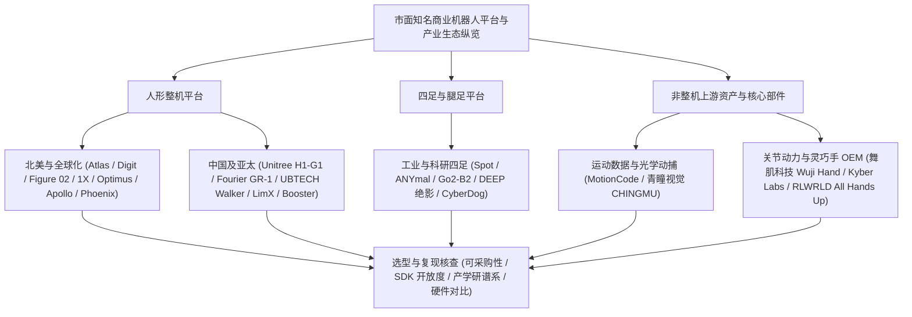

# 市面知名机器人平台纵览

## 一句话定义

本页回答：**除了少数明星项目外，产业与新闻里还经常出现哪些人形、四足与腿足平台**，它们大致属于哪条技术–商业路线，以及在本知识库里应去哪里深挖。

## 英文缩写速查

| 缩写 | 英文全称 | 简要说明 |
|------|----------|----------|
| AI | Artificial Intelligence | 人工智能 |
| VLA | Vision-Language-Action | 视觉-语言-动作多模态基础策略方向 |
| G1 | Unitree G1 Humanoid | 宇树入门级教育科研人形平台 |
| RL | Reinforcement Learning | 通过与环境交互最大化长期回报来学习策略的范式 |
| Retargeting | Motion Retargeting | 将人体/动物动作映射到目标机器人骨架 |
| ANYmal | ANYbotics Quadruped | ANYbotics 的四足机器人研究平台 |
| Locomotion | Robot Locomotion | 足式/人形等无轮移动能力的总称 |

## 为什么重要

做选型、写综述或对齐仿真模型时，如果只盯着一两家公司，容易误判「行业平均水平」。把 **高频出镜的平台族谱** 摊开，可以快速判断：

- 你需要对标的是 **科研易获得硬件**（如宇树）、**工业落地闭环**（如 Agility / Apptronik）、还是 **全栈 AI 叙事**（如 Figure / Sanctuary）。
- 四足与人形的 **供应商重叠**（例如同一家公司既做四足又做人形）会影响采购、售后与仿真资产迁移策略。

## 核心机制：平台阵营与路线分层

本页不列产品推销清单，而是按**商业场景定位 + 产学研孵化谱系**把高频平台分成三条线索来读，并与本库[公司技术路线对照](../comparisons/robot-foundation-model-company-paths-2026.md)互补。

### 人形：常见「阵营」速览

下列品牌在英文科技媒体、国内产业报道与展会中曝光度较高；**不等同于性能排名**，亦不构成采购建议。

#### 北美 / 全球化总部（全能与物流叙事）

| 品牌（例子） | 典型标签 | 本库延伸阅读 |
|--------------|-----------|----------------|
| Boston Dynamics | Atlas / Spot；液压转型全电 Atlas | [Boston Dynamics](../entities/boston-dynamics.md) |
| Agility Robotics | Digit 1–5；仓储物流人形与协作安全（Nasdaq: AGLT） | [Agility Robotics（公司全栈）](../entities/agility-robotics.md)、[Motor Cortex WBC](../entities/agility-wbc-foundation-model.md)、[Physical AI × 机械硬件（SciRob 2026）](../entities/paper-physical-ai-mechanical-hardware.md)、[Digit RL 行走](../entities/paper-digit-humanoid-locomotion-rl.md) |
| Figure AI | Figure 02、Helix VLA | [Figure AI](../entities/figure-ai.md) |
| 1X Technologies | EVE、NEO | [1X Technologies](../entities/1x-technologies.md) |
| Tesla | Optimus；汽车供应链叙事 | [人形机器人总览表](../entities/humanoid-robot.md) |
| Apptronik | Apollo；工业通用人形 | 同上速览表 |
| Sanctuary AI | Phoenix、Carbon | 见 [原始资料链接索引](../../sources/repos/notable-commercial-robot-platforms.md) |

### 中国及亚太（出货与场景绑定深）

| 品牌（例子） | 典型标签 | 本库延伸阅读 |
|--------------|-----------|----------------|
| Unitree | H1、G1；Go2、B2 | [Unitree](../entities/unitree.md)、[G1](../entities/unitree-g1.md) |
| Fourier Intelligence | GR-1 等全身人形 | [硬件对比](../queries/hardware-comparison.md) |
| UBTECH | Walker 系列 | 同上 |
| LimX Dynamics、Booster Robotics 等 | 融资与赛事曝光高 | [LimX COSA](../entities/limx-cosa.md)（逐际大脑 OS + Oli）；[Booster RoboCup Demo](../entities/booster-robocup-demo.md)（Booster 相关） |

更多官网入口见 [原始资料：平台链接索引](../../sources/repos/notable-commercial-robot-platforms.md)。

### 运动数据与训练资产（非整机品牌）

整机厂商之外，产业侧还有专门提供 **人体运动采集、标注与跨管线交付** 的供应商，常与人形 **模仿学习 / RL / 动画** 共用同一套运动资产（通常仍需 [Motion Retargeting](../concepts/motion-retargeting.md)）。例：[MotionCode](../entities/motioncode.md)（官网 [motioncode.ai](https://motioncode.ai/)）；国内光学动捕全栈 [青瞳视觉 CHINGMU](../entities/chingmu.md)（[en.chingmu.com](https://en.chingmu.com/)，含 **MotionDecode** 千小时数据与 G1 重定向样例）。

### 关节动力与执行器 OEM（非整机品牌）

| 厂商（例子） | 典型标签 | 本库延伸阅读 |
|--------------|-----------|----------------|
| 舞肌科技（上海舞肌） | **F 系列 / Pan Motor** 关节电机叙事 + 官方 **Wuji Hand** 五指灵巧手 | [舞肌科技](../entities/wuji-robotics.md) |
| Kyber Labs（Brooklyn） | **背驱动仿人灵巧手** + 双臂操作平台；**skills-based AI**；明确不做整机人形 | [Kyber Labs](../entities/kyber-labs.md) |
| RLWRLD（瑞沃世界） | 不卖整机；公开 **All Hands Up** 腕装灵巧手画廊 / Kapandji 对照，服务 [RLDX-1](../entities/rldx-1.md) 跨手选型 | [All Hands Up](../entities/all-hands-up.md) |

### 四足与腿足：常见平台

| 类型 | 代表厂商 / 产品 | 说明 |
|------|-------------------|------|
| 工业四足 | Boston Dynamics **Spot** | 巡检、测绘；与 [Boston Dynamics](../entities/boston-dynamics.md) 同一技术谱系 |
| 高端科研 / 工业四足 | ANYbotics **ANYmal** | ETH 衍生，防爆与工业场景强；见 [ANYmal](../entities/anymal.md) |
| 科研与消费级四足主流量产 | Unitree **Go2 / B2** 等 | 生态与价格带宽大；见 [Unitree](../entities/unitree.md) |
| 国内行业四足 | DEEP Robotics **绝影** 系列 | 电力、应急、测绘等场景常见 |
| 开发者生态 | 小米 **CyberDog** 等 | 偏品牌与开发者社区，迭代快 |

## 工程实践：选型与复现核查口径

1. **先分「可采购平台 / 公开 SDK / 闭源服务」**：例如 Agility Robotics（Digit）聚焦 B2B 客户驻场 CAP/RaaS 与工业安全工作站验收，现役商业栈全闭源；科研团队若需开放硬件或可复现 RL 入口，应转向 [Unitree G1](../entities/unitree-g1.md) 或 [开源人形硬件](../entities/open-source-humanoid-hardware.md)。
2. **产学研谱系溯源**：结合 [国内 50 所](./china-embodied-ai-labs-landscape-2026.md) 与 [海外 43 所](./overseas-embodied-ai-labs-landscape-2026.md) 实验室地图，可核查商业品牌背后的早期学术动力学或学习控制谱系（如 CLEAR → LimX、ETH RSL → ANYbotics、OSU DRL → Agility）。
3. **跨层对齐技术细节**：确认平台定位后，进入 [主流人形机器人硬件对比](../queries/hardware-comparison.md) 对照质量/功率/传动参数，并进入各实体页核对代码/权重开放状态。

## 局限与风险

- **曝光量 ≠ 可买性 ≠ 可复现性：** 概念原型、实验室样机与稳定商业供货差别极大；演示视频不代表真实产线 uptime 或 ROI。
- **「全栈自研 AI」与「运控扎实」不总在一个团队：** 评估时要拆开核查硬件执行器、底层安全/中间件、策略层与真实部署数据管线。
- **国内四足 ≠ 只有一家：** 除宇树外，云深处、小米等在垂直场景同样高频出现，选型要看场景认证与售后而不是只看参数表。
- **索引边界与时效：** 本页综合的深蓝公众号国内外实验室盘点数据截至于 2026-07，`sources/repos/notable-commercial-robot-platforms.md` 为多品牌官方入口导航清单（本轮仅对 Agility Robotics 等已建档案实体作了深度官网核查，其余清单条目以各自实体页最新核查为准）。

## 关联页面

- [国内具身智能实验室三层地图（2026）](./china-embodied-ai-labs-landscape-2026.md) — 高校孵化 / 校企合作 → 公司叙事
- [海外具身智能实验室地图（2026）](./overseas-embodied-ai-labs-landscape-2026.md) — PI 衍生企业（ANYbotics、π、[Skild](../entities/skild-ai.md) 等）对照
- [四足机器人](../entities/quadruped-robot.md)
- [人形机器人](../entities/humanoid-robot.md)
- [主流人形机器人硬件对比](../queries/hardware-comparison.md)
- [Query：人形机器人硬件怎么选](../queries/humanoid-hardware-selection.md)
- [Locomotion 任务](../tasks/locomotion.md)
- [Unitree](../entities/unitree.md)
- [Boston Dynamics](../entities/boston-dynamics.md)
- [ANYmal](../entities/anymal.md)
- [MotionCode](../entities/motioncode.md) — 人体运动数据与 Mind 线人形训练叙事
- [青瞳视觉 CHINGMU](../entities/chingmu.md) — 光学动捕硬件/软件 + MotionDecode 具身数据集
- [All Hands Up](../entities/all-hands-up.md) — RLWRLD 腕装灵巧手档案与 Type 1/Type 2 选型

## 参考来源

- [notable-commercial-robot-platforms](../../sources/repos/notable-commercial-robot-platforms.md)
- [国内 50 所具身智能实验室盘点归档（2026-07，已通读）](../../sources/blogs/wechat_shenlan_china_embodied_labs_50_2026.md)
- [海外 43 所具身智能实验室盘点归档（2026-08，已通读）](../../sources/blogs/wechat_shenlan_overseas_embodied_labs_43_2026.md)
- [Agility Robotics 官网与技术/安全/开源核查（2026-11-20）](../../sources/sites/agility-robotics.md)

## 推荐继续阅读

- [IEEE Spectrum Robotics](https://spectrum.ieee.org/topic/robotics/) — 产业动态与产品发布跟踪
- [Agility Robotics（Digit）](https://www.agilityrobotics.com/) — 物流人形商业部署案例入口
