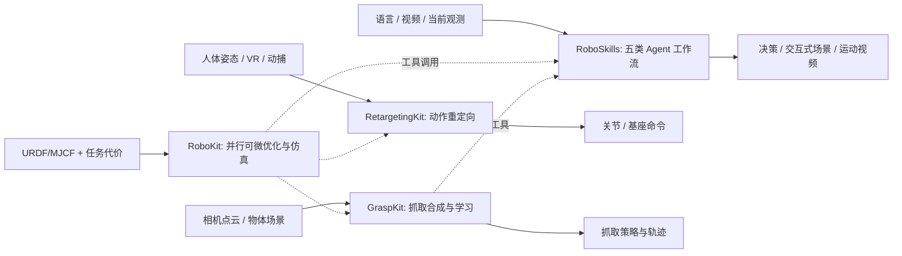

# OpenRoboKit：优化、重定向、抓取与 Agent 工作流

## 一句话定义

**OpenRoboKit** 是 UC San Diego 相关团队组织维护的四个独立机器人开源工具的集合；其中 **RoboKit** 论文获 CoRL 2026 Spotlight，而 **RetargetingKit、GraspKit、RoboSkills** 分别承担不同应用层能力，**不能将四个项目视为一篇论文或一个单体包**。

## 英文缩写速查

| 缩写 | 英文全称 | 简要说明 |
|---|---|---|
| MPC | Model Predictive Control | RoboKit 物理仿真闭环优化 |
| IK | Inverse Kinematics | 从末端/姿态目标求关节配置 |
| RL | Reinforcement Learning | RoboKit / GraspKit 场景的仿真策略学习 |
| LLM | Large Language Model | RoboSkills Agent as Policy 的回合式代码决策 |
| CVAE | Conditional Variational Autoencoder | GraspKit 的点云条件抓取策略 |

## 为什么重要

传统机器人系统常将数值优化、人体动作采集、抓取合成与智能体控制混成一条不可替换的流水线。OpenRoboKit 将这些拆为 **可独立安装、可按场景组合** 的官方仓库。选型时应区分论文 benchmark（RoboKit 优化吞吐）、实际仿真工作流（GraspKit）和 Agent 的 token 成本或评测成功率（RoboSkills），它们不是同一个性能指标。

## 核心原理

OpenRoboKit 官方组织 [README](https://github.com/openrobokit/.github/blob/main/profile/README.md) 列出的**四个仓库**（2026-11-16 核验）：

| 子项目 | 输入 | 关键能力 | 典型输出 |
|---|---|---|---|
| [RoboKit](../entities/robokit-openrobokit.md) | URDF/MJCF、任务目标、状态/代价 | GPU 并行 IK、优化、物理仿真与 MPC | 配置、控制序列、优化数据 |
| [RetargetingKit](../entities/retargetingkit.md) | VR、手套、动捕、人体姿态帧 | 手/臂/人形优化式或神经式重定向 | 关节或基座命令 |
| [GraspKit](../entities/graspkit.md) | 场景、机器人、点云/相机 | 抓取候选优化、仿真筛选、CVAE 策略训练 | 抓取轨迹、策略 |
| [RoboSkills](../entities/roboskills.md) | 自然语言、视觉/机器人观测或视频 | Agent as Policy、Auto Research、Agentic Simulation、Real2Sim、Motion Generation | Agent 决策、仿真资产/回放、运动视频 |

### 流程总览

这张图描述项目的**功能关联**，不是强制同一进程或每个任务都要经过四种工具：

## 工程实践

- **从底层优化入门**：先复现 RoboKit 的 `uv run src/robokit/examples/ik/01_basic.py`，再选择仿真 MPC 示例；论文速度数字必须带作者硬件与具体任务口径。
- **从人类动作入门**：RetargetingKit 先在 Viser 检查关节顺序、坐标系与动作映射，然后再接真机。
- **从抓取训练入门**：GraspKit 按 `render_data → optimize_grasps → process_sim_data → train` 检查数据配对、成功率与依赖。
- **从 Agent 工作流入门**：RoboSkills 先验证 `agent_as_policy` 的 adapter、状态、规划与动作执行；视频转仿真工作流则按 `--tools` 选择重建与物理步骤。
- 四种运行路径各自的细节、已阅读源码范围和 Mermaid 时序图见关联实体页；官网并不保证跨仓库 API 始终无缝兼容。

## 局限与风险

- **官网抓取边界**：`openrobokit.com` 在本次文本访问环境无法完整读取；其组织成员、开源状态及执行入口以官方 GitHub README/源码核验。对应站点原始归档仍保留「通读：未完成」，不能伪造官网全文已读。
- **论文与工具边界**：RoboKit 的 [CoRL 2026 作者 PDF 归档](../../sources/papers/robokit_corl2026_spotlight.md) 由仓库此前记录过完整核验；本次没有重新直接读取其 PDF，更没有复现实验。不可把 RoboSkills Agent 成本和 RoboKit 性能倍数混同。
- **部署边界**：公开库中的机器人示例只证明源码入口存在；第三方机器人驱动、模型、数据、许可证、真机安全都需要具体评审。

## 关联页面

- [RoboKit](../entities/robokit-openrobokit.md)
- [RetargetingKit](../entities/retargetingkit.md)
- [GraspKit](../entities/graspkit.md)
- [RoboSkills](../entities/roboskills.md)
- [Real2Sim 纵深路线](../../roadmap/depth-real2sim.md)

## 参考来源

- [OpenRoboKit 官网入口与访问状态记录](../../sources/sites/openrobokit.md)
- [RoboKit 原始源码归档](../../sources/repos/robokit-openrobokit.md)
- [RetargetingKit 原始源码归档](../../sources/repos/retargetingkit.md)
- [GraspKit 原始源码归档](../../sources/repos/graspkit.md)
- [RoboSkills 原始源码归档](../../sources/repos/roboskills.md)
- [官方 GitHub 组织简介](https://github.com/openrobokit/.github/blob/main/profile/README.md)

## 推荐继续阅读

- [RoboKit CoRL 2026 Spotlight 论文（作者 PDF）](https://openrobokit.com/robokit/paper.pdf)
- [RoboKit 官方开发文档](https://github.com/openrobokit/robokit/blob/main/docs/guide/overview.md)
- [RoboSkills 五类工作流](https://github.com/openrobokit/roboskills)
- [GraspKit 官方 pipeline](https://github.com/openrobokit/graspkit/blob/main/docs/guide/pipeline.md)
