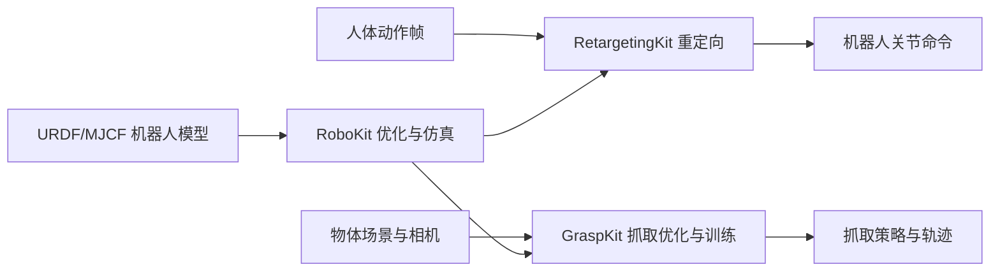

# OpenRoboKit：优化、遥操作与抓取工具集

## 一句话定义

OpenRoboKit 是围绕机器人可微优化、动作重定向和抓取学习形成的三个独立 GitHub 开源项目集合；不是一个将所有算法封装在同一仓库的单体框架。

## 英文缩写速查

| 缩写 | 英文全称 | 简要说明 |
|---|---|---|
| MPC | Model Predictive Control | RoboKit 仿真闭环优化的一个应用 |
| IK | Inverse Kinematics | 求解姿态与末端约束的基础能力 |
| RL | Reinforcement Learning | 仿真反馈下的策略优化 |
| CVAE | Conditional Variational Autoencoder | GraspKit 示例的抓取策略生成模型 |

## 为什么重要

研究者可按任务分层选用：单机器人逆运动学/轨迹优化从 RoboKit 开始；实时人体动作映射用 RetargetingKit；需要抓取数据生成到学习部署闭环时用 GraspKit。RetargetingKit 与 GraspKit 均声明基于 RoboKit，但安装依赖、输入、输出和真机设备适配各自不同。

## 核心原理

| 子项目 | 输入 | 关键处理 | 输出 |
|---|---|---|---|
| [RoboKit](../entities/robokit-openrobokit.md) | URDF/MJCF、目标/代价、仿真状态 | 批量可微模型、代价优化、仿真 | 关节配置或控制轨迹 |
| [RetargetingKit](../entities/retargetingkit.md) | VR/手套/动捕/记录帧 | 人→机器人重定向求解 | 关节命令、可选基座位姿 |
| [GraspKit](../entities/graspkit.md) | 场景、机器人、点云/相机 | 抓取优化、筛选、CVAE 训练 | 抓取轨迹、策略 |

### 流程总览

## 工程实践

- 先复现 RoboKit 的 IK 基础示例，而不是直接对比 README 的 benchmark 倍率。
- RetargetingKit 先用可视化 target 验证帧坐标、手性、关节顺序，再连接真实硬件。
- GraspKit 先用小场景运行 `launch.py` 各步骤，并检查场景 ID、抓取有效率与仿真成功率。
- 三个仓库的详细源码时序图分别见对应实体页；此总览只描述仓库间依赖关系。

## 局限与风险

官方官网页面本次未能直接读取；RoboKit 的 CoRL 2026 论文全文受 OpenReview 浏览器验证阻挡，论文实验设置仍待逐节核验。官方源码中存在 Wuji Hand 2.2 仿真示例，**不能因此声称已验证与 PNP 科研整机方案兼容**。

## 关联页面

- [RoboKit](../entities/robokit-openrobokit.md)
- [RetargetingKit](../entities/retargetingkit.md)
- [GraspKit](../entities/graspkit.md)

## 参考来源

- [官方网站与访问状态归档](../../sources/sites/openrobokit.md)
- [三个官方 GitHub 仓库](https://github.com/openrobokit)

## 推荐继续阅读

- [RoboKit 官方文档](https://github.com/openrobokit/robokit/blob/main/docs/guide/overview.md)
- [GraspKit pipeline](https://github.com/openrobokit/graspkit/blob/main/docs/guide/pipeline.md)
