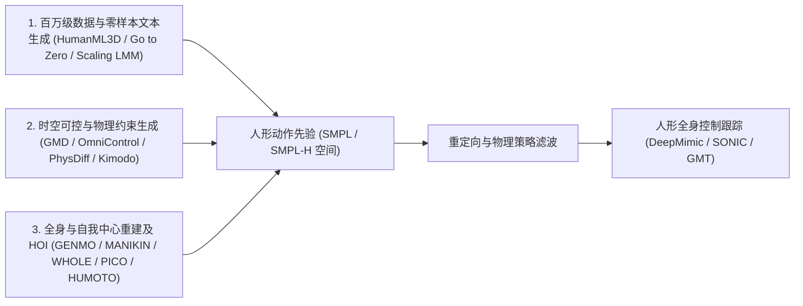

# Paper Notebooks · Human Motion

**Human Motion**（`14_Human_Motion`）是 [Robot Learning Paper Notebooks](https://imchong.github.io/Robot_Learning_Paper_Notebooks/index.html) 主页面的第 **14** 类；截至 2026-11-20 核查上游仓库 `papers/14_Human_Motion/` 实有 **38 个** 深读笔记目录，本概览页并列收录与人体动作密切交叉的扩展条目，共列出 **44** 条索引。

## 一句话定义

聚焦人体三维动作表征、文本/多模态运动生成、可控补间与物理约束扩散、以及自我中心/人–物交互重建的分类汇总索引入口。

## 英文缩写速查

| 缩写 | 英文全称 | 简要说明 |
|------|----------|----------|
| RL | Reinforcement Learning | 通过与环境交互最大化长期回报来学习策略 |
| WBC | Whole-Body Control | 协调全身关节满足多任务/约束的控制基础设施 |
| Sim2Real | Simulation to Real | 把仿真中学到的策略迁移落地真机的工程主线 |
| SMPL | Skinned Multi-Person Linear Model | 人体运动学与网格重建的主流参数化表示 |
| HOI | Human–Object Interaction | 人体与环境/物体接触交互动作建模 |

## 为什么重要

- **人体动作是人形全身控制的上游先验**：不管是 `DeepMimic` / `SONIC` 等模仿式全身控制，还是 `OmniControl` / `PhysDiff` / `ARDY` 等运动生成主干，都从本分类的数据集（HumanML3D / MotionMillion / HUMOTO）与扩散/自回归范式演化而来。
- **区分纯运动学与物理闭环研究**：本索引同时囊括动画导向的文本生成、人–物重建，以及面向物理角色/机器人的模仿与跟踪方法，便于按是否含物理仿真筛查文献。

## 核心原理

本分类索引按专题可拆为三条核心支线（均与上游 `papers/14_Human_Motion/` 目录和本库实体对应）：① **百万级数据与零样本文本生成**（HumanML3D、Go to Zero、Scaling LMM、TRACE）；② **时空可控与物理约束生成**（GMD、OmniControl、CondMDI、PhysDiff、ARDY、Kimodo）；③ **全身/自我中心重建与人–物交互**（GENMO、MANIKIN、WHOLE、PICO、HUMOTO、EmbodMocap）。

### 本类论文索引（44 篇）

- [AvatarPoser](../entities/paper-notebook-avatarposer-articulated-full-body-pose-tracking.md) — [深读笔记](https://imchong.github.io/Robot_Learning_Paper_Notebooks/papers/14_Human_Motion/AvatarPoser__Articulated_Full-Body_Pose_Tracking_from_Sparse_Motion_Sensing/AvatarPoser__Articulated_Full-Body_Pose_Tracking_from_Sparse_Motion_Sensing.html)
- [Being-M0.5](../entities/paper-notebook-being-m0-5-a-real-time-controllable-vision-langu.md) — [深读笔记](https://imchong.github.io/Robot_Learning_Paper_Notebooks/papers/14_Human_Motion/Being-M0.5__A_Real-Time_Controllable_Vision-Language-Motion_Model/Being-M0.5__A_Real-Time_Controllable_Vision-Language-Motion_Model.html)
- [Climber Force and Motion Estimation from Video](../entities/paper-notebook-climber-force-and-motion-estimation-from-video.md) — [深读笔记](https://imchong.github.io/Robot_Learning_Paper_Notebooks/papers/14_Human_Motion/Climber_Force_and_Motion_Estimation_from_Video/Climber_Force_and_Motion_Estimation_from_Video.html)
- [ClimbingCap](../entities/paper-notebook-climbingcap-multi-modal-dataset-and-method-for-r.md) — [深读笔记](https://imchong.github.io/Robot_Learning_Paper_Notebooks/papers/14_Human_Motion/ClimbingCap__Multi-Modal_Dataset_and_Method_for_Rock_Climbing_in_World_Coordinate/ClimbingCap__Multi-Modal_Dataset_and_Method_for_Rock_Climbing_in_World_Coordinate.html)
- [Control Operators for Interactive Character Animation](../entities/paper-notebook-control-operators-for-interactive-character-anim.md) — [深读笔记](https://imchong.github.io/Robot_Learning_Paper_Notebooks/papers/14_Human_Motion/Control_Operators_for_Interactive_Character_Animation/Control_Operators_for_Interactive_Character_Animation.html)
- [Efficient and Scalable Monocular Human-Object Interaction Motion Reconstruction](../entities/paper-notebook-efficient-and-scalable-monocular-human-object-in.md) — [深读笔记](https://imchong.github.io/Robot_Learning_Paper_Notebooks/papers/14_Human_Motion/Efficient_and_Scalable_Monocular_Human-Object_Interaction_Motion_Reconstruction/Efficient_and_Scalable_Monocular_Human-Object_Interaction_Motion_Reconstruction.html)
- [EgoPoser](../entities/paper-notebook-egoposer-robust-real-time-egocentric-pose-estima.md) — [深读笔记](https://imchong.github.io/Robot_Learning_Paper_Notebooks/papers/14_Human_Motion/EgoPoser__Robust_Real-Time_Egocentric_Pose_Estimation_from_Sparse_Sensors/EgoPoser__Robust_Real-Time_Egocentric_Pose_Estimation_from_Sparse_Sensors.html)
- [EgoExoMoCap](../entities/paper-egoexomocap.md) — 分布式 HMD ego-exo 野外动捕（ECCV 2026 Spotlight，[arXiv:2607.15868](https://arxiv.org/abs/2607.15868)）
- [CLOTHO](../entities/paper-clotho-loose-inertial-garments.md) — 松散惯性服装 IMU canonicalization → 标准 10-IMU 表示（TOG / SIGGRAPH Asia 2026，DOI [10.1145/3842534](https://doi.org/10.1145/3842534)）
- [Ego-Exo4D-HM](../entities/paper-egoexo4d-hm.md) — Ego-Exo4D 上 SMPL-H 4D 重建与 HF 发布（[arXiv:2609.30187](https://arxiv.org/abs/2609.30187)）
- [EmbodMocap](../overview/ego-category-01-data-collection.md) — 见 wiki 实体页
- [Example-based Motion Synthesis via Generative Motion Matching](../entities/paper-notebook-example-based-motion-synthesis-via-generative-mo.md) — [深读笔记](https://imchong.github.io/Robot_Learning_Paper_Notebooks/papers/14_Human_Motion/Example-based_Motion_Synthesis_via_Generative_Motion_Matching/Example-based_Motion_Synthesis_via_Generative_Motion_Matching.html)
- [FAME](../entities/paper-notebook-fame.md) — 待深读
- [FLAM](../entities/paper-notebook-flam-foundation-model-based-body-stabilization-f.md) — 待深读
- [FRAME](../entities/paper-notebook-frame-floor-aligned-representation-for-avatar-mo.md) — [深读笔记](https://imchong.github.io/Robot_Learning_Paper_Notebooks/papers/14_Human_Motion/FRAME__Floor-aligned_Representation_for_Avatar_Motion_from_Egocentric_Video/FRAME__Floor-aligned_Representation_for_Avatar_Motion_from_Egocentric_Video.html)
- [Flexible Motion In-betweening with Diffusion Models](../entities/paper-notebook-flexible-motion-in-betweening-with-diffusion-mod.md) — [深读笔记](https://imchong.github.io/Robot_Learning_Paper_Notebooks/papers/14_Human_Motion/Flexible_Motion_In-betweening_with_Diffusion_Models/Flexible_Motion_In-betweening_with_Diffusion_Models.html)
- [Flow Matching Imitation Learning for Multi-Support Manipulation](../entities/paper-notebook-flow-matching-imitation-learning-for-multi-suppo.md) — 待深读
- [Full-Order Sampling-Based MPC for Torque-Level Locomotion Control via Diffusion-Style Annealing](../entities/paper-notebook-full-order-sampling-based-mpc-for-torque-level-l.md) — 待深读
- [GENMO](../entities/soma-retargeter.md) — 见 wiki 实体页
- [Generating Diverse and Natural 3D Human Motions from Textual Descriptions](../entities/paper-notebook-humanml3d.md) — [深读笔记](https://imchong.github.io/Robot_Learning_Paper_Notebooks/papers/14_Human_Motion/HumanML3D/HumanML3D.html)
- [Go to Zero](../entities/paper-notebook-go-to-zero-towards-zero-shot-motion-generation-w.md) — [深读笔记](https://imchong.github.io/Robot_Learning_Paper_Notebooks/papers/14_Human_Motion/Go_to_Zero__Towards_Zero-shot_Motion_Generation_with_Million-scale_Data/Go_to_Zero__Towards_Zero-shot_Motion_Generation_with_Million-scale_Data.html)
- [GRIP](../entities/paper-grip.md) — CMU/Keio 稀疏 IMU+鞋垫物理 MoCap 与 PRISM 数据集（CVPR 2026，[arXiv:2603.16233](https://arxiv.org/abs/2603.16233)）
- [Guided Motion Diffusion for Controllable Human Motion Synthesis](../entities/paper-notebook-guided-motion-diffusion-for-controllable-human-m.md) — [深读笔记](https://imchong.github.io/Robot_Learning_Paper_Notebooks/papers/14_Human_Motion/Guided_Motion_Diffusion_for_Controllable_Human_Motion_Synthesis/Guided_Motion_Diffusion_for_Controllable_Human_Motion_Synthesis.html)
- [HUMOTO](../entities/paper-notebook-humoto-a-4d-dataset-of-mocap-human-object-intera.md) — [深读笔记](https://imchong.github.io/Robot_Learning_Paper_Notebooks/papers/14_Human_Motion/HUMOTO__A_4D_Dataset_of_Mocap_Human_Object_Interactions/HUMOTO__A_4D_Dataset_of_Mocap_Human_Object_Interactions.html)
- [Implicit Bézier Motion Model for Precise Spatial and Temporal Control](../entities/paper-notebook-implicit-b-zier-motion-model-for-precise-spatial.md) — [深读笔记](https://imchong.github.io/Robot_Learning_Paper_Notebooks/papers/14_Human_Motion/Implicit_Bezier_Motion_Model_for_Precise_Spatial_and_Temporal_Control/Implicit_Bezier_Motion_Model_for_Precise_Spatial_and_Temporal_Control.html)
- [Kimodo](../entities/kimodo.md) — 见 wiki 实体页
- [KungfuBot](../entities/paper-notebook-kungfubot-physics-based-humanoid-whole-body-cont.md) — 待深读
- [Learned Motion Matching](../methods/diffusion-motion-generation.md) — 见 wiki 实体页
- [Learning Differentiable Reachability Maps for Optimization-based Humanoid Motion Generation](../entities/paper-notebook-learning-differentiable-reachability-maps-for-op.md) — 待深读
- [MAGNet](../entities/paper-notebook-magnet.md) — [深读笔记](https://imchong.github.io/Robot_Learning_Paper_Notebooks/papers/14_Human_Motion/MAGNet__Diffusion_Forcing_for_Multi-Agent_Interaction_Sequence_Modeling/MAGNet__Diffusion_Forcing_for_Multi-Agent_Interaction_Sequence_Modeling.html)
- [MANIKIN](../entities/paper-notebook-manikin-biomechanically-accurate-neural-inverse.md) — [深读笔记](https://imchong.github.io/Robot_Learning_Paper_Notebooks/papers/14_Human_Motion/MANIKIN__Biomechanically_Accurate_Neural_Inverse_Kinematics_for_Human_Motion_Estimation/MANIKIN__Biomechanically_Accurate_Neural_Inverse_Kinematics_for_Human_Motion_Estimation.html)
- [OmniControl](../entities/paper-notebook-omnicontrol-control-any-joint-at-any-time-for-hu.md) — 本库详细页（姊妹 Paper Notebooks 深读待撰写）
- [PICO](../entities/paper-notebook-pico-reconstructing-3d-people-in-contact-with-ob.md) — [深读笔记](https://imchong.github.io/Robot_Learning_Paper_Notebooks/papers/14_Human_Motion/PICO__Reconstructing_3D_People_In_Contact_with_Objects/PICO__Reconstructing_3D_People_In_Contact_with_Objects.html)
- [PAMI](../entities/paper-pami-part-anchored-motion.md) — 文本条件全身人-物交互生成，以部位锚点协同预测物体轨迹（arXiv:2609.38466）
- [PRIMAL](../entities/paper-notebook-primal-physically-reactive-and-interactive-motor.md) — [深读笔记](https://imchong.github.io/Robot_Learning_Paper_Notebooks/papers/14_Human_Motion/PRIMAL__Physically_Reactive_and_Interactive_Motor_Model_for_Avatar_Learning/PRIMAL__Physically_Reactive_and_Interactive_Motor_Model_for_Avatar_Learning.html)
- [PhysDiff](../entities/paper-notebook-physdiff-physics-guided-human-motion-diffusion-m.md) — [深读笔记](https://imchong.github.io/Robot_Learning_Paper_Notebooks/papers/14_Human_Motion/PhysDiff__Physics-Guided_Human_Motion_Diffusion_Model/PhysDiff__Physics-Guided_Human_Motion_Diffusion_Model.html)
- [Predictive Sampling](../entities/paper-notebook-predictive-sampling-real-time-behaviour-synthesi.md) — 待深读
- [Scaling Large Motion Models with Million-Level Human Motions](../entities/paper-notebook-scaling-large-motion-models-with-million-level-h.md) — [深读笔记](https://imchong.github.io/Robot_Learning_Paper_Notebooks/papers/14_Human_Motion/Scaling_Large_Motion_Models_with_Million-Level_Human_Motions/Scaling_Large_Motion_Models_with_Million-Level_Human_Motions.html)
- [SoftMimic](../entities/paper-notebook-softmimic-learning-compliant-whole-body-control.md) — 待深读
- [TEDi](../entities/paper-notebook-tedi-temporally-entangled-diffusion-for-long-ter.md) — [深读笔记](https://imchong.github.io/Robot_Learning_Paper_Notebooks/papers/14_Human_Motion/TEDi__Temporally-Entangled_Diffusion_for_Long-Term_Motion_Synthesis/TEDi__Temporally-Entangled_Diffusion_for_Long-Term_Motion_Synthesis.html)
- [Taming Diffusion Probabilistic Models for Character Control](../entities/paper-notebook-taming-diffusion-probabilistic-models-for-charac.md) — [深读笔记](https://imchong.github.io/Robot_Learning_Paper_Notebooks/papers/14_Human_Motion/Taming_Diffusion_Probabilistic_Models_for_Character_Control/Taming_Diffusion_Probabilistic_Models_for_Character_Control.html)
- [The Role of Domain Randomization in Training Diffusion Policies for Whole-Body Humanoid Control](../entities/paper-notebook-the-role-of-domain-randomization-in-training-dif.md) — 待深读
- [WHOLE](../entities/paper-notebook-whole.md) — [深读笔记](https://imchong.github.io/Robot_Learning_Paper_Notebooks/papers/14_Human_Motion/WHOLE__World-Grounded_Hand-Object_Lifted_from_Egocentric_Videos/WHOLE__World-Grounded_Hand-Object_Lifted_from_Egocentric_Videos.html)
- [Whole-body Multi-contact Motion Control for Humanoid Robots Based on Distributed Tactile Sensors](../entities/paper-notebook-whole-body-multi-contact-motion-control-for-huma.md) — 待深读

## 工程实践

- **如何按下游用途检索**：做人形物理控制跟踪（如 SONIC/GMT）的运动先验，优先查看 `Go to Zero`、`HumanML3D`、`Scaling Large Motion Models`；做关键帧/轨迹插补编辑则看 `GMD`、`OmniControl`、`CondMDI`、`TEDi`、`ARDY`；涉及物理可行性检查重点看 `PhysDiff` 与 `Taming Diffusion`。
- **对齐上游深读状态**：上游仓库当前含 **38 个** 独立论文笔记目录；标注「待深读」条目尚未在原站点展开精读页面，具体细节需以 arXiv 原文或本库独立实体页为准。

## 局限与风险

- **动画/人体中心偏置**：多数 `14_Human_Motion` 论文在 SMPL / SMPL-H 运动学空间评测，不默认包含机器人关节力矩、足底接触力学或平衡约束，迁移到真机需重定向及物理策略滤波。
- **统计口径动态演进**：上游持续新增条目，本概览页同时并入若干跨类密切相关的人体/交互文献（共计 44 条），数量多于原始 `papers/14_Human_Motion/` 的 38 个目录。

## 关联页面

- 总索引：[humanoid-paper-notebooks-index.md](./humanoid-paper-notebooks-index.md)
- 纵深路线：[动作生成纵深](../../roadmap/depth-motion-generation.md)
- 笔记主页：<https://imchong.github.io/Robot_Learning_Paper_Notebooks/index.html>

## 参考来源

- [robot_learning_paper_notebooks_readme_reading_cat14.md](../../sources/repos/robot_learning_paper_notebooks_readme_reading_cat14.md)
- [humanoid-robot-learning-paper-notebooks](../../sources/sites/humanoid-robot-learning-paper-notebooks.md)
- [Robot Learning Paper Notebooks](https://imchong.github.io/Robot_Learning_Paper_Notebooks/index.html)
- 本类论文来源笔记（节选）：[GENMO：人体动作通用模型](../../sources/papers/genmo.md)、[MotionMillion-Codes](../../sources/repos/motionmillion-codes.md)、[CondMDI（扩散式动作补间）](../../sources/repos/condmdi.md)

## 推荐继续阅读

- [机器人论文阅读笔记总站](https://imchong.github.io/Robot_Learning_Paper_Notebooks/index.html)
