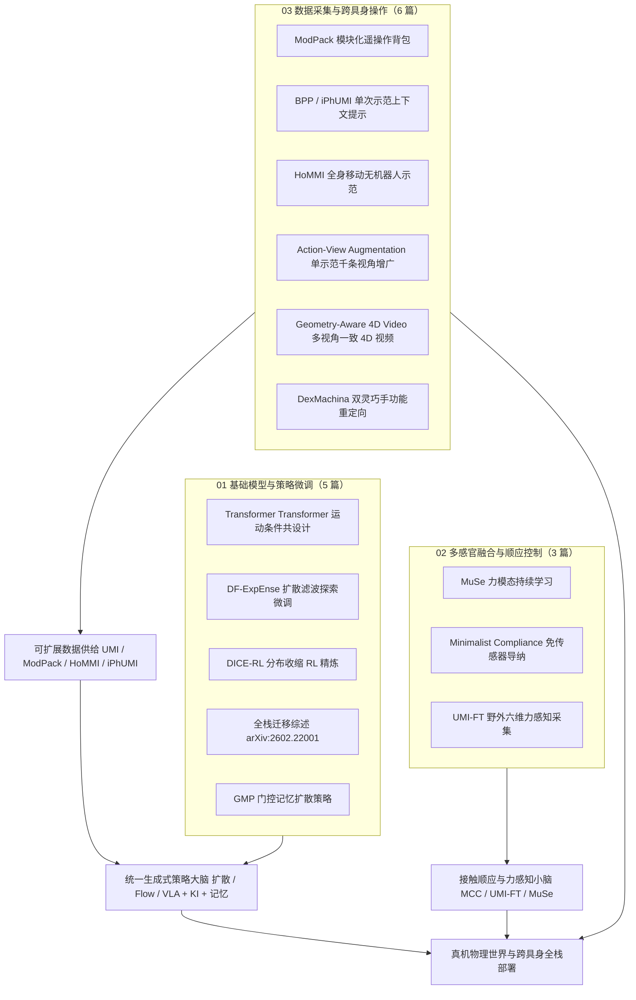

# REALab 技术地图：14 篇工作与全栈迁移视角（2026）

> **本页定位**：以 Song & Stulp 合著综述 [Are Foundation Models the Route to Full-Stack Transfer in Robotics?（arXiv:2602.22001）](../entities/paper-foundation-models-full-stack-transfer.md) 提供的方法论骨架为纵轴，结合 [深蓝 AI · 斯坦福宋舒然团队 14 篇工作全盘点](https://mp.weixin.qq.com/s/vcewu3wKIcrsidzfGr2-yg) 梳理 2026 年 Stanford REALab 14 篇代表作的技术地图与开源状态；实验室总览见 [海外具身智能实验室地图](./overseas-embodied-ai-labs-landscape-2026.md)。

## 一句话定义

Stanford **Robotics and Embodied AI Lab（REALab，宋舒然）** 在 2026 年围绕「**基础模型不是全栈迁移的全部答案，必须协同在线 RL、门控记忆、物理顺应与多样无机器人数据接口**」这一主判断展开 14 篇工作，推动具身操作从单一 visuomotor 映射走向 **跨具身泛化 + 接触式物理顺应 + 野外可扩展示教**。

## 英文缩写速查

| 缩写 | 英文全称 | 简要说明 |
|------|----------|----------|
| REALab | Robotics and Embodied AI Lab | 斯坦福大学宋舒然团队实验室 |
| VLA | Vision-Language-Action | 视觉–语言–动作多模态策略与流匹配专家体系 |
| KI | Knowledge Insulation | $\pi_{0.5}$ / $\pi_{0.6}$ 等用梯度隔离保护 VLM 高层语义不被低层动作微调破坏 |
| UMI | Universal Manipulation Interface | 便携无机器人手持示教接口及其力感知/移动端扩展（UMI-FT / iPhUMI） |
| GMP | Gated Memory Policy | 离线误差标定门控的历史记忆扩散策略 |
| BPP | Behavior Prompting Policy | 单次示范作为测试时上下文提示的扩散策略 |
| VOC | Virtual Object Controller | DexMachina 中用于双灵巧手轨迹引导的虚拟物体控制课程 |

## 为什么重要

- **给出基础模型在机器人「全栈迁移」中的真实边界：** [全栈迁移综述（arXiv:2602.22001）](../../sources/papers/foundation_models_full_stack_transfer_arxiv_2602_22001.md) 采用 Jaquier et al. 迁移阶梯（*Mimicry → Imitation → Emulation → Causal / Verbal / Goal*）指出：LLM/VLM 擅长高层语义与因果先验，但高频控制微调会洗掉语义（需要 **Knowledge Insulation**），且单纯规模化图文–动作预训练无法自动解决 **长程非马尔可夫记忆**、**未知接触物理动力学** 与 **超模仿上限的闭环改进**。
- **三条研发主线精准补齐上述缺口：**
  1. **基础模型与策略精炼（5 篇）** — 补齐在线 RL 突破（DF-ExpEnse / DICE-RL）、非马尔可夫门控记忆（GMP）与共设计统一表征（Transformer Transformer）；
  2. **多模态感官融合与物理顺应（3 篇）** — 补齐接触动力学与力感知持续接入（MuSe / Minimalist Compliance / UMI-FT）；
  3. **可扩展数据接口与跨具身操作（6 篇）** — 补齐多样示范供给（iPhUMI+BPP / ModPack / HoMMI / 视角与 4D 增广 / DexMachina）。
- **树立开放真机评测共识：** 综述倡导超越单一封闭指标，显式报告源域–目标域分布迁移边界并支持 RoboArena / euROBIN 等开放基准评测。

## 流程总览：全栈迁移三条脉络

## 核心原理：按脉络与迁移层级解读

> **全栈迁移纵轴（源自 `arXiv:2602.22001`）：** 高层依赖 VLA 的语言–视觉对齐与 **Knowledge Insulation（$\pi_0$ / $\pi_{0.5}$-KI / $\pi_{0.6}$ 梯度阻断）** 与 **FAST 动作块压缩** 保持语义推理；中低层通过 **具身无关共享表征（如手持 UMI/人手腕）**、**隐空间对齐** 或 **微调/上下文提示** 完成物理适应。14 篇实体页面已全部独立建页如下：

### Wiki 实体索引（14 篇）

| # | 工作 | Wiki 实体 | arXiv |
|---|------|-----------|-------|
| 01 | Transformer Transformer | [paper-transformer-transformer](../entities/paper-transformer-transformer.md) | 2607.25798 |
| 02 | DF-ExpEnse | [paper-df-expense](../entities/paper-df-expense.md) | 2606.19656 |
| 03 | DICE-RL | [paper-dice-rl](../entities/paper-dice-rl.md) | 2603.10263 |
| 04 | 全栈迁移综述 | [paper-foundation-models-full-stack-transfer](../entities/paper-foundation-models-full-stack-transfer.md) | 2602.22001 |
| 05 | GMP | [paper-gated-memory-policy](../entities/paper-gated-memory-policy.md) | 2604.18933 |
| 06 | MuSe | [paper-muse-multisensory-continual-learning](../entities/paper-muse-multisensory-continual-learning.md) | 2606.30988 |
| 07 | Minimalist Compliance | [paper-minimalist-compliance-control](../entities/paper-minimalist-compliance-control.md) | 2603.00913 |
| 08 | UMI-FT | [paper-umi-ft](../entities/paper-umi-ft.md) | 2601.09988 |
| 09 | ModPack | [paper-modpack](../entities/paper-modpack.md) | 2607.19479 |
| 10 | BPP | [paper-behavior-prompting-policy](../entities/paper-behavior-prompting-policy.md) | 2606.30457 |
| 11 | HoMMI | [paper-hommi](../entities/paper-hommi.md) | 2603.03243 |
| 12 | Action-View Augmentation | [paper-action-view-augmentation](../entities/paper-action-view-augmentation.md) | 2606.19586 |
| 13 | Geometry-Aware 4D Video | [paper-geometry-aware-4d-video-generation](../entities/paper-geometry-aware-4d-video-generation.md) | 2507.01099 |
| 14 | DexMachina | [paper-dexmachina](../entities/paper-dexmachina.md) | 2505.24853 |

### 01 — 机器人基础模型与策略微调

| # | 工作 | 核心技术要点 | 本库延伸 |
|---|------|--------------|----------|
| 01 | [Transformer Transformer](../entities/paper-transformer-transformer.md) | RoboTokens + DiT 统一运动条件机体共设计与跨具身控制；ALOHA 跟踪误差约 −70% | [ALOHA](../entities/aloha.md)、[cross-embodiment 选型](../queries/cross-embodiment-transfer-strategy.md) |
| 02 | [DF-ExpEnse](../entities/paper-df-expense.md) | 扩散策略多模态采样 + critic ensemble 平衡质量与探索；真机群协同在线探索 | [Diffusion Policy](../methods/diffusion-policy.md) |
| 03 | [DICE-RL](../entities/paper-dice-rl.md) | RL 作「分布收缩」算子；选择性行为正则 + 价值引导动作选择精炼扩散策略 | 同上；真机长周期操作 |
| 04 | [全栈迁移综述](../entities/paper-foundation-models-full-stack-transfer.md) | Jaquier 六级迁移阶梯 + OpenVLA/π₀-FAST/π₀-KI + 跨具身三路径 + RoboArena 评测规范 | [VLA](../methods/vla.md)、[VLA 复现谱系](./vla-open-source-repro-landscape-2025.md) |
| 05 | [GMP](../entities/paper-gated-memory-policy.md) | SigLIP2 缓存摘要 + 末步加噪历史动作 + 验证集误差标定门控；MemMimic SR +30.1%、600s 恒定 0.16s | [diffusion-model](../concepts/diffusion-model.md)、[Imitation Learning](../methods/imitation-learning.md) |

### 02 — 多模态感官融合与顺应控制

| # | 工作 | 核心技术要点 | 本库延伸 |
|---|------|--------------|----------|
| 06 | [MuSe](../entities/paper-muse-multisensory-continual-learning.md) | 多阶段融合 + 多感官未来预测 + 经验回放，以少量力/触觉持续微调预训练视觉策略 | [manipulation](../tasks/manipulation.md) |
| 07 | [Minimalist Compliance](../entities/paper-minimalist-compliance-control.md) | 电机电流/电压 + 雅可比估计外力实现免 F/T 传感器导纳控制；跨 ARX/G1/LEAP | [PRISM](../entities/paper-prism.md)、[CURRENT](../entities/paper-current-as-touch-proprioceptive-contact.md) |
| 08 | [UMI-FT](../entities/paper-umi-ft.md) | 指端 CoinFT 六维力 + RGB/深度同步采集野外交互力信号训练顺应策略 | [UME-Exo](../entities/paper-ume-exo.md) |

### 03 — 数据采集接口与跨具身操作

| # | 工作 | 核心技术要点 | 本库延伸 |
|---|------|--------------|----------|
| 09 | [ModPack](../entities/paper-modpack.md) | 模块化可穿戴遥操作背包 + 即插即用主手与感知，降低双臂移动操作采数门槛 | [teleoperation](../tasks/teleoperation.md) |
| 10 | [BPP](../entities/paper-behavior-prompting-policy.md) | 低频观测+高频动作 Prompt Chunk + 扩散 UNet 零梯度切任务；`iPhUMI` 示教；多样性>单任务条数 | [机器人 ICL](../concepts/robot-in-context-learning.md) |
| 11 | [HoMMI](../entities/paper-hommi.md) | UMI + 第一人称视觉；具身无关视野 + 放松头部姿态 + DiT 全身控制策略 | [HALOMI](../entities/paper-halomi-humanoid-loco-manipulation.md) |
| 12 | [Action-View Augmentation](../entities/paper-action-view-augmentation.md) | 单条手眼示范经鱼眼 3DGS + 轨迹优化扩增至千条新视角可避障轨迹 | OOD 位姿/避障增广 |
| 13 | [Geometry-Aware 4D Video](../entities/paper-geometry-aware-4d-video-generation.md) | 跨视角点图对齐生成无相机标定的 4D RGB-D 视频并追踪位姿训练策略 | [robot world models](./robot-world-models-training-loop-taxonomy.md) |
| 14 | [DexMachina](../entities/paper-dexmachina.md) | VOC 虚拟物体控制课程 + 任务/运动/接触复合奖励训练双灵巧手功能重定向 | [CHORD](../entities/paper-chord-contact-wrench-dexterous-manipulation.md) |

## 工程实践：开源状态复核（2026-11-19 更新）

| 工作 | 开放程度 | 入口与可复现边界 |
|------|----------|------------------|
| Transformer Transformer | **已开源** | [GitHub](https://github.com/real-stanford/transformer-transformer) + ckpt |
| DF-ExpEnse | **已开源** | [GitHub](https://github.com/real-stanford/dfexpense) |
| DICE-RL | **已开源** | [GitHub](https://github.com/real-stanford/dice-rl) + [HF 数据/ckpt](https://huggingface.co/wintermelontree) |
| 全栈迁移综述 | **不适用** | DLR + Stanford 联合方法论综述（`arXiv:2602.22001`） |
| GMP | **已开源** | [GitHub](https://github.com/real-stanford/gated-memory-policy) + [项目页](https://gated-memory-policy.github.io/) + [HF 数据/ckpt](https://huggingface.co/datasets/yihuai-gao/gated-memory-policy) |
| MuSe | **部分** | [项目页](https://jadenvc.github.io/multisensory-continual-learning/) |
| Minimalist Compliance | **未列 GitHub** | [项目页](https://minimalist-compliance-control.github.io/)（免学习电流估力控制律，非神经网络栈） |
| UMI-FT | **已开源** | [GitHub](https://github.com/real-stanford/UMI-FT) |
| ModPack | **已开源** | [GitHub](https://github.com/real-stanford/modpack)（遥操作接口，不含策略训练） |
| BPP | **已开源** | [GitHub](https://github.com/real-stanford/behavior_prompting) + `real-stanford/iPhUMI` + HF 数据/ckpt（无线传 prompt 与真机 DrawAnything 脚本未释出） |
| HoMMI | **已开源** | [GitHub](https://github.com/xxm19/hommi) |
| Action-View Augmentation | **部分** | [1001-demos](https://chuerpan.com/1001-demos.github.io/) |
| Geometry-Aware 4D | **部分** | [robot4dgen](https://robot4dgen.github.io/) |
| DexMachina | **仿真 benchmark** | [project-dexmachina](https://project-dexmachina.github.io/)；真机鲁棒性待检验 |

## 局限与风险

- **策展盘点非全集：** 仅覆盖 2026 年 14 篇代表性成果，REALab 先驱工作如原版 Diffusion Policy 与 UMI 未单独列入编号。
- **全栈迁移仍受制于物理接触与闭环长程：** 正如 `arXiv:2602.22001` 所强调，单纯堆叠 VLA 规模不能自动保证接触顺应和长程状态恢复，仍需结合力传感、控制律及显式记忆。
- **开源覆盖度存在链路断点：** 如 ModPack 仅开遥操作硬件软件，BPP 无线手机实时传 prompt 接口仍在 TODO，Minimalist Compliance 需按各电机驱动器内阻与转矩常数实测标定。

## 关联页面

- [海外具身智能实验室地图（2026）](./overseas-embodied-ai-labs-landscape-2026.md)
- [具身上下文学习（ICL）纵深路线](../../roadmap/depth-icl.md) — 收录 BPP、GMP 与本技术地图的上下文操作主线
- [Diffusion Policy](../methods/diffusion-policy.md)
- [Imitation Learning](../methods/imitation-learning.md)
- [VLA](../methods/vla.md)
- [Transformer Transformer（实体）](../entities/paper-transformer-transformer.md)
- [manipulation](../tasks/manipulation.md)
- [teleoperation](../tasks/teleoperation.md)
- [bimanual-manipulation](../tasks/bimanual-manipulation.md)
- [cross-embodiment 选型](../queries/cross-embodiment-transfer-strategy.md)

## 参考来源

- [全栈迁移核心综述（arXiv:2602.22001 精读笔记）](../../sources/papers/foundation_models_full_stack_transfer_arxiv_2602_22001.md)
- [wechat_shenlan_realab_14_papers_2026.md](../../sources/blogs/wechat_shenlan_realab_14_papers_2026.md)
- [原始抓取正文](../../sources/raw/wechat_shenlan_realab_14_papers_2026-08-18/article.md)

## 推荐继续阅读

- 全栈迁移综述：Freek Stulp, Shuran Song et al., [Are Foundation Models the Route to Full-Stack Transfer in Robotics? (arXiv:2602.22001)](https://arxiv.org/abs/2602.22001)
- 原文盘点：[微信公众号文章（深蓝 AI）](https://mp.weixin.qq.com/s/vcewu3wKIcrsidzfGr2-yg)
- [Diffusion Policy 原论文](https://arxiv.org/abs/2303.04137) — REALab 扩散动作基线
- [UMI (RSS 2024)](https://arxiv.org/abs/2402.10329) — 便携示教采集前序工作
