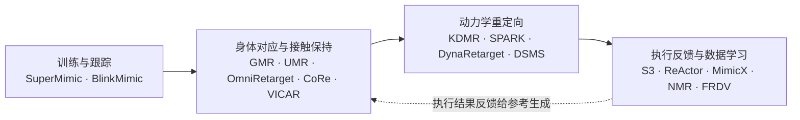

# 训练加速之后的重定向：16 个方法阅读坐标（2026-11）

## 一句话定义

**本页是对一篇公众号长文的阅读坐标：作者的主张是，人形跟踪训练变快变便宜之后，重定向不该只做「事前几何映射」，而应让通用运控策略的实际执行结果参与参考动作的检查与修正；文中 16 个方法分属四类，本页把它们链到各自唯一的详情节点，并标出核对出的差异。**

## 英文缩写速查

| 缩写 | 英文全称 | 简要说明 |
|------|----------|----------|
| GMR | General Motion Retargeting | 基于 IK 的通用人体→人形运动学重定向 |
| DSMS | Direct Simulation-based Multiple Shooting | Shooting for Contact 的核心：仿真器在环的直接多重打靶，把长轨迹拆成多个仿真片段并要求衔接 |
| SBTO | Sampling-Based Trajectory Optimization | DynaRetarget 用的采样式轨迹优化 |
| GRF | Ground Reaction Force | KDMR 用来推断接触日程的地面反力 |
| WBT | Whole-Body Tracking | 全身动作跟踪策略 |
| IK | Inverse Kinematics | 运动学逆解 |
| RL | Reinforcement Learning | 强化学习 |

## 为什么重要

- 重定向伪影（穿模、自碰撞、脚滑、不可行力矩）会被原样交给跟踪策略；文章把这一层看作训练加速后仍落后的环节。
- 16 个方法名字相近、层次不同（有的是跟踪训练，有的是重定向求解，有的是数据学习），读时容易混；按「它改的是哪一层」分段能避免把 SuperMimic 与重定向方法直接比较。
- 入库时发现若干口径问题（例如 GMR 页曾把 TWIST 的 arXiv 编号当作 GMR 论文），本页集中记录，便于后续修订。

## 阅读坐标

以下「文章说法」均为作者表述；「入库核对」为对一手资料的核对（详见 [来源归档](../../sources/blogs/wechat_yuanxq_retargeting_general_tracking_2026-11-05.md)）。

### 一、训练与跟踪

| 方法 | 节点 | arXiv | 文章说法 | 入库核对 |
|---|---|---|---|---|
| SuperMimic | [paper-supermimic](../entities/paper-supermimic.md) | 2610.28480 | 用可微世界模型把跟踪训练成本压下去 | 标题、作者、2026-10-20 与摘要页一致；它是跟踪训练方法，不是重定向；官方项目页 2026-11-05 仍无代码链接，已有仓库均为社区实现 |
| BlinkMimic | [blinkmimic](../entities/blinkmimic.md) | 无论文 | 40 段 G1 重定向 LAFAN1 动作的策略约三分钟 | 属实但口径要补：这是社区仓库 README 的自报结果，RTX 4090 单卡、40 段 LAFAN1（2.45 小时）、三种子均值，首次回报达 0.82 约 2.94 分钟，严格目标（40 段零失败并连续 3 个 checkpoint 达标）约 3.38 分钟，对照 InstantTrack v1.2 为 7.36 分钟；它基于社区 SuperMimic 实现与 InstantTrack，不是 SuperMimic 官方代码，我未复现 |

- 文章把二者并列为「同一路线」：SuperMimic 论文主实验是 BONES-SEED 大规模动作库，BlinkMimic 的 40 段 LAFAN1 是另一个、小得多的设置，三分钟不能与 SuperMimic 论文的 3 小时直接比较。

### 二、身体对应与接触保持

| 方法 | 节点 | arXiv | 文章说法 | 入库核对 |
|---|---|---|---|---|
| GMR | [motion-retargeting-gmr](../methods/motion-retargeting-gmr.md) | 2510.02252 | 比例适配改善身体对应 | 论文是 *Retargeting Matters*；代码里确有按人体比例缩放目标再用 mink 解 IK，归类基本准确。库内页原把 2505.02833（实为 TWIST）当 GMR 论文，已更正；该页没有「GMR 本体」专用的论文实体页，节点为方法页 |
| UMR | [paper-umr-unified-motion-retargeting](../entities/paper-umr-unified-motion-retargeting.md) | 2609.02134 | 表面稠密对应 | 题目为「Learned Point Cloud Correspondence」，页面写的是规范 T-pose 稠密点云对应加约束表面匹配，与文章「表面对应」一致 |
| OmniRetarget | [paper-hrl-stack-03-omniretarget](../entities/paper-hrl-stack-03-omniretarget.md) | 2509.26633 | 交互网格保持身体、物体、地形关系 | 与页面一致（interaction mesh + 序贯 SOCP）；数据子集见 [omniretarget-dataset](../entities/omniretarget-dataset.md) |
| CoRe | [paper-core](../entities/paper-core.md) | 无 arXiv（Humanoids 2025） | 脚—地接触与动作修正 | 与「接触感知精炼」一致；它的前端 [RMR](../entities/paper-rmr.md) 是同团队另一篇（IROS 2025），不要混为一篇；官方仓库默认分支只有项目页模板，页中所称 v0.1.0 软件我在 `git ls-remote` 中没看到对应标签，**未能证实** |
| VICAR | [paper-vicar-contact-aware-video-imitation](../entities/paper-vicar-contact-aware-video-imitation.md) | 2610.13079 | 接触位姿、运动速度、碰撞间距 | 与论文页一致；官方仓库只含项目网站与轨迹回放，训练代码在外部 checkout |

- 归类提示：文章把 GMR、UMR 放在「身体对应」，把 OmniRetarget、CoRe、VICAR 放在「接触保持」；但 UMR 论文的对照基线包含接触任务上的 OmniRetarget，OmniRetarget 也含约束求解，边界并不严格。

### 三、动力学重定向

| 方法 | 节点 | arXiv | 文章说法 | 入库核对 |
|---|---|---|---|---|
| KDMR | [paper-kdmr](../entities/paper-kdmr.md) | 2603.09956 | 把状态、接触、驱动约束纳入轨迹求解 | 页面：用同步 GRF 推断 heel–toe 接触日程再做多接触全身轨迹优化；宣称发表时开源，截至核对无官方代码 |
| SPARK | [paper-spark-skeleton-aligned-retargeting](../entities/paper-spark-skeleton-aligned-retargeting.md) | 2603.11480 | 同上 | 指 *Skeleton-Parameter Aligned Retargeting*；库内另有 [paper-notebook-spark](../entities/paper-notebook-spark.md)（arXiv 2502.03132，*Safe Protective and Assistive Robot Kit*）是**同名不同篇**，与本文无关；项目页无代码 |
| DynaRetarget | [paper-notebook-dynaretarget-dynamically-feasible-retargeting-us](../entities/paper-notebook-dynaretarget-dynamically-feasible-retargeting-us.md) | 2602.06827 | 逐步扩大优化时间范围，前面动作随后续结果调整 | 对应其增量 SBTO；官方仓库 Atarilab/sbto 只含 SBTO 阶段，不含 IK 前端与 PPO 训练 |
| Shooting for Contact（DSMS） | [paper-shooting-for-contact](../entities/paper-shooting-for-contact.md) | 2608.03116 | 把长动作拆成多个仿真片段，要求片段衔接再共同优化 | 对应多重打靶；方法细节另见 [DSMS 方法页](../methods/dsms-contact-implicit-multiple-shooting.md)（与论文页是同一项目的两个页面） |

### 四、执行反馈与数据学习

| 方法 | 节点 | arXiv | 文章说法 | 入库核对 |
|---|---|---|---|---|
| S³ | [paper-sample-simulate-select](../entities/paper-sample-simulate-select.md) | 2609.26420 | 多候选 + 同一控制器执行择优，用于文本生成动作 | 与页面一致；它是零训练的「采样—仿真—选择」，不修改动作本身；代码未开源 |
| ReActor | [reactor-physics-aware-motion-retargeting](../methods/reactor-physics-aware-motion-retargeting.md) | 2605.06593 | 联合优化参考参数与策略 | 摘要页一致（双层优化，上层改参考形态、下层 RL 跟踪）；未找到官方代码；节点为方法页 |
| MimicX | [paper-mimicx](../entities/paper-mimicx.md) | 2610.09055 | 利用执行误差调整监督与课程 | 页面一致（调整 tracking objective 与 reset curriculum）；它的输入是视频重建动作，不是传统动捕重定向；另有同名前缀的 handmimicx 是不同论文 |
| NMR | [neural-motion-retargeting-nmr](../methods/neural-motion-retargeting-nmr.md) | 2603.22201 | 物理修正后的动作与人体动作配对训练重定向模型 | 与 CEPR 数据管线一致，论文称约 3 万对；官方仓库仅发布推理代码与 checkpoint，数据集与训练代码未发布 |
| FRDV | [paper-fast-motion-retargeting-pipeline-humanoid](../entities/paper-fast-motion-retargeting-pipeline-humanoid.md) | 2610.28470 | 快速运动学 + 接触隐式控制优化 | 论文题为 *Fast Motion Retargeting Pipeline for Scalable Humanoid Robot Learning*；FRDV 是仓库 / 项目页简称（Fast Retargeting with Dynamics Validation）。库内页原写「无代码仓库」，实际项目页链到 DARoSLab/FRDV，且 README 说只发布运动学部分、动力学验证未发布，已更正 |

- 文章说「FRDV 展示了几何初值 + 动力学反馈的组合」；按官方仓库现状，公开可运行的只有运动学一半，反馈那一半只能依据论文判断。

## 文章观点与我的核对结论

- **作者观点：** 训练加速让「试候选—执行—修参考」变得廉价；重定向的核心矛盾是「几何上可定义」与「动力学上可实现」；评价应包含穿透深度与持续时间、自碰撞、脚滑、接触丢失、力矩裕度和任务完成。
- **核对到的一致处：** 16 个方法都能在 arXiv 或官方来源找到对应的唯一论文或仓库，标题、作者、日期与各节点页一致（CoRe 无 arXiv，以 Crossref 的 DOI 记录核对）。
- **核对到的差异：** ①BlinkMimic 不是论文，是社区仓库，三分钟是其自报的严格目标时间；②GMR 页曾引错 arXiv 编号；③FRDV 页曾漏记官方仓库；④SPARK 与库内另一个同名 SPARK 不同；⑤CoRe 与 RMR 是两篇论文共享一个仓库入口。
- **文章没有说明、本页也无法替它补的：** 文章没有给出任何实验对比，「通用运控模型修参考」目前在 ReActor、MimicX、S³、FRDV 等工作里是不同程度的实现，没有公认统一框架——这是作者的判断，我无法独立核实。

## 未核实项与推测

- BlinkMimic 的耗时我未复现；仓库页写明共享 GPU 时异步探测可能出错。
- CoRe 官方软件 v0.1.0 的存在未在仓库标签中证实。
- NMR 仓库 README 把网络写成 VQ-VAE（FSQ）+ 70M LLaMA 式 Transformer，与论文 HTML 的「ResNet 编码 + LLaMA 式全自注意力」措辞不同，**推测**是描述粒度差异，未逐层对照。
- 各论文全文我没有重新通读，指标引用以各自节点页为准。

## 关联页面

- [Motion Retargeting](../concepts/motion-retargeting.md)
- [Motion Retargeting Pipeline](../concepts/motion-retargeting-pipeline.md)
- [重定向总览 Hub](./hub-motion-retargeting.md)
- [BeyondMimic](../methods/beyondmimic.md)
- [SONIC](../methods/sonic-motion-tracking.md)
- [InstantTrack](../entities/instanttrack.md)
- [SBTO](../entities/sbto.md)
- [holosoma](../entities/holosoma.md)

## 参考来源

- [微信公众号来源归档](../../sources/blogs/wechat_yuanxq_retargeting_general_tracking_2026-11-05.md)
- [GMR 技术报告归档](../../sources/papers/gmr_retargeting_matters_arxiv_2510_02252.md)
- 原文：<https://mp.weixin.qq.com/s/LAjf3Tuk4LqLWlRU955Yhg>
- 各方法 arXiv 摘要页：见来源归档核对表。
