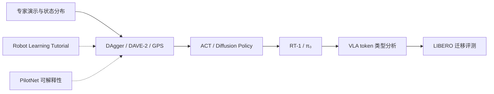

# 机器人学习 11 篇奠基文献：从端到端控制到 VLA

## 一句话定义

按**问题驱动而非发表年份**组织 11 篇一手论文：先看分布偏移与端到端策略，再看动作生成与大规模 VLA，最后用 LIBERO 的知识迁移问题检验能力。

## 英文缩写速查

| 缩写 | 英文全称 | 简要说明 |
|---|---|---|
| BC | Behavior Cloning | 从示教训练策略 |
| IL | Imitation Learning | 模仿学习范式 |
| GPS | Guided Policy Search | 局部控制器指导神经网络策略 |
| ACT | Action Chunking with Transformers | 以动作块建模模仿学习 |
| VLA | Vision-Language-Action | 图像与语言驱动动作的模型 |
| RL | Reinforcement Learning | 奖励驱动的策略学习 |

## 为什么重要

这组论文覆盖「**数据来自哪里 → 训练何种策略 → 输出如何表示 → 如何评估部署与迁移**」的主要技术分歧，不应把所有方法统称为一个端到端网络。

## 核心原理

该流程是**学习顺序图**，不表示后一种论文在算法上调用前一种论文的模块。

## 论文对照表

| 序号 | 论文 / 归档节点 | 技术主线与主要对照 |
|---|---|---|
| 1 | [Robot Learning: A Tutorial](../../sources/courses/robot_learning_tutorial_arxiv_2510_12403.md) · [arXiv](https://arxiv.org/abs/2510.12403) | 综述：经典机器人学 → RL → IL → 通用 VLA，LeRobot 示例 |
| 2 | [DAVE-2: End to End Learning for Self-Driving Cars](../entities/paper-dave2-end-to-end-driving.md) · [arXiv](https://arxiv.org/abs/1604.07316) | 驾驶示教：前视图像回归转向 |
| 3 | [PilotNet Saliency](../entities/paper-pilotnet-saliency.md) · [arXiv](https://arxiv.org/abs/1704.07911) | 解释：逐层激活与区域干预 |
| 4 | [Deep Visuomotor Policies](../entities/paper-deep-visuomotor-policies.md) · [arXiv](https://arxiv.org/abs/1504.00702) | 机器人视觉力矩：Guided Policy Search |
| 5 | [ACT / ALOHA](../entities/paper-act.md) · [arXiv](https://arxiv.org/abs/2304.13705) | 双臂动作块与时间集成 |
| 6 | [Diffusion Policy](../entities/paper-diffusion-policy.md) · [arXiv](https://arxiv.org/abs/2303.04137) | 条件扩散动作序列 |
| 7 | [RT-1](../entities/paper-rt-1.md) · [arXiv](https://arxiv.org/abs/2212.06817) | 语言条件下的离散动作 token |
| 8 | [VLA Action Tokenization Survey](../entities/paper-vla-action-tokenization-survey.md) · [arXiv](https://arxiv.org/abs/2507.01925) | 八类动作 token 的表示与执行接口 |
| 9 | [DAgger / Ross et al.](../entities/paper-ross-dagger.md) · [arXiv](https://arxiv.org/abs/1011.0686) | 在线聚合示教，缓解状态分布偏移 |
| 10 | [π₀ / pi0 Flow](../entities/paper-pi0.md) · [arXiv](https://arxiv.org/abs/2410.24164) | 视觉语言模型与动作流匹配 |
| 11 | [LIBERO](../entities/libero-benchmark.md) · [arXiv](https://arxiv.org/abs/2306.03310) | 终身迁移基准：130 个操控任务 |

## 论文原文核对要点

- **DAVE-2：** 训练采集三相机、部署单前视摄像头；约 98% 自动转向时间不代表完整自动驾驶成功率。
- **GPS：** PR2 使用 effort/前馈电压接口；训练时局部控制器可用完整状态、部署深度策略使用观测。
- **ALOHA/ACT：** 原文系统成本小于 $20k 而非 $2k，动作 chunk 与 temporal ensembling 有别于 Diffusion Policy 的丢弃式滚动预测。
- **Diffusion Policy：** §5.2 明确 robomimic 初始化 bug 实为 22；附录真机配置 DDIM 16 推理步，§3.4 给出 10 步的时延示例，不应混写。
- **RT-1：** 13 台机器人、17 个月、约 13 万演示，744 个任务；Appendix C 描述 280 ms 统一节拍等待，不是单次纯网络前向时延。
- **LIBERO：** 130 任务 = Spatial/Object/Goal 各 10 + LIBERO-100，后者包括 90 个短程和 10 个长程任务；其评测是终身迁移而非真机泛化度量。

## 工程实践

1. **数据闭环：** 先对照 [DAgger](../entities/paper-ross-dagger.md) 与 [DAVE-2](../entities/paper-dave2-end-to-end-driving.md)，判断专家数据是否覆盖部署策略的实际状态分布。
2. **执行接口：** 对照 [GPS](../entities/paper-deep-visuomotor-policies.md) 的力矩输出、[ACT](../entities/paper-act.md) 的动作块与 [Diffusion Policy](../entities/paper-diffusion-policy.md) 的采样过程。
3. **泛化验证：** 对照 [RT-1](../entities/paper-rt-1.md)、[π₀](../entities/paper-pi0.md) 的多任务训练与 [LIBERO](../entities/libero-benchmark.md) 的终身迁移测量，不混同静态成功率和顺序学习效果。
4. **解释与分解：** 利用 [PilotNet](../entities/paper-pilotnet-saliency.md) 的区域敏感性实验思路，区分可视化与因果安全验证；参阅 [VLA Token 综述](../entities/paper-vla-action-tokenization-survey.md) 明确动作语义。

## 局限与风险

这是阅读路线索引而不是统一实验基准；不同论文在年份、机器人平台、数据规模和评测指标上不可直接横向排名。11 篇论文的原文阅读情况分别记录于 frontmatter `original` 所指向的一手资料归档。阅读原文不等同逐项复现全部实验、审计引用论文或验证项目源码，遇到数字冲突须返回论文具体版本与表号。

## 关联页面

- [DAgger 原论文](../entities/paper-ross-dagger.md)
- [端到端视觉驾驶](../entities/paper-dave2-end-to-end-driving.md)
- [PilotNet 解释](../entities/paper-pilotnet-saliency.md)
- [GPS 视觉运动策略](../entities/paper-deep-visuomotor-policies.md)
- [VLA 动作 token 综述](../entities/paper-vla-action-tokenization-survey.md)
- [LIBERO](../entities/libero-benchmark.md)

## 参考来源

- [十一篇官方论文身份与仓库节点映射](../../sources/papers/robot_learning_11_foundation_papers_primary_index.md)
- [Robot Learning 教程](../../sources/courses/robot_learning_tutorial_arxiv_2510_12403.md)

## 推荐继续阅读

- [Robot Learning: A Tutorial (arXiv)](https://arxiv.org/abs/2510.12403)
