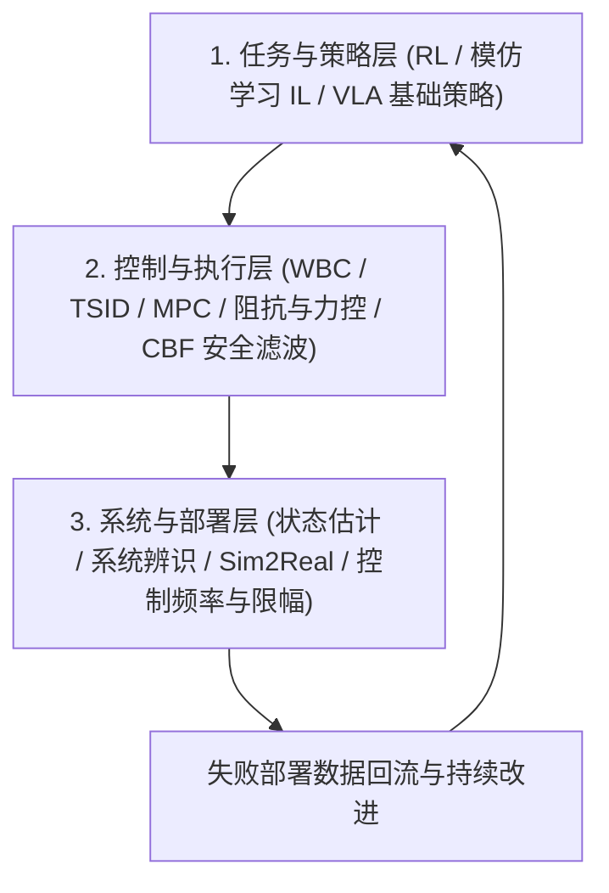

# Robot Learning Overview · 机器人学习概览

## 一句话定义

机器人学习用演示、环境交互或观测数据训练策略或预测模型，并通过控制器和机器人状态反馈，把学到的行为变成可验证的闭环任务执行。

## 英文缩写速查

| 缩写 | 英文全称 | 简要说明 |
|------|----------|----------|
| RL | Reinforcement Learning | 从交互奖励学习策略 |
| IL | Imitation Learning | 从专家演示学习策略 |
| Sim2Real | Simulation to Real | 学习策略落地真机的工程主线 |
| VLA | Vision-Language-Action | 多模态基础策略方向 |
| WBC | Whole-Body Control | 人形/移动操作的控制基础设施 |

## 为什么重要

当环境、接触状态或任务难以逐一写成规则时，可以用数据补足人工模型。学习策略与传统控制经常互补：策略选择行为，执行层处理稳定性、时效和物理约束。对有浮动基座、输入约束或接触切换的机器人，动作能被模型输出，并不意味着它能被硬件实现。

## 核心原理与组成

### 1. 强化学习（RL）
用交互产生的轨迹和奖励优化预期累计回报；任务是否真的做成，还要用独立指标复核。

### 2. 模仿学习（IL）
用专家示范学习策略。闭环中策略会改变自己的后续观测，示范拟合良好仍可能因误差累积而失败。

### 3. 预测模型
学习环境动态模型，用于 planning 或 model-based RL。

### 4. 感知-动作联合学习
端到端学习直接从 raw sensor 到 action 的映射。

## 三层架构：从策略到系统

如果把机器人学习只理解成“用一个神经网络输出动作”，就很容易在真实机器人上踩坑。更实用的理解方式是把它拆成三层：

### 1. 任务与策略层

这一层回答“机器人要做什么、策略学什么”：

- 强化学习：适合从交互中学习长期回报
- 模仿学习：适合从人类示范中快速学到可用行为
- VLA / Foundation Policy：把语言、视觉和动作统一起来，适合多任务操作

这层的难点是数据、奖励和泛化，而不是高频执行本身。

### 2. 控制与执行层

这一层回答“高层策略给出的目标，怎么安全稳定地变成机器人动作”：

- 对人形机器人，常见执行层包括 [Whole-Body Control](../concepts/whole-body-control.md)、[TSID](../concepts/tsid.md)、[Model Predictive Control](../methods/model-predictive-control.md)
- 对操作任务，常见执行层包括 [Impedance Control](../concepts/impedance-control.md)、力位混合控制和任务空间控制
- 对带安全约束的系统，还会加入 [Control Barrier Function](../concepts/control-barrier-function.md) 或 safety filter

很多“学习失败”其实发生在这里：策略输出没问题，但执行层接不住，或者真机频率、延迟和约束根本不匹配。

### 3. 系统与部署层

这一层回答“训练好的东西如何真实跑起来”：

- 感知和状态估计是否稳定
- 训练分布和真机分布是否一致
- 控制频率、通信延迟、动作限幅是否处理妥当
- 数据能否从失败部署里回流继续改进

这也是 [Sim2Real](../concepts/sim2real.md)、[Sensor Fusion](../concepts/sensor-fusion.md)、[System Identification](../concepts/system-identification.md) 变得关键的原因。

## 五大主题导航

当前知识库里的机器人学习主线，基本可以归成五个主题：

### 1. Locomotion

研究机器人如何稳定移动，包括平地行走、地形适应、扰动恢复和全身平衡。它通常和 RL、MPC、WBC 紧密相关，是人形机器人最核心的能力底座。

入口页：

- [Locomotion](../tasks/locomotion.md)
- [Terrain Adaptation](../concepts/terrain-adaptation.md)
- [人形机器人运动控制 Know-How](./humanoid-motion-control-know-how.md)

### 2. Manipulation

研究机器人如何抓取、装配、双臂协同和执行接触丰富任务。它是模仿学习、遥操作、VLA 和 Foundation Policy 最集中的应用场景。

入口页：

- [Manipulation](../tasks/manipulation.md)
- [Bimanual Manipulation](../tasks/bimanual-manipulation.md)
- [Contact-Rich Manipulation](../concepts/contact-rich-manipulation.md)

### 3. Learning Methods

研究机器人策略本身如何从数据中学出来，包括 RL、IL、Behavior Cloning、Diffusion Policy、VLA 等。它们不是互斥路线，而是经常组合使用：例如 BC 预训练 + RL 微调，或 VLA 负责语义层、传统控制负责执行层。

入口页：

- [Reinforcement Learning](../methods/reinforcement-learning.md)
- [Imitation Learning](../methods/imitation-learning.md)
- [Behavior Cloning](../methods/behavior-cloning.md)
- [VLA](../methods/vla.md)
- [机器人学习五大范式（IL / RL / LfV / VLA / 持续学习）](../comparisons/robot-learning-five-paradigms-taxonomy.md) — 按学习信号选型的对照框架
- [World Action Models（WAM）](../concepts/world-action-models.md) — 世界预测与动作生成耦合的具身基础模型范式（综述与 Awesome-WAM 资源入口）

### 4. Safe / Structured Control

研究如何在有物理约束和安全约束的情况下，让系统既稳定又可部署。这里会自然连到 Lyapunov、CLF、CBF、WBC 与 MPC。

入口页：

- [Whole-Body Control](../concepts/whole-body-control.md)
- [Control Lyapunov Function](../formalizations/control-lyapunov-function.md)
- [Control Barrier Function](../concepts/control-barrier-function.md)
- [Query：CLF 与 CBF 在 WBC/MPC 中的联合使用](../queries/clf-cbf-in-wbc.md)

### 5. Sim2Real 与系统落地

研究如何把仿真中的学习结果迁移到真实机器人上，包括域随机化、系统辨识、状态估计、调试和部署流程。对于真实机器人项目，这一主题往往决定一个策略能不能真正落地。

入口页：

- [Sim2Real](../concepts/sim2real.md)
- [Domain Randomization](../concepts/domain-randomization.md)
- [Query：Sim2Real 工程 Checklist](../queries/sim2real-checklist.md#快速部署检查)
- [Query：RL 策略真机调试 Playbook](../queries/robot-policy-debug-playbook.md)

## 当前图谱里的几个 community 应该怎么读

图谱社区并不是严格学科分类，而更像“在链接上天然靠得近的一组页面”。当前最值得关注的几组主干通常是：

- **Locomotion 社区**：从 LIP/ZMP、Centroidal Dynamics、MPC、WBC 一路连到 locomotion 与 sim2real，适合走传统运动控制主线
- **WBC / Safe Control 社区**：围绕 TSID、HQP、CLF、CBF、接触约束和安全过滤，适合想做可证明稳定/安全控制的人
- **IL / Manipulation 社区**：围绕遥操作、行为克隆、Diffusion Policy、VLA、操作与双臂任务，适合想做操作与多模态策略的人
- **DL / Formalization 社区**：围绕 [深度学习基础](../concepts/deep-learning-foundations.md)、Lyapunov、LQR、MDP、Bellman 等基础形式化页面，适合补理论地基

这些社区之间并不是割裂的。一个成熟的机器人系统往往同时跨过多个社区：例如 VLA 提供高层语义目标，WBC 负责高频执行，Sim2Real 负责部署闭环。

## 如果你准备系统学习，推荐怎么进入

### 路线 A：先把控制主干学通

如果你想做人形运动控制、MPC、WBC、状态估计，建议从 [运动控制主路线](../../roadmap/motion-control.md) 或 [Locomotion](../tasks/locomotion.md) 一路往下读。这样能先建立“机器人为什么需要这些结构”的系统直觉。

### 路线 B：从数据驱动方法切入

如果你已经在做操作或模仿学习，建议从 [Manipulation](../tasks/manipulation.md) → [Behavior Cloning](../methods/behavior-cloning.md) → [Diffusion Policy](../methods/diffusion-policy.md) → [VLA](../methods/vla.md) 这条线进入，再回头补执行层和 sim2real。

### 路线 C：以 query 页做问题驱动阅读

如果你不是线性系统学习，而是带着明确问题来，例如：

- “做 sim2real 部署先查什么？”
- “VLA 怎么和低层控制器接？”
- “接触丰富操作常见失败怎么修？”

那就直接先读对应 query 页，再顺着 `## 关联页面` 回到概念页和方法页。这也是知识库目前最符合工程问题驱动的一种读法。

## 学习建议

- **先建立主干，再看花样。** 没搞清楚 WBC、MPC、状态估计，就很容易把 RL/VLA 当黑盒 magic。
- **把 query 页当“高价值经验回写”。** 它们不是附录，而是从具体问题反推知识结构的最好入口。
- **注意任务层和执行层的边界。** 很多模型文章写的是“高层表现”，但真实落地成败取决于执行层与部署层。
- **尽量沿着相关页面跳转阅读。** 这个仓库最核心的价值不是某一页写得多，而是页面之间已经形成了交叉引用的图结构。

## 和其他领域的关系

- **控制理论**：提供稳定性、收敛性理论支撑
- **优化**：RL 训练本质是优化问题
- **计算机视觉**：感知模块的基础
- **运动控制**：具体执行层面的基础

## 工程实践

以桌面抓取为起点：固定任务、物体范围与初始状态，定义“抓起后能稳定保持”的验收条件。先在仿真同时测任务成功、耗时、干预和失败类别，再用留出的物体摆位复测。移到真机前，对齐观测坐标、单位、关节顺序、动作语义和控制周期；核对超时、限位、停止与回退规则。用 [Sim2Real 工程 Checklist](../queries/sim2real-checklist.md#快速部署检查) 和 [真机调试 Playbook](../queries/robot-policy-debug-playbook.md) 验证整条闭环，而不是只比较训练曲线。

## 局限与风险

- **训练回报不能替代验收。** 奖励与任务成功、节拍或干预成本不一致时，应分别报告。
- **离线拟合不能替代闭环。** DAgger 说明为什么专家分布上的误差不能直接外推到策略自己访问的状态；补采纠偏示范与重新验证闭环是不同环节。
- **仿真能过不代表真机能过。** Tobin 等验证的是视觉域随机化对特定定位及抓取设置的迁移，不能据此推出时延、接触参数或执行器误差都能迁移。先辨别是观测偏移、控制接口还是动力学差异，再选择辨识、随机化或数据补采。

## 知识库维护方法论

本知识库采用 Karpathy LLM Wiki 模式构建：LLM 作为维护者，人类作为 curator，通过 Ingest / Query / Lint 三类操作持续积累知识。

- [LLM Wiki 方法论（Karpathy）](../concepts/llm-wiki-karpathy.md) — 知识库构建模式来源
- [Andrej Karpathy](../entities/andrej-karpathy.md) — 模式提出者；Tesla Autopilot 视觉栈、CS231n 与 Zero to Hero 教育主线
- [运动控制主路线](../../roadmap/motion-control.md) — 人形运控 L−1 → L7 的完整学习路线

## 参考来源

- [Spinning Up 强化学习入门与 MIT 欠驱动机器人课程导论的原文核对](../../sources/sites/robot-learning-overview-primary.md)
- [Ross 等：DAgger 与闭环分布偏移](../../sources/papers/dagger_reading_arxiv_1011_0686.md)
- [Tobin 等：视觉域随机化与 Sim2Real](../../sources/papers/domain_randomization_tobin_reading_arxiv_1703_06907.md)
- Sutton & Barto, *Reinforcement Learning: An Introduction* — RL 标准教材
- [OpenAI Spinning Up in Deep RL](https://spinningup.openai.com) — 实践入门
- [动手学强化学习（蘑菇书）](../entities/hands-on-rl-book.md) — 中文教材与 PPO/SAC 代码（[hrl.boyuai.com](https://hrl.boyuai.com/)）

## 发表与引用

选题、投稿或核对会议/期刊信息时，见 [机器人顶会顶刊发表渠道对比](../comparisons/robotics-research-venues.md)（ICRA、IROS、CoRL、RSS、T-RO、IJRR、Science Robotics 官方入口索引）。日常预印本检索与本库论文默认外链层见 **[arXiv](../entities/arxiv.md)**（与录用渠道正交）。

## 关联页面

- [国内具身智能实验室三层地图（2026）](./china-embodied-ai-labs-landscape-2026.md) — 国内产学研实验室导航
- [海外具身智能实验室地图（2026）](./overseas-embodied-ai-labs-landscape-2026.md) — 海外实验室 → 方法 / 平台对照
- [arXiv](../entities/arxiv.md) — 开放获取预印本平台宏观节点
- [机器人顶会顶刊发表渠道对比](../comparisons/robotics-research-venues.md)
- [Reinforcement Learning](../methods/reinforcement-learning.md)
- [动手学强化学习（蘑菇书）](../entities/hands-on-rl-book.md)
- [Imitation Learning](../methods/imitation-learning.md)
- [机器人学习五大范式](../comparisons/robot-learning-five-paradigms-taxonomy.md) — IL / RL / 视频 / VLA / 持续学习选型
- [Locomotion](../tasks/locomotion.md)
- [Whole-Body Control](../concepts/whole-body-control.md)
- [LLM Wiki 方法论（Karpathy）](../concepts/llm-wiki-karpathy.md) — 本知识库的构建方法论来源
- [Andrej Karpathy](../entities/andrej-karpathy.md) — LLM Wiki 提出者与深度学习/视觉教育索引
- [人形机器人运动控制 Know-How](./humanoid-motion-control-know-how.md) — 真机调试的工程经验（传感器 / 电机热管理 / 地形）
- [人形机器人八大能力技术地图](./humanoid-eight-capabilities-technology-map.md) — 感知/抓取/WBC/平衡/VLA/WM/数据/仿真科普鸟瞰

## 推荐继续阅读

- [Robot Learning Paper Notebooks 知识库索引](./humanoid-paper-notebooks-index.md) — 按论文笔记主站的 14 类主题导航
- Sutton & Barto, *Reinforcement Learning: An Introduction*
- [OpenAI Spinning Up in Deep RL](https://spinningup.openai.com)
- [动手学强化学习在线书](https://hrl.boyuai.com/chapter)
