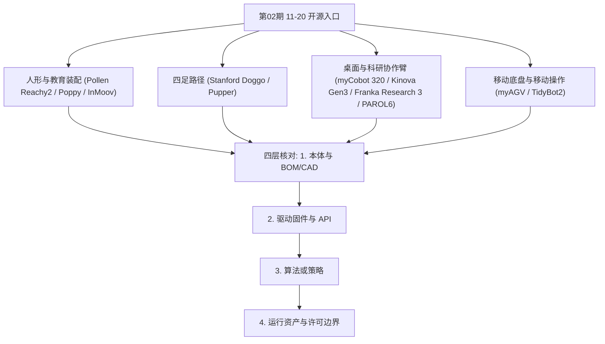

---

type: overview
tags: [open-source, hardware, humanoid, quadruped, manipulator, mobile-robot, wechat-curator, stanford]
status: complete
original:
  - ../../sources/sites/robot-open-source-issue02-primary-entry-reading-2026-11-15.md
updated: 2026-11-15
related:
  - ./robot-open-source-wechat-issue01-curator.md
  - ../entities/open-source-humanoid-hardware.md
  - ../entities/humanoid-robot.md
  - ../entities/quadruped-robot.md
  - ../tasks/manipulation.md
  - ../entities/pollen-reachy2.md
  - ../entities/poppy-project-robots.md
  - ../entities/inmoov-humanoid.md
  - ../entities/stanford-doggo-and-pupper.md
  - ../entities/elephantrobotics-mycobot-320.md
  - ../entities/elephantrobotics-myagv.md
  - ../entities/tidybot2.md
  - ../entities/kinova-gen3.md
  - ../entities/franka-research-3.md
  - ../entities/parol6-source-robotics.md
  - ../queries/humanoid-hardware-selection.md
sources:
  - ../../sources/sites/robot-open-source-issue02-primary-entry-reading-2026-11-15.md
  - ../../sources/repos/open-robot-hardware-entry-review-2026-11-15.md
  - ../../sources/blogs/wechat_jixie_robot_open_source_treasury_issue02_10_robots.md
summary: "微信公众号「机械Robot」第02期《10个全开源网址》：Reachy2、Poppy、InMoov、Stanford Doggo/Pupper、myCobot 320、myAGV、TidyBot2、Kinova Gen3、Franka Research 3、PAROL6 的实体索引与官方入口。"
---

# 机器人开源宝库（微信策展第02期）— 索引

## 一句话定义

本页对应转载清单 **第 11–20 号**共 **10** 条开源机器人/平台入口，拆成独立实体节点，并集中指向 **官方文档、GitHub 组织与论文/数据集页**；个人网盘与 360 共享链不作唯一依据。

## 英文缩写速查

| 缩写 | 英文全称 | 简要说明 |
|------|----------|----------|
| CAD | Computer-Aided Design | 计算机辅助设计，硬件结构建模 |
| ROS 2 | Robot Operating System 2 | 机器人系统集成与通信的常用中间件 |
| SLAM | Simultaneous Localization and Mapping | 同步定位与建图 |
| SDK | Software Development Kit | 软件开发工具包 |
| Manipulation | Robot Manipulation | 抓取、移动、操作物体的任务总称 |

## 为什么重要

同一“开源机器人”清单混合可打印平台、科研整机、底盘和机械臂驱动。先辨认开放对象，才能估计采购、制造、软件适配和标定的成本；可访问的文档链接本身不能证明整机软硬件均可复现。

## 核心原理：按任务和开放层级组织入口

学习机械装配与电机控制可从Poppy/InMoov的模块开始；研究操作策略可看myCobot、Kinova或Franka的接口；移动操作需同时考虑底盘与机械臂，参考Reachy2、myAGV组合或TidyBot2。Doggo/Pupper是四足路径，应进一步按代际与维护状态选择。

每个入口分别核对**本体/BOM、驱动与API、算法或策略、运行资产**四层。例如Kinova的ROS驱动开放不等于机械CAD开放，Poppy的硬件与软件许可也不同。以下表格保留原清单编号，工程判断以[官方资料复核](../../sources/sites/robot-open-source-issue02-primary-entry-reading-2026-11-15.md)和实体页为准。

## 11–20 实体页一览

| # | 实体页 | 一句话 |
|---|--------|--------|
| 11 | [Pollen Reachy2](../entities/pollen-reachy2.md) | 模块化移动人形 + 双臂 + 全向底盘；文档 / GitHub / Hugging Face 三角入口 |
| 12 | [Poppy 平台](../entities/poppy-project-robots.md) | Inria 系 3D 打印教育人形与 Torso 等变体 |
| 13 | [InMoov](../entities/inmoov-humanoid.md) | 3D 打印全尺寸人形；Arduino + MyRobotLab 生态 |
| 14 | [Stanford Doggo / Pupper](../entities/stanford-doggo-and-pupper.md) | Doggo历史四足与Pupper教学路线；Doggo停止支持，v3单独维护 |
| 15 | [大象 myCobot 320](../entities/elephantrobotics-mycobot-320.md) | 桌面六轴协作臂；官方文档仓与中文支持 |
| 16 | [大象 myAGV](../entities/elephantrobotics-myagv.md) | 麦克纳姆轮移动平台；官方文档中的ROS与SLAM示例 |
| 17 | [TidyBot2](../entities/tidybot2.md) | 家庭物品整理移动操作；论文 + 硬件文档站 |
| 18 | [Kinova Gen3](../entities/kinova-gen3.md) | 轻型协作臂系列；区分本体、自由度、夹爪与 ROS 发行版 |
| 19 | [Franka Research 3](../entities/franka-research-3.md) | 七轴力控科研臂；官方 docs + frankarobotics 组织 |
| 20 | [PAROL6](../entities/parol6-source-robotics.md) | Source Robotics 桌面六轴；PAROL-docs + 作者 GitHub |

## 本期入口的维护复核

[2026-11-15 官方文档复核](../../sources/repos/open-robot-hardware-entry-review-2026-11-15.md)更新本期 myCobot 320、Kinova Gen3 与 Poppy 条目：分别核对 M5/Pi 文档路径、Gen3/Gen3 lite 与 ROS 分支、软硬件许可和 CAD LFS 下载方式。原清单保留为发现线索，项目文档、驱动示例与硬件发布物须按各自入口选择；本次没有把转载清单视作所有型号都已实机复现的证据。

## 工程实践

1. 先固定任务、负载、机动性和所需控制接口，筛到一至两个具体型号。
2. 对照本体、控制器、ROS发行版、驱动/固件、夹爪和资产版本；不能把同品牌不同型号的命令直接混用。
3. 把文档阅读、离线测试、仿真和真机结果分开记录。Reachy2 SDK的离线CI与在线gRPC测试是不同范围；Franka FCI的1kHz网络接口也不能推断为所有高层Python逻辑的频率。
4. 先验证状态回读和坐标/单位，再验证动作；硬件制造还须确认CAD发布物、打印/加工条件和装配标定。本轮没有执行任何控制命令。

## 局限与风险

清单用于发现资料，既不构成全部项目的深读报告，也不保证今天能取得所有历史网盘/CAD文件。Doggo的维护状态、PAROL6的控制板/固件适用范围及商业协作臂的API边界会影响复现路径；许可须按软硬件和资产分别核对。各原文通读归档在[官方入口复核](../../sources/sites/robot-open-source-issue02-primary-entry-reading-2026-11-15.md)逐项说明范围，没有用转载清单替代主项目原文。

## 与第01期的关系

- 第01期索引：[机器人开源宝库（微信策展第01期）](./robot-open-source-wechat-issue01-curator.md)（傅利叶 N1、智元 X1、天工、ODRI、BHL、Orca、TurtleBot3、ROBOTIS 等）。

## 关联页面

- [开源人形硬件方案对比](../entities/open-source-humanoid-hardware.md)
- [人形机器人](../entities/humanoid-robot.md)
- [四足机器人](../entities/quadruped-robot.md)
- [Manipulation](../tasks/manipulation.md)

## 推荐继续阅读

- [Franka FCI Overview](https://frankarobotics.github.io/docs/overview.html) — 具体控制接口与ROS集成边界。
- [Pupper v3官方文档](https://pupper-v3-documentation.readthedocs.io/en/latest/) — 代际、镜像与部署路径。

- [原文第02期（微信）](https://mp.weixin.qq.com/s/wl_WvXn78WHxIRCrZb5xfA)

## 参考来源

- [官方入口原始资料与核对范围](../../sources/sites/robot-open-source-issue02-primary-entry-reading-2026-11-15.md)。

- [官方硬件文档与入口复核](../../sources/repos/open-robot-hardware-entry-review-2026-11-15.md)

- [wechat_jixie_robot_open_source_treasury_issue02_10_robots.md](../../sources/blogs/wechat_jixie_robot_open_source_treasury_issue02_10_robots.md)
