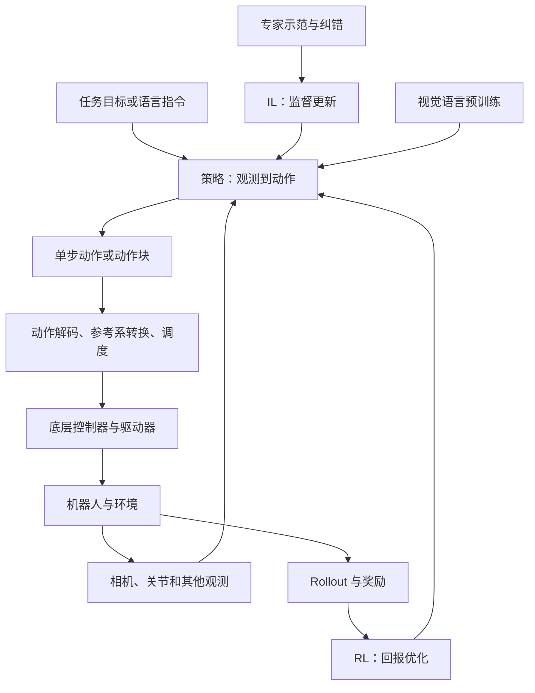
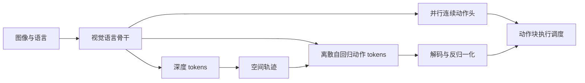
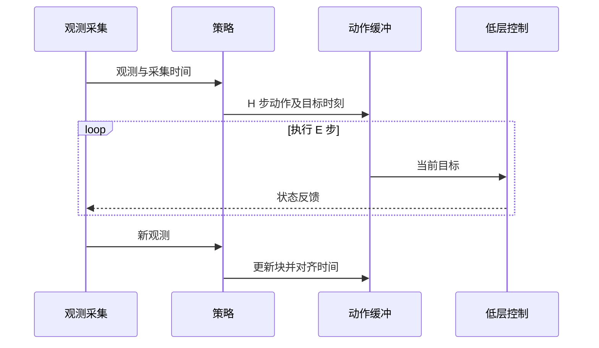

# Robot Policies: From Imitation Learning to Token VLA / 机器人策略：从模仿学习到 Token VLA

> 本页根据 human five 2026-11-24 课程整理文本编译，并以已定位的各研究官方资料交叉核对。原始讲座为 Xinyuan Liu 在 Arizona State University CSE 598（Fall 2026）的 Physical AI 客座讲座，已由讲者官网及封面核实；[官方课件](https://drive.google.com/file/d/19M1BsdvSGGHaS0SpdblaL1DRg_5AfxSt/view?usp=sharing) 与 [视频](https://youtu.be/p1KjuI2z8uM) 已定位，PDF 正文未成功取得，仍不能声称课程原文已核读。

## 一句话定义

机器人策略将观测和目标映射到可执行动作；IL 与 RL 主要区别在训练信号，VLA 是条件输入与策略架构的一种实现方式，三者并非互斥。

## 英文缩写速查

| 缩写 | 英文全称 | 简要说明 |
|---|---|---|
| IL | Imitation Learning | 模仿专家示范 |
| BC | Behavior Cloning | 监督观测到动作 |
| RL | Reinforcement Learning | 优化长期回报 |
| ACT | Action Chunking with Transformers | 预测动作序列 |
| PPO | Proximal Policy Optimization | 近端策略优化 |
| VLA | Vision-Language-Action | 视觉语言条件动作策略 |
| FK / IK | Forward / Inverse Kinematics | 正 / 逆运动学 |
| DCT | Discrete Cosine Transform | 时序动作频域变换 |
| BPE | Byte Pair Encoding | 压缩离散符号序列 |

## 为什么重要

将任务语义、训练监督、动作分布和实时控制分层，才能定位错误究竟来自数据覆盖、模型输出、动作坐标系、推理延迟，还是控制器/执行器。学习路线不等同于模型版本演进。

## 核心原理与流程总览

训练分支并不意味着部署时每一步都更新策略参数；冻结策略也可闭环执行。

### 1. Physical AI 与学习问题

状态描述系统真实情况，观测是传感器可获得的信息；部分可观测时可加入历史、记忆或状态估计。轨迹是一系列状态和动作，rollout 是运行产生轨迹的过程，episode 通常按任务终止或时限定义，三词并非严格同义。

以下为标准形式的补充，不是公众号中丢失的公式原样恢复：

- 策略：$a_t\sim\pi_\theta(\cdot\mid o_{0:t},g)$。
- 折扣回报：$G_t=\sum_{k=0}^{T-t-1}\gamma^k r_{t+k}$；期望回报 $J(\theta)=\mathbb E[G_0]$。
- 完全可观测的固定目标 MDP：$p_\theta(\tau)=\rho_0(s_0)\prod_{t=0}^{T-1}\pi_\theta(a_t\mid s_t)P(s_{t+1}\mid s_t,a_t)$。
- 策展视角：数据分布、学习权重、策略参数化是三个设计轴，不宣称所有 RL 均可化成同一个固定加权 BC 目标。

### 2. 动作表示与控制契约

| 维度 | 选项 | 部署核对 |
|---|---|---|
| 空间 | Joint / Task | 关节顺序、末端参考系、IK 多解与可达性 |
| 参考 | Absolute / chunk-start Relative / stepwise Delta | 参考时刻、坐标系、积分与姿态组合；各框架命名可能不同 |
| 模式 | Position / Velocity / Impedance / Torque | 单位、限位、控制器增益、饱和、接触稳定性 |
| 时间 | 单步 / chunk | 采样频率、执行前缀、观测时间戳 |

策略输出不等同于电机电流。对于典型关节 PD 目标控制，可用 $\tau=K_p(q_d-q)+K_d(\dot q_d-\dot q)+\tau_{ff}$ 说明目标到力矩的接口；真实驱动器结构与控制模式依硬件而定。阻抗控制强调期望动态关系，不只意味着降低位置增益。

Sim2Real 可从域随机化、真机数据混训、生成式数据扩增和测量域差切入；生成场景外观不等同于物理动态已校准。

### 3. 模仿学习

| 方法 | 解决的问题 | 仍有的约束 |
|---|---|---|
| BC + MSE | 监督回归 | 多模态平均、分布偏移 |
| GMM | 表达多个动作模式 | 模式覆盖、采样质量 |
| BC-RNN | 利用历史推断运动趋势 | 隐状态、历史长度 |
| [ACT](../entities/paper-act.md) | CVAE 与 Transformer 预测连续动作块 | 部署反馈频率、跨块一致性 |
| DAgger | 收集 learner 访问状态的专家标签 | 专家查询成本与安全 |
| HG-DAgger | 人类决定接管及交还控制 | 接管判据、纠错数据覆盖 |

ACT 的训练后验编码动作序列与状态；其经典部署设置使用零潜变量。时间集成融合对同一目标时刻的多次预测，不能直接平均不同目标时刻的动作。

### 4. 强化学习

Rollout 收集状态、动作和奖励；actor 生成动作，critic 估计价值，优势函数 $A^\pi(s,a)=Q^\pi(s,a)-V^\pi(s)$ 比较动作相对基线的收益。PPO-Clip 优化裁剪代理目标；裁剪限制目标中的更新激励，并不是对新旧策略 KL 或所有概率比的硬约束。

AMP 使用判别器学习运动风格奖励，并与任务奖励组合。语言模型生成奖励代码、VLM 给视频评分与 Agent 迭代实验属于奖励设计/评价的不同环节；需核对真实任务成功、奖励投机、接触安全与重复试验，不能只优化 VLM 分数。

### 5. Token VLA 和连续动作头

| 工作 | 动作/数据路径 | 边界 |
|---|---|---|
| [RT-2](../entities/paper-rt-2.md) | VLM 生成离散动作 token | 数值量化、解码延迟 |
| [Open X-Embodiment](../entities/paper-open-x-embodiment.md) | 多本体数据与 RT-X 实验 | 数据项目不等于单一模型 |
| [OpenVLA](../entities/paper-openvla.md) | DINOv2 + SigLIP 特征与语言模型、离散动作 | 归一化、模型计算、逐 token 解码 |
| FAST | DCT、量化、BPE，压缩动作序列 | 压缩误差与高频接触细节 |
| OpenVLA-OFT | 并行解码、动作块、连续动作头、L1 回归 | 微调配方与特定任务协议 |
| [MolmoAct](../entities/paper-molmoact.md) | depth tokens、2D spatial plan、动作 tokens | 推理延迟与中间表征误差 |

图为多种独立模型的输出路径对照，不代表同一模型同时运行所有分支。高层 Agent 可选择技能或任务顺序，低层策略执行；直接调用大模型输出关节目标仍需校验动作、时限和安全接口。

## 工程实践：动作块与反馈调度

设预测长度 $H$，执行前缀 $E$，控制指令周期 $\Delta t$，推理时延 $L$。每次只执行 $E$ 步再更新观测时，名义动作块覆盖 $H\Delta t$，重规划周期还受推理和调度影响。同步执行可在动作耗尽后等待；异步执行可一边运行旧块一边根据观测预测新块，需对齐新预测起点和已经执行的动作，防止过期动作。

该图为概念级同步滚动执行示意，并非某个官方仓库源码时序。异步方案需另查 [Action Chunking](../methods/action-chunking.md) 与 [控制重规划](../concepts/receding-horizon-policy-execution.md)。

建议对同一任务扫描 $H,E$，记录首次动作可用延迟、观测到执行延迟、执行缓冲欠载、动作跳变、任务成功率、任务完成时间与安全事件。不要把 chunk 越长或单次 forward 越快等同于整体闭环越好。

## 局限与风险

- 原始讲座身份已确认，但课件正文和演示尚未核读，故不记录 GPT 模型具体版本、推理秒数等无可核验口径。
- 原文部分公式在用户文本中丢失，本页明确为标准公式补充。
- 该笔记不包含统一官方可运行项目；源码运行时序图不适用。各论文/模型入口应在唯一实体页中独立核对。
- 未对全部列出的原始论文逐篇通读或复现实验，不将本页当作完成论文深读。

## 关联页面

- [模仿学习](../methods/imitation-learning.md)
- [强化学习](../methods/reinforcement-learning.md)
- [VLA](../methods/vla.md)
- [Action Chunking](../methods/action-chunking.md)
- [Sim2Real](../concepts/sim2real.md)
- [五大机器人学习范式](../comparisons/robot-learning-five-paradigms-taxonomy.md)
- [VLA 纵深路线](../../roadmap/depth-vla.md)
- [模仿学习纵深路线](../../roadmap/depth-imitation-learning.md)

## 推荐继续阅读

- [ACT 原始项目](https://tonyzhaozh.github.io/aloha/)
- [PPO 官方算法文档](https://spinningup.openai.com/en/latest/algorithms/ppo.html)
- [FAST 官方 tokenizer](https://huggingface.co/physical-intelligence/fast)
- [OpenVLA-OFT 原始项目](https://openvla-oft.github.io/)

## 参考来源

- [human five 课程笔记归档及相关一手资料核对清单](../../sources/blogs/wechat_human_five_robot_policies_2026-11-24.md)
- [ACT 原始论文归档](../../sources/papers/act_arxiv_2304_13705.md)
- [RT-2 原始论文归档](../../sources/papers/rt2_vla_reading_arxiv_2307_15818.md)
- [OpenVLA 原始论文归档](../../sources/papers/openvla_reading_arxiv_2406_09246.md)
