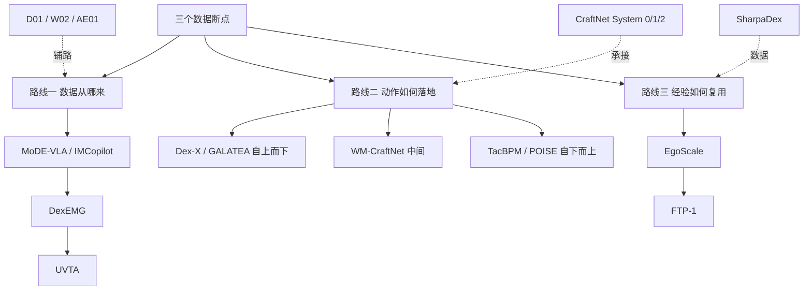

# Sharpa 学术路线：三个数据断点、三条路线

> 来源：[天南具身公园，2026-10-22](../../sources/blogs/wechat_tiannan_sharpa_academic_route_2026-10-22.md)。本页只做阅读坐标，不复述全文；每个项目的细节在各自节点。

## 一句话定义

Sharpa 把灵巧操作的数据问题拆成三个断点（遥操作无触觉、人手到机器手有 gap、多源数据对不上），分别用三条并行路线回应，并以 CraftNet 分层架构承接。

## 英文缩写速查

| 缩写 | 英文全称 | 简要说明 |
|------|----------|----------|
| VTLA | Vision-Tactile-Language-Action | CraftNet 的模型类型 |
| EMG | Electromyography | DexEMG 用肌电恢复手型 |
| WM | World Model | WM-CraftNet 的核心 |
| Sim2Real | Simulation to Real | 路线二的共同落地方式 |

## 总览

## 项目索引（每项一个独立节点）

| 路线 | 项目 | 节点 |
|------|------|------|
| 一 | IMCopilot + MoDE-VLA（削苹果） | [MoDE-VLA](../entities/paper-sa-2603-08122-mode-vla-mixture-of-dexterous-experts-vla.md) |
| 一 | DexEMG | [DexEMG](../entities/paper-dexemg.md) |
| 一 | UVTA | [UVTA](../entities/paper-uvta-human-tactile-dexterous-manipulation.md) |
| 二 | Dex-X | [Dex-X](../entities/paper-dex-x.md) |
| 二 | GALATEA | [GALATEA](../entities/paper-galatea.md) |
| 二 | WM-CraftNet | [WM-CraftNet](../entities/paper-wm-craftnet.md) |
| 二 | TacBPM | [TacBPM](../entities/paper-tacbpm.md) |
| 二 | POISE | [POISE](../entities/paper-poise-in-hand-6d-pose-reaching.md) |
| 三 | EgoScale | [EgoScale](../entities/paper-sa-2602-16710-egoscale-scaling-dexterous-manipulation-with-div.md) |
| 三 | FTP-1 | [FTP-1](../entities/paper-ftp-1.md) |
| 架构 | CraftNet | [CraftNet](../entities/craftnet.md) |
| 数据 | SharpaDex | [SharpaDex](../entities/sharpadex.md) |
| 硬件 | D01 / W02 / AE01 | [D01](../entities/sharpa-d01-robot.md)、[W02](../entities/sharpa-w02-hand.md)、[AE01](../entities/sharpa-ae01-data-glove.md) |

## 作者判断（文内）

- 接口演进：开关 → 轨迹 → 潜变量；上层能传给底层的信息越来越多。
- 规模悬念：文内转述 Sharpa 称现有约 2 万小时量级数据，in-context learning 所需可能 1000 万小时以上。
- 以上是作者与 Sharpa 的判断，不是实验结论。

## 关联页面

- [Sharpa Robotics](../entities/sharpa-robotics.md)
- [接触丰富操作](../concepts/contact-rich-manipulation.md)
- [Manipulation](../tasks/manipulation.md)

## 参考来源

- [天南具身公园：Sharpa 学术路线](../../sources/blogs/wechat_tiannan_sharpa_academic_route_2026-10-22.md)
