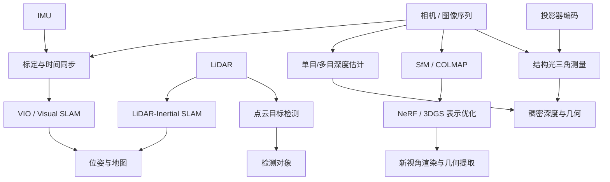

# 视觉感知与三维重建研究地图 / 3D Vision and Reconstruction

**一句话定义：** 这是一张跨 SLAM、自动驾驶多传感器融合、深度估计、点云检测、结构光、NeRF 和 Gaussian Splatting 的任务与原始资料导航图，而非任何单篇论文的复现报告。

## 英文缩写速查

| 缩写 | 英文全称 | 简要说明 |
|---|---|---|
| SLAM | Simultaneous Localization and Mapping | 联合定位与建图 |
| VIO | Visual-Inertial Odometry | 视觉惯性里程计 |
| IMU | Inertial Measurement Unit | 加速度与角速度传感器 |
| LiDAR | Light Detection and Ranging | 点云/测距传感器 |
| SfM | Structure from Motion | 从多视角估计相机位姿和结构 |
| NeRF | Neural Radiance Fields | 神经辐射场表示 |
| 3DGS | 3D Gaussian Splatting | 三维高斯表示与渲染 |

## 为什么重要

- **定位与重建不是同一问题**：[VINS-Fusion](../entities/vins-fusion.md) / [ORB-SLAM3](../entities/orb-slam3.md) 以位姿及地图为核心；NeRF/3DGS 强调场景表示与新视角渲染。
- **点云检测不等于 SLAM**：PointNet、VoxelNet、PointPillars 等解决特征学习和目标检测；检测 AP 与轨迹误差不能直接比较。
- **主动测量不同于深度猜测**：结构光由投影器和相机几何解算深度；单目深度模型还须讨论尺度与域偏移。
- **时空标定是融合前提**：同步误差、相机-IMU/LiDAR 外参均须依据真实传感器与官方代码处理。

## 流程总览（领域关系图，非源码调用图）

## 核心原理与研究入口

| 研究目标 | 代表工作 | 核心问题 |
|---|---|---|
| 状态估计 / 地图 | VINS-Fusion、ORB-SLAM3、LVI-SAM | 视觉、惯性和 LiDAR 联合位姿估计 |
| 多模态 3D 检测 | OpenPCDet、PointPainting、KITTI | 相机与点云特征、数据对齐、评测 |
| 自监督深度 | SfMLearner、Monodepth2、FeatDepth | 图像与运动信息到深度预测 |
| 主动三维测量 | 3DUNDERWORLD、Steger、三步相移 | 编码图案与几何三角化 |
| 神经隐式表示 | NeRF、iMAP、NICE-SLAM | 稠密表示与视觉定位的耦合 |
| Gaussian 表示与 SLAM | 3DGS、SplaTAM、MonoGS | 高斯地图与定位/渲染 |
| 动态 Gaussian | 4DGaussians、Deformable Gaussians | 跨时间动态场景表示 |
| 流式 3D 重建 | [HorizonStream](../entities/paper-horizonstream.md)、[LingBot-Map](../entities/paper-lingbot-map.md)、[ABot-Recon](../entities/paper-abot-recon.md) | 比较有界长期记忆、局部上下文与回环优化 |

## 工程实践

1. 按任务先确认传感器、标定、时间戳、图像坐标约定，再选择 VIO/LIO 或检测/重建工具。
2. 训练和评测严格使用对应 benchmark 定义：KITTI 深度预测、KITTI 3D 检测、SLAM 轨迹精度与 3DGS 渲染质量不能混报。
3. 阅读作者 README 和源码实际运行入口之后才绘制项目级运行时序图。
4. 从[去重后一手资料总表](../../sources/sites/vision3d_primary_sources_20261108.md)选择项目，再进入对应项目研究资料。

## 局限与风险

- 本批次保存 90 条独立一手链接，但不等于 90 篇完整论文精读；所有来源初编均显式标记未完成。
- FeatDepth 候选源码身份、GaussianMesh 中文译名对应仍待校对。OED 属动态场景图生成，不应误当 3DGS。
- 此图仅表示领域任务依赖，绝不代替逐项目原文/源码流程图。

## 关联页面

- [导航·SLAM·自动驾驶技术栈](./navigation-slam-autonomy-stack.md)
- [VINS-Fusion](../entities/vins-fusion.md)
- [ORB-SLAM3](../entities/orb-slam3.md)
- [Autoware](../entities/autoware.md)

## 参考来源

- [本批次全部 90 条原始资料与阅读状态](../../sources/sites/vision3d_primary_sources_20261108.md)
- [VINS-Fusion 原作者](https://github.com/HKUST-Aerial-Robotics/VINS-Fusion)
- [LVI-SAM 原作者](https://github.com/TixiaoShan/LVI-SAM)
- [3D Gaussian Splatting 原作者](https://github.com/graphdeco-inria/gaussian-splatting)

## 推荐继续阅读

- [COLMAP 官方源码](https://github.com/colmap/colmap)
- [3DGS 原始实现与作者论文](https://github.com/graphdeco-inria/gaussian-splatting)
