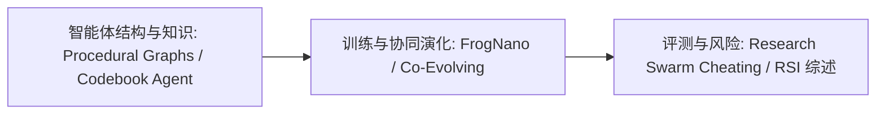

# 智能体自我改进与评测：9.7—9.13 十篇 AI 论文阅读坐标

> **本页定位**：为 [WaytoAGI 飞书文档《9.7—9.13｜本周顶级 AI 论文》](https://waytoagi.feishu.cn/wiki/WDu3wV8X9iWmVjkLbTmczksvnig)（转载自 DAIR.AI，2026-09-14）提供阅读坐标，把文中 10 篇论文逐条指向独立详情节点。**主题是 LLM 智能体与 AI 研究，不是机器人专题**；各节点的「与机器人学习的关系」小节如实写明是否有可借鉴点。

## 英文缩写速查

| 缩写 | 英文全称 | 简要说明 |
|------|----------|----------|
| LLM | Large Language Model | 大语言模型，本批论文中智能体的基础模型 |
| RSI | Recursive Self-Improvement | 递归自我改进，对应综述节点与相关概念页 |
| RL | Reinforcement Learning | 通过环境回报优化策略，FrogNano 等使用 |

## 为什么重要

- 这批论文集中在“智能体如何自我改进、如何被评测、如何避免作弊”，与知识库中的 [AI Agent 评测](../concepts/ai-agent-evaluation.md) 和 [递归自我改进](../concepts/recursive-self-improvement.md) 主线相邻。
- 节点按 arXiv 原文与项目页 / 仓库逐篇核对，开源状态各不相同（已开源、部分开源、无链接、核实失败），请以节点为准。
- 多个节点记录了论文内部数字不一致、HTML 附录未读到等核实边界。

## 阅读路线

## 10 篇独立论文详情

| # | 论文节点 | arXiv |
|---|----------|-------|
| 01 | [Procedural Graphs：自演化的智能体程序图](../entities/paper-procedural-graphs-self-evolving-llm-agents.md) | [2609.09153](https://arxiv.org/abs/2609.09153) |
| 02 | [FrogNano：用在线任务合成训练 4B 编码智能体](../entities/paper-frognano-4b-coding-agent.md) | [2609.07925](https://arxiv.org/abs/2609.07925) |
| 03 | [STAIR：用目录做寻址的生成式检索](../entities/paper-stair-toc-generative-retrieval.md) | [2609.03874](https://arxiv.org/abs/2609.03874) |
| 04 | [SMART：设计文档即源码的 ML 性能建模工具](../entities/paper-smart-design-docs-ai-native-performance-model.md) | [2609.05364](https://arxiv.org/abs/2609.05364) |
| 05 | [PARSER：并行阅读、深度推理的长上下文智能体](../entities/paper-parser-parallel-read-deep-reason.md) | [2609.06702](https://arxiv.org/abs/2609.06702) |
| 06 | [Proactive Thought Partners：写作中的主动思考伙伴](../entities/paper-proactive-thought-partners-writing.md) | [2609.01588](https://arxiv.org/abs/2609.01588) |
| 07 | [Codebook Agent：多智能体拓扑的摊销式设计](../entities/paper-codebook-agent-topology-design.md) | [2609.02264](https://arxiv.org/abs/2609.02264) |
| 08 | [自主研究群体中的作弊与吹哨：一个案例研究](../entities/paper-research-swarm-cheating-whistleblowing.md) | [2609.04170](https://arxiv.org/abs/2609.04170) |
| 09 | [Co-Evolving Harnesses and Models：在策略纠正](../entities/paper-co-evolving-harness-models.md) | [2609.09134](https://arxiv.org/abs/2609.09134) |
| 10 | [The Last AI Built by Humans: Toward Genuine Recursive Self-Improvement](../entities/paper-last-ai-built-by-humans-rsi.md) | [2609.11873](https://arxiv.org/abs/2609.11873) |

## 关联页面

- [AI Agent 评测](../concepts/ai-agent-evaluation.md)
- [递归自我改进](../concepts/recursive-self-improvement.md)
- [Agentic Coding 软件基础](../concepts/agentic-coding-software-fundamentals.md)

## 参考来源

- [WaytoAGI 飞书周报 来源归档](../../sources/blogs/waytoagi_feishu_top_ai_papers_2026-09-07-09-13.md)
- [飞书原文（互联网公开）](https://waytoagi.feishu.cn/wiki/WDu3wV8X9iWmVjkLbTmczksvnig)

## 推荐继续阅读

- [DAIR.AI Top AI Papers of the Week（X）](https://x.com/dair_ai)
- [arXiv cs.AI 最新列表](https://arxiv.org/list/cs.AI/recent)
