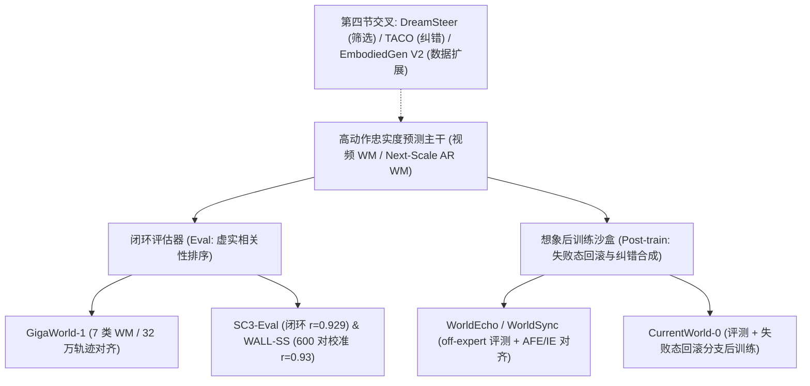

# 世界模型动作后果分类 04：训练与评估闭环

> **分类页**：对应 [具身智能研究室 · 世界模型动作后果专题](https://mp.weixin.qq.com/s/a5ZDDv70CLDfY98mfviWuA) 的 **04 训练与评估闭环** 段；总地图见 [动作后果技术地图](./robot-world-models-action-consequence-technology-map.md)。

## 一句话定义

**本分类梳理把世界模型接入研发管线后端的两大闭环应用：一是以虚实高度相关的闭环生成替代昂贵真机策略排序（Eval），二是通过失败态回滚与想象分支合成反馈纠错信号做策略后训练（Post-train）。**

## 英文缩写速查

| 缩写 | 英文全称 | 简要说明 |
|------|----------|----------|
| WAM | World Action Model | 联合未来观测与动作生成的具身策略 |
| VLA | Vision-Language-Action | 常被修正、筛选或后训练的上层策略 |
| WM | World Model | 预测动作后果的潜变量或视频模型 |
| MoE | Mixture of Experts | 异构动作模态的专家混合架构 |

## 为什么重要

- **打通离线评测与真机部署的最后一公里：** 通过 SC3-Eval、WALL-SS 等闭环评测器可将虚实成功率 Pearson/Spearman 相关性推高到 \(r \approx 0.93\) 量级，使新策略上线前的多候选筛查成本大幅降低。
- **把失败轨迹转化为可复用的纠错经验：** WorldEcho / WorldSync 与 CurrentWorld-0 展示了世界模型不仅是「裁判」，还可从失败状态回滚分叉，生成合规纠错数据用于后训练。

## 核心机制与本组工作

该路线通常由「高动作忠实度预测主干（动作条件视频 WM 或 Next-Scale AR WM）+ 非专家反例对齐配方（如 AFE/IE 或自一致约束）+ 失败分支回滚 / 虚实校准」组成，分别承担策略评估器和想象后训练沙盒两种角色。

| 工作 | Wiki 实体 | 文内角色 |
|------|-----------|----------|
| GigaWorld-1 | [../entities/paper-gigaworld-1-policy-evaluation](../entities/paper-gigaworld-1-policy-evaluation.md) | 7 类视频 WM + 32 万轨迹研究策略评估对齐 |
| SC3-Eval | [../entities/paper-sc3-eval](../entities/paper-sc3-eval.md) | 自一致视频生成作真机 VLA 评估器（闭环 \(r=0.929\)） |
| WorldEcho / WorldSync | [../entities/paper-worldecho-worldsync](../entities/paper-worldecho-worldsync.md) | off-expert 动作跟随评测 + AFE/IE 对齐；作策略改进模拟器（确认未开源） |
| CurrentWorld-0 | [../entities/current-robotics-currentworld](../entities/current-robotics-currentworld.md) | 产业侧交互模拟器：评测 + 失败态回滚分支后训练（确认未开源） |
| WALL-SS（路线外延） | [../entities/paper-wall-ss](../entities/paper-wall-ss.md) | next-scale AR 流式 WM；600 对虚实成功率 \(r=0.93\)（训练代码待发布） |

### 交叉引用（文内第四节）

| 工作 | Wiki 实体 | 角色 |
|------|-----------|------|
| DreamSteer | [../entities/paper-dreamsteer-vla-deployment-steering](../entities/paper-dreamsteer-vla-deployment-steering.md) | 部署前候选动作筛选 |
| TACO | [../entities/paper-taco-tactile-wm-vla-posttrain](../entities/paper-taco-tactile-wm-vla-posttrain.md) | 失败片段纠错后训练 |
| EmbodiedGen V2 | [../entities/paper-embodiedgen-v2-sim-ready-world-engine](../entities/paper-embodiedgen-v2-sim-ready-world-engine.md) | 环境与数据扩展 |

## 工程实践

- **把「虚实相关性验证」作为评测器上线前置条件：** 对照 SC3-Eval（闭环 \(r=0.929\)）与 WALL-SS（600 对虚实校准 \(r=0.93\)），新世界模型充当策略考场前，必须先跑通不同水平策略的真实排序相关性校验。
- **失败态样本优先进入微调闭环：** 构建 WorldEcho / WorldSync 类非专家数据集或 CurrentWorld-0 类分支回滚时，重点采集接近失败边界与恢复动作片段，而不是只喂成功专家演示。

## 常见误区或局限

- **闭源产业系统复现受限：** WorldEcho / WorldSync 与 CurrentWorld-0 均已确认未开源，且部分技术报告未给出完整超参、算力开销或跨本体泛化界限。
- **评估偏差与自圆其说风险：** 若后训练策略直接优化同一世界模型打分而缺乏真机定期校准，策略可能利用模型幻觉捷径（reward hacking）而非提升真实操作物理成功率。

## 架构与路线图

## 关联页面

- [World Action Models](../concepts/world-action-models.md)
- [动作后果技术地图](./robot-world-models-action-consequence-technology-map.md)
- [CurrentWorld-0](../entities/current-robotics-currentworld.md) — 跨本体交互 WM 作评测/后训练沙盒
- [WALL-SS](../entities/paper-wall-ss.md) — next-scale AR + 虚实校准（自变量，2026-08）
- [WorldEcho / WorldSync](../entities/paper-worldecho-worldsync.md) — 动作跟随评测与对齐配方（arXiv:2608.24885）

## 参考来源

- [wechat_embodied_ai_lab_robot_world_models_action_consequence_2026.md](../../sources/blogs/wechat_embodied_ai_lab_robot_world_models_action_consequence_2026.md)
- [current_robotics_currentworld.md](../../sources/blogs/current_robotics_currentworld.md)
- [sc3_eval_arxiv_2606_18610.md](../../sources/papers/sc3_eval_arxiv_2606_18610.md)
- [worldecho_worldsync_arxiv_2608_24885.md](../../sources/papers/worldecho_worldsync_arxiv_2608_24885.md)

## 推荐继续阅读

- [具身世界模型六路线 · 评估主导型](./embodied-wm-route-evaluation.md)
- [动作后果技术地图](./robot-world-models-action-consequence-technology-map.md)
