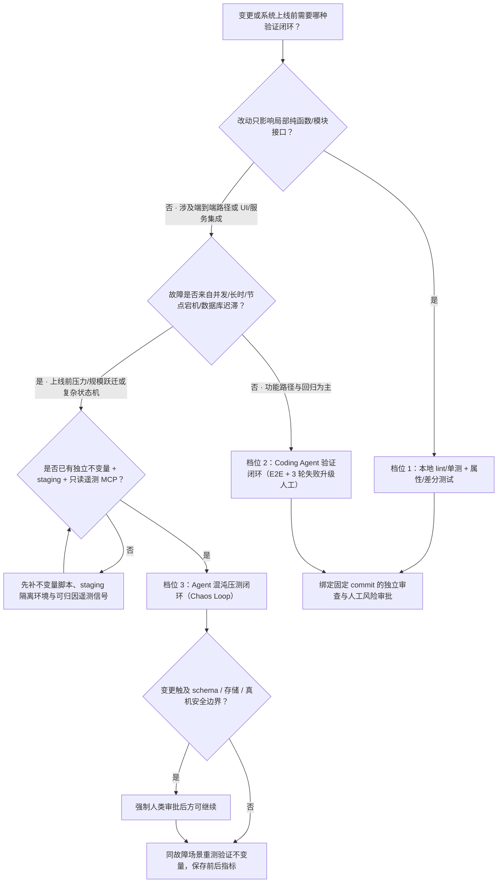

# Query：Coding Agent 验证闭环与混沌压测闭环（Chaos Loop）工程选型

> **Query 产物**：本页由以下问题触发：「团队已经用 Coding Agent 写代码并跑单测/PR 评审，什么时候该停在单 PR 验证闭环，什么时候必须升级到预生产混沌压测闭环（Chaos Loop）？两者在验证证据、遥测接口、人工门禁、成本与机器人控制软件迁移上如何取舍？」
> 综合来源：[Agent 驱动的混沌压测闭环](../methods/agent-driven-chaos-testing-loop.md)、[Coding Agent 验证闭环](../methods/coding-agent-verification-loops.md)、[Coding Agent 验证与代码评审](../comparisons/coding-agent-verification-vs-code-review.md)、[Claude Docs Chaos Loop 原文归档](../../sources/blogs/claude_dev_chaos_loop_docs_launch_2026-11-17.md)、[Claude Code 验证实践原文归档](../../sources/blogs/claude_dev_verification_addy_osmani_2026-11-16.md)。

## 一句话定义

**单 PR 验证闭环**解决「这一次改动是否破坏已定义路径与不变量」，而**Agent 混沌压测闭环（Chaos Loop）**把验证推向「连续多轮 10× 负载、断连与宕机故障注入 → 遥测归因 → 可逆修复 → 同条件重测」；两者是按故障成本与状态耦合度逐档升级的工程连续体，而非互斥替代。

## 英文缩写速查

| 缩写 | 英文全称 | 简要说明 |
| --- | --- | --- |
| E2E | End-to-End | 在可启动的真实系统上执行端到端用户或服务路径 |
| MCP | Model Context Protocol | 工具只读接口协议，例如让 Agent 读取 Datadog 遥测 |
| COW | Copy-on-Write | 写时复制数据结构优化，避免按键或编辑时重复拷贝 |
| PR | Pull Request | 绑定代码差异、行为验证证据与人工风险评审的单元 |
| CI | Continuous Integration | 每次提交或合并前自动执行的低成本构建与测试门禁 |
| HIL | Human-in-the-Loop | Schema、存储布局、真机上机等高风险决策的人工审批 |

## 为什么重要

1. **避免把「PR 全绿」当成「上线或上机稳定」：** 单 PR 内的 E2E、属性与差分测试只覆盖开发者预先设想的路径与样例；当系统面临高并发重连、慢查询放大、内存泄漏或节点宕机时，故障往往出现在跨模块状态耦合与长时运行中。
2. **避免在低风险模块过度烧算力：** Chaos Loop 在 Claude Docs 案例中持续约两周、峰值并发 30 个 sub-agent，按 Fable 5.2 API 牌价累计约 12.5 万美元（文章对小服务的 3,000–10,000 美元类比只是未实测粗估）；没有先过低成本静态检查、单 PR E2E 与可观察信号建设就直接上长周期混沌压测，只会放大噪声与成本。
3. **防止权限越界：** 两篇工程复盘共同的底线是「Agent 负责提出可验证证据与可逆修改，不可回滚的 schema/存储变更、评分规则文件（`REVIEW.md`）修改权与生产/真机放行权必须留在人类手中」。

## 选型决策树与分档对照

| 维度 | 档位 2：Coding Agent 验证闭环 | 档位 3：Agent 混沌压测闭环（Chaos Loop） |
| --- | --- | --- |
| **核心问题** | 这次 diff 在真实应用里是否按预期工作？ | 系统在 10× 负载、断连风暴与部分失效下能否守住业务不变量？ |
| **触发时机** | 每次 PR 提交 / 合并队列前 | 重大架构上线前、吞吐量级跃迁前、长程稳定性加固窗口 |
| **核心手段** | `.claude/skills/verify` 驱动 E2E、属性测试、差分测试 | Harness 在 staging 施压/杀实例/慢数据库 + 读遥测反证假设 |
| **收敛判据** | diff 触发的 3–10 项可靠性检查通过；连续 3 轮失败升级人工 | 预设硬不变量（如长文档即时打开、已确认编辑零丢失）在同场景重测通过 |
| **可观测性要求** | 运行日志、trace、失败截图与退出码 | 细粒度 query 名、扫描/返回行数、pod/进程内存剖析、p95/p99 时延（如经 Datadog MCP 只读） |
| **人工把门边界** | `REVIEW.md` 锁定在 default branch；按风险等级要求 1–2 人审 | 难以回滚的 schema、key layout、存储与物化方案及生产发布必须人工批准 |
| **已报告参考成本** | 单 PR 随 CI 时长与局部修复轮次线性增长 | Claude Docs 两周案例作者自述约 12.5 万美元（Fable 5.2 牌价）；无独立审计对照 |

## 工程落地与门禁清单

### 1. 升级到 Chaos Loop 前的三项前置条件

1. **先把成功条件写成独立不变量，而不是「提高稳定性」：** 像 Claude Docs 冻结「长历史文档即时打开」与「服务端已确认编辑不丢失」一样，每轮注入后由独立脚本/探针判定是否守住不变量，绝不采用 Agent 的口头自评。
2. **先做局部验证与门禁灰度（`off → observe → enforce`）：** 便宜的 lint、构建与单 PR E2E 先拦掉低级回归；新增审查或校验规则先观察误报率并由历史事故/revert 集校准，再开启阻断。
3. **补齐可归因遥测而非只给笼统报错：** 若指标无法区分是哪条查询、哪个数据结构或哪个消息队列导致内存/时延飙升（如 Claude Docs 初次缩缓存假设被遥测推翻后改查到按键重复拷贝并替换为 COW，单文档内存从约 3 GB 降至约 180 MB），Agent 只能盲目叠补丁。

### 2. 机器人软件与控制系统的迁移边界

- **只迁移软件侧环路，不越过物理安全边界：** 对 ROS 2 节点通信中断、控制进程重启、仿真长时间 rollout、传感器掉帧与状态机超时切换，可在隔离的仿真/HIL（非实机带电自由运动）或预生产镜像里套用「不变量 + 故障注入 + 遥测归因 + 同场景重测」。
- **不可替代的机器人验收门禁：** 软件级 E2E 或混沌压测全绿**不能**替代控制周期/jitter 实测、关节限位与力矩饱和检查、硬件急停链路验证与人工上机审批；不得把自动故障注入直接接到无机械/电气保护的真实机器人执行器上。

## 局限与风险

- **一手证据均为团队工程复盘：** 两篇核心来源（2026-11-16 与 2026-11-17 工程博客）均未开源内部 CI harness、完整评测脚本与原始运行日志，文中提到的约 90% 编写率、629 次发布无回滚及 12.5 万美元等数字属于作者自述，不能当成跨团队通用基准。
- **长程目标漂移与算力放大风险：** 长时间多 sub-agent 闭环存在 goal drift 与无效试错烧钱风险，必须保留轮次上限（如三轮失败升级人工）与预算熔断。
- **语言与技术栈不可过度外推：** Claude Docs 采用 Rust 与少依赖提升内存可归因性，但作者未做 Rust 与 Go 的对照实验，不能由此推出「带 GC 语言不适合 Agent 运维」。

## 关联页面

- [Agent 驱动的混沌压测闭环](../methods/agent-driven-chaos-testing-loop.md) — 本文详述的阶段划分、流程总览与工程方法本体
- [Coding Agent 验证闭环](../methods/coding-agent-verification-loops.md) — E2E、属性测试、差分测试与验证器校准细节
- [Coding Agent 验证与代码评审](../comparisons/coding-agent-verification-vs-code-review.md) — 验证证据与独立 diff 评审的职责切分
- [Claude Code 动态多 Agent 工作流](../methods/claude-code-dynamic-workflows.md) — 创建隔离 harness 与协调 sub-agent 扇出的方法
- [可观测性：日志、指标与链路追踪](../concepts/observability-logs-metrics-tracing.md) — 将系统运行态转化为可归因遥测的基础
- [多 Agent 编码管理与认知把关](../concepts/coding-agent-orchestration-and-cognitive-oversight.md) — 人工审批容量与委托边界
- [AI Agent 评测](../concepts/ai-agent-evaluation.md) — 防止执行者篡改验证标准与评测过拟合
- [RSI 纵深路线](../../roadmap/depth-rsi.md) — 区分工程压测闭环与权重/算法级递归自改进

## 参考来源

- [Using a "chaos loop" to harden the Claude Docs launch（2026-11-17，原文研读归档）](../../sources/blogs/claude_dev_chaos_loop_docs_launch_2026-11-17.md) — Vivek Nair，Anthropic
- [How the Claude Code team thinks about verification（2026-11-16，原文研读归档）](../../sources/blogs/claude_dev_verification_addy_osmani_2026-11-16.md) — Addy Osmani，Claude Code 工程团队

## 推荐继续阅读

- [官方工程博客：Using a "chaos loop" to harden the Claude Docs launch](https://claude.dev/blog/chaos-loop-claude-docs-launch/)
- [官方工程博客：How the Claude Code team thinks about verification](https://claude.dev/blog/how-the-claude-code-team-thinks-about-verification/)
