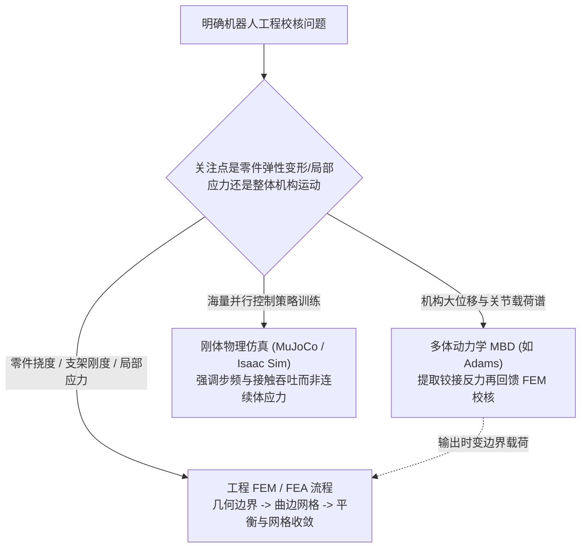

# Query：机器人结构 FEM/FEA 仿真何时该上、如何做收敛与可信度验证？

> **Query 产物**：本页由以下问题触发：「机器人结构件变形、应力校核与机构动力学验证时，什么时候必须走 FEM/FEA 工程仿真建模与验证流程，什么时候用多体动力学（MBD）或刚体 RL 仿真，拿到彩色应力云图后怎样做网格收敛与平衡验收？」
> 综合来源：[工程仿真建模与验证流程](../methods/engineering-simulation-workflow.md)、[参数化 CAD 建模流程](../methods/parametric-cad-workflow.md)、[结构公差与仿真工具链](../concepts/structure-tolerance-simulation-toolchain.md)、[Adams vs MuJoCo vs Isaac Sim 三类仿真问题](../comparisons/adams-vs-mujoco-vs-isaac-sim-three-problem-types.md)

## 一句话结论

**刚体动力学与 RL 仿真算运动和策略，多体动力学（MBD）算机构大位移与铰接载荷谱，而有限元（FEM/FEA）用于校核零部件局部变形、刚度与应力分布**；在交付任何 FEA 结果前，必须完成关注量（QoI）定义、粗细网格收敛、反力-外载平衡检查与几何奇异点排除。

## 英文缩写速查

| 缩写 | 英文全称 | 简要说明 |
|---|---|---|
| FEM / FEA | Finite Element Method / Finite Element Analysis | 连续体偏微分方程离散求解与结构工程仿真分析 |
| MBD | Multi-Body Dynamics | 多体动力学，求解运动副连接机构的大范围刚体/柔性运动与关节载荷 |
| QoI | Quantity of Interest | 仿真重点关心的物理输出量（如末端挠度、关键截面应力） |
| CAD | Computer-Aided Design | 计算机辅助设计，FEM 几何与装配约束的上游来源 |
| V&V | Verification and Validation | 数值求解验证（收敛/守恒）与物理试验对标确认 |

## 选型决策路径与三类仿真分工

| 维度 | 工程 FEM / FEA（[Engineering Simulation Workflow](../methods/engineering-simulation-workflow.md)） | 多体动力学 MBD | 刚体 RL/SIL 仿真 |
|---|---|---|---|
| **核心输出** | 位移场、应变/应力张量、模态频率与支反力 | 机构轨迹、接触脉冲与运动副时变载荷 | 策略奖励、控制跟踪误差与任务成功率 |
| **连续体假设** | 小应变线弹性起手；塑性/接触/屈曲须显式换非线性本构 | 默认刚体为主（可局部挂模态柔性体） | 刚体 + 简化接触/执行器模型 |
| **时间与网格成本** | 随自由度与曲面阶次迅速增长，通常离线校核 | 中等时间步长 ODE/DAE 求解 | 微秒/毫秒级高并发步进 |
| **典型误用** | 把线弹性尖角奇异峰值直接当屈服失效判据 | 直接用 MBD 代替零件截面疲劳/应力集中校核 | 用刚体仿真结果推断连杆或减速器外壳结构强度 |

## 工程收敛与验收四步核查

1. **先锁定 QoI 与解析量级估算**：在网格剖分前先定义关键评价量（如臂端下垂位移、法兰螺栓孔周边应力）和简单梁/杆理论的量级预估，防止被局部峰值误导。
2. **粗细网格收敛对比（Mesh Convergence）**：至少跑两到三档网格密度，确认 QoI 随单元加密趋于稳定；若某尖角处应力随加密无限发散，多为直角/点载荷引起的**数值奇异点**而非真实物理屈服。
3. **全局反力与外载平衡校核**：汇总所有固定端支反力并与施加外载对比，确认静力平衡误差在数值容差内，排除边界条件漏约束或接触穿透异常。
4. **守住线弹性与单一物理场边界**：线弹性静力分析结果不直接外推为大变形屈曲、接触滑移、热耦合或疲劳寿命结论；需要这些结论时须切换到对应非线性或耦合求解设置并用台架实测标定。

**一手证据对应：** NGSolve 固定版本算例建立带孔三维实体，离散线弹性方程、求位移并后处理应力；显示放大的变形不是实际位移。该算例没有交付该结构件的台架对比或网格收敛报告。上面的关注量、平衡与收敛检查是验收建议；有材料或接触非线性时不能直接沿用该线弹性结论。

## 局限与风险

- **几何与边界条件简化失真**：忽略倒角、轴承预紧、螺栓连接刚度或把分布接触简化为刚性固定，常导致刚度高估或支反力失真。
- **跨尺度串联的误差传递**：用 [参数化 CAD 建模流程](../methods/parametric-cad-workflow.md) 导出几何后，还需保留命名边界组与材料属性映射，避免网格重划分时丢失载荷面标识。
- **证据边界**：本页结合 [工程仿真建模与验证流程](../methods/engineering-simulation-workflow.md)（NGSolve 3D 线弹性示例）与站内多体/公差综述编写，未对具体硬件结构件运行独立物理台架校核。

## 关联页面

- [工程仿真建模与验证流程](../methods/engineering-simulation-workflow.md) — 几何边界、网格生成、求解与网格收敛验证标准步骤
- [参数化 CAD 建模流程](../methods/parametric-cad-workflow.md) — 上游 CadQuery / OCCT 几何与 STEP 导出规范
- [结构公差与仿真工具链](../concepts/structure-tolerance-simulation-toolchain.md) — 公差、装配约束与多物理仿真协同背景
- [Adams vs MuJoCo vs Isaac Sim 三类仿真问题](../comparisons/adams-vs-mujoco-vs-isaac-sim-three-problem-types.md) — MBD、刚体 RL 与 SIL 三类仿真的边界对照
- [机器人仿真三层架构](../concepts/robot-simulation-three-layers.md) — 物理引擎、渲染与任务逻辑分层

## 参考来源

- [工程仿真建模与验证流程一手方法归档](../../sources/sites/platform-method-engineering-simulation-workflow.md)
- [结构公差与仿真工具链归档](../../sources/blogs/wechat_zane_hub_structure_tolerance_simulation_toolchain_2026-10-17.md)

## 推荐继续阅读

- [NGSolve 官方文档与有限元案例](https://ngsolve.org/docu/latest/)
