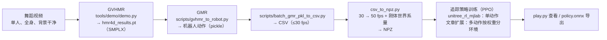

# Query：视频里的舞蹈怎么搬到 G1？GVHMR → GMR → BeyondMimic 多动作训练实操

> **Query 产物**：本页由以下问题触发：「想把短视频里的舞蹈搬到 Unitree G1，从视频到可部署的追踪策略，每一步该用什么、命令是什么、哪里容易踩坑？」
> 综合来源：[GVHMR](../entities/gvhmr.md)、[GMR 重定向](../methods/motion-retargeting-gmr.md)、[BeyondMimic](../methods/beyondmimic.md)、[unitree_rl_mjlab](../entities/unitree-rl-mjlab.md)、[mjlab](../entities/mjlab.md)，以及深蓝学院教程的[来源归档](../../sources/blogs/wechat_shenlan_g1_beyondmimic_31_dances_2026-11-06.md)（含我对四个官方仓库的静态核对）。

## TL;DR 流水线

| 步骤 | 命令（作者给出，我核对了参数名） | 产物 | 核对要点 |
|------|----------------------------------|------|----------|
| ① 选视频 | — | 视频片段 | 全身全程可见、单人、背景简洁、光照均匀（作者表述）；误差会一路传到训练 |
| ② GVHMR | `python tools/demo/demo.py --video <视频> -s` | `outputs/demo/<名>/hmr4d_results.pt` | **`-s` 是 `--static_cam`（跳过 DPVO），不是「保存」**；GVHMR 全称见下 |
| ③ GMR 重定向 | `python scripts/gvhmr_to_robot.py --gvhmr_pred_file <pt> --robot unitree_g1 --record_video --save_path <路径>` | 机器人动作文件 | 代码用 `pickle.dump` 写出，**不看扩展名**；后续脚本要求 `.pkl` |
| ④ 转 CSV | `python scripts/batch_gmr_pkl_to_csv.py --folder <目录>` | `<目录>/csv/*.csv`：root_pos(3) + root_quat(4, xyzw) + 关节角 | 只处理 `.pkl`；> 30 fps 会降到 30 fps |
| ⑤ 转 NPZ | `csv_to_npz.py`（输入 30 fps → 输出 50 fps） | NPZ：fps、joint_pos/vel、body_pos/quat/lin_vel/ang_vel（世界系） | 两个仓库各有一份同名脚本，**参数写法与实现不同**，见下 |
| ⑥ 训练 | `scripts/train.py Unitree-G1-Tracking-No-State-Estimation --motion_file=<单个 npz> --env.scene.num-envs=4096` | `logs/rsl_rl/g1_tracking/.../model_*.pt` | 官方一次只训一个动作；多动作是作者自己的扩展 |
| ⑦ 回放 | `scripts/play.py ... --checkpoint_file=...` | 可视化；训练时同时导出 `policy.onnx` | 文章建议 viser 后端 |

## 多动作训练：按权重分环境（作者的扩展）

官方 unitree_rl_mjlab 与（已退役的）whole_body_tracking 都只接受一个 `--motion_file`。作者加了 `MultiMotionCommands` 与 `train_multi.py`，用 yaml 列出每个动作文件和权重，再按权重把并行环境分给各动作：

| 例子 | 动作权重 | 总环境数 | 各动作环境数 |
|------|----------|----------|--------------|
| 狗熊哆嗦毛 / 闪身步 / 浪子踢球 | 1 / 1 / 2 | 4096 | 1024 / 1024 / 2048 |

文章的完整设置：31 个动作，较难的（狗熊哆嗦毛、浪子踢球）权重 2，其余 1；13312 个环境；约 20000 轮；RTX 5080 约 23 小时；最终 mean_reward 约 32。**这些数字是作者表述，未核实；扩展代码在文章与官方仓库里都没有，没有真机结果。**

## 文章说法与一手资料的出入

| 文章说法 | 一手核对（静态阅读官方仓库，未运行） |
|----------|----------------------------------------|
| GVHMR = Global-View Human Motion Recovery | arXiv:2409.06662 题名为 *World-Grounded Human Motion Recovery via Gravity-View Coordinates*（见 [GVHMR 节点](../entities/gvhmr.md)） |
| `-s` 表示保存结果 | `demo.py` 的 `-s/--static_cam`：If true, skip DPVO；README 示例里 `-s` 同义 |
| `--save_path` 输出 `.pkl`，示例却写 `.npz` | 写出的永远是 pickle；`batch_gmr_pkl_to_csv.py` 只处理 `.pkl`，`.npz` 命名的文件会被跳过（推断） |
| 官方库只支持单动作 | 成立：`train.py` 只收一个 `--motion_file`，仓库内无 `train_multi` / `MultiMotion` |
| BeyondMimic 官方库 whole_body_tracking 可用 | README 标注 **retired**，实现转到 mjlab 的 tracking task |
| 「基于 Isaac Lab / 在 Isaac Sim 做 FK 并上传 WandB Registry」 | 这是 whole_body_tracking 的 `csv_to_npz.py`（Isaac Lab）；文中实际用的 unitree_rl_mjlab 版用 MuJoCo 时间步长、没有 wandb / registry 字样（文章把两套工具链混在一起，推测） |
| G1 有 23 或 29 个可控关节 | 成立：GMR 的 `unitree_g1` 为 29 DoF；unitree_rl_mjlab 另有 `Unitree-G1-23Dof-Tracking-No-State-Estimation` |

## 英文缩写速查

| 缩写 | 英文全称 | 简要说明 |
|------|----------|----------|
| GVHMR | World-Grounded Human Motion Recovery via Gravity-View Coordinates | 从单目视频恢复世界系人体运动 |
| GMR | General Motion Retargeting | 通用动作重定向，人体 → 机器人 |
| SMPLX | SMPL eXpressive | 带手部与表情的参数化人体模型 |
| DPVO | Deep Patch Visual Odometry | GVHMR 里估计相机运动的模块（`-s` 跳过它） |
| NPZ | NumPy zipped archive | 追踪训练使用的参考动作文件格式 |
| PPO | Proximal Policy Optimization | 追踪策略的训练算法 |
| WBT | Whole-Body Tracking | 全身动作追踪（BeyondMimic 的任务名） |

## 落地时的取舍与风险

- **视频质量决定上限：** 遮挡、多人、半身入镜会让腿部轨迹残缺，后面无法补救（作者表述）。
- **运动学可行 ≠ 物理上站得住：** 重定向只保证姿势摆得出，单脚支撑平衡、转身角动量和落地冲击要靠追踪策略在物理仿真里学（作者表述，与 [BeyondMimic](../methods/beyondmimic.md) 页一致）。
- **工具链选哪套：** 官方 BeyondMimic 库已退役，追踪实现在 mjlab；若沿用旧教程里的 Isaac Lab + WandB Registry 路线，要注意与 unitree_rl_mjlab 的脚本不通用。
- **没有真机证据：** 文章只给仿真回放；上真机前仍需按 [Sim2Real 检查清单](./sim2real-checklist.md) 检查。

## 参考来源

- [深蓝学院教程（微信归档，含一手核对）](../../sources/blogs/wechat_shenlan_g1_beyondmimic_31_dances_2026-11-06.md)
- [BeyondMimic 论文来源归档（arXiv:2508.08241）](../../sources/papers/bfm_awesome_beyondmimic_arxiv_2508_08241.md)

## 关联页面

- [GVHMR](../entities/gvhmr.md)
- [GMR 动作重定向](../methods/motion-retargeting-gmr.md)
- [BeyondMimic](../methods/beyondmimic.md)
- [unitree_rl_mjlab](../entities/unitree-rl-mjlab.md)
- [mjlab](../entities/mjlab.md)
- [Unitree G1](../entities/unitree-g1.md)
- [Isaac Lab](../entities/isaac-lab.md)
- [Motion Retargeting](../concepts/motion-retargeting.md)
- [Sim2Real 检查清单](./sim2real-checklist.md)

## 一句话记忆

视频 → GVHMR → GMR → CSV → NPZ → 追踪训练：每一步的格式都不通用，`-s` 是静态相机、GMR 写的是 pickle、官方 BeyondMimic 库已退役，多动作训练是自己扩展的。
