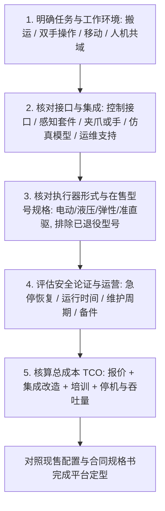

# 主流人形机器人硬件对比

> **Query 产物**：本页由问题「主流人形机器人硬件平台横向对比」触发。
> Query 类型：对比分析
> 生成日期：2026-04-15
> 问题：主流人形机器人平台在硬件能力上有何差异？如何根据任务选择平台？

---

## 英文缩写速查

| 缩写 | 英文全称 | 简要说明 |
|------|----------|----------|
| DoF | Degrees of Freedom | 自由度；用于描述机器人关节/运动维数 |
| WBC | Whole-Body Control | 全身控制；关联多关节任务协调 |
| RL | Reinforcement Learning | 强化学习；作为硬件平台上层控制/训练路线的比较背景 |

## 口径说明

以下是供应商公开资料中的代表性信息，不能直接作为同口径性能排名。不同代际、选配和配置会影响规格；采购前请核对对应型号的当前规格书与合同配置。页面复核日期：2026-10-23。

## 平台速览

| 平台 | 官方公开信息 | 状态口径 |
|------|---------------|----------|
| Boston Dynamics Atlas（电动版） | 56 DoF、90 kg；瞬时负载 50 kg、持续负载 30 kg | 官方面向工业应用，具体交付配置以供应商为准 |
| Unitree G1 | 23–43 个关节自由度；约 35 kg（含电池） | 官方产品页列有不同配置 |
| Agility Digit | Agility 在 2026 年称 Digit 4 累计超过 65,000 小时现场运行；Digit 5 仍在开发 | 运行时长是公司披露，不等同于不同任务间可比的性能指标 |
| Figure F.03 | Figure 当前产品页面展示 F.03；公司已于 2026-09 宣布退役 F.02 | 比较当前产品时不应再把 F.02 当作现售/在研主型号 |

## 选型时应核对

- **任务与工作环境**：搬运、双手操作、移动、人与机器人共域，以及工作站是否为人形尺度。
- **接口与集成**：可用的控制接口、感知套件、夹爪/手、仿真模型、开发者支持和现场运维能力。
- **安全与运营**：安全论证、急停和恢复流程、运行时间、维护周期、备件及远程监控。
- **总成本**：价格、集成改造、培训、维护、停机和任务吞吐量；单看机器人报价或峰值负载不足以决策。

执行器形式（电动、液压、弹性或准直驱）会影响控制带宽、顺应性、维护和能耗，但不能单独推出某平台的任务能力。应以具体版本的执行器和力/位置反馈规格为准，不把不同平台泛化成统一结论。

## 流程与架构图

## 关联页面
- [人形机器人总览](../entities/humanoid-robot.md)
- [全身运动控制](../concepts/whole-body-control.md)
- [Locomotion 任务](../tasks/locomotion.md)
- [WBC vs RL 对比](../comparisons/wbc-vs-rl.md)

## 参考来源
- [Unitree G1 官方产品页规格通读](../../sources/sites/unitree_g1_product_page_reading_g1spec.md)（原文：<https://www.unitree.com/g1>）
- [Agility Robotics 官网与 Digit 5 核查](../../sources/sites/agility-robotics.md)（原文：<https://www.agilityrobotics.com/solutions/digit-5>）
- [Humanoid Hardware 101 全文落盘](../../sources/raw/wechat_humanoid_hardware_101_2026-06-01.md)
- [Boston Dynamics Atlas](https://bostondynamics.com/products/atlas/)
- [Figure: F.02 Decommission](https://www.figure.ai/news/f-02-decommission)
- [原始硬件对比资料](../../sources/papers/humanoid_hardware.md)
