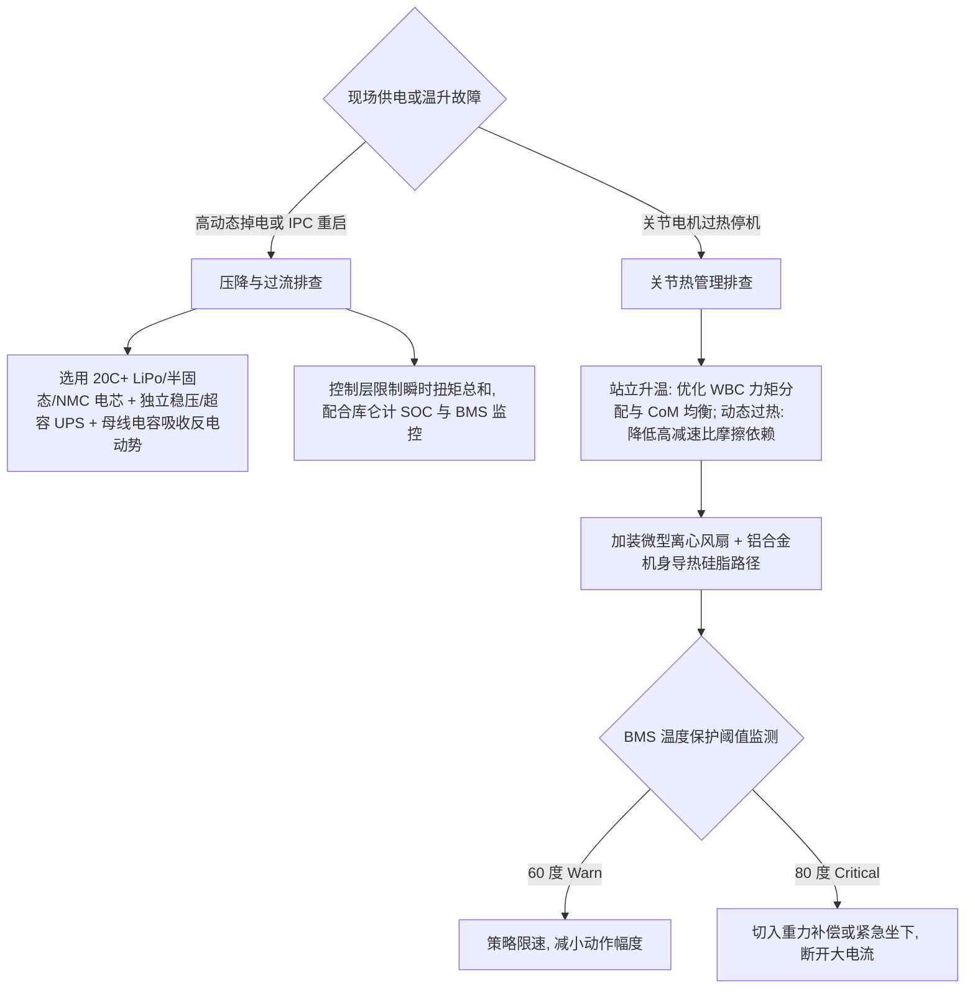

# 人形机器人电池与热管理指南

> **Query 产物**：本页由以下问题触发：「人形机器人在做高动态动作时电池掉电极快，且关节电机经常过热停机，怎么排查和优化？」
> 综合来源：[Know-how](../overview/humanoid-motion-control-know-how.md)、[Humanoid Hardware](../entities/humanoid-robot.md)

---

人形机器人的能量密度要求极高。一个具有 20-40 个关节的系统，在执行跳跃或快速行走时，瞬时峰值功率可能达到数千瓦。

## 英文缩写速查

| 缩写 | 英文全称 | 简要说明 |
|------|----------|----------|
| BMS | Battery Management System | 电池管理系统 |
| WBC | Whole-Body Control | 协调全身关节满足多任务/约束的控制基础设施 |
| CoM | Center of Mass | 质心，平衡与 locomotion 规划的核心状态量 |
| Locomotion | Robot Locomotion | 足式/人形等无轮移动能力的总称 |

## 1. 电池系统 (Battery Management)

### C 速率与放电曲线
- **需求**：普通的航模电池可能无法支撑人形机器人的持续高动态输出。必须选择 **高 C 速率 (20C+)** 的锂聚合物 (LiPo) 或半固态电池。
- **压降 (Voltage Sag) 处理**：当电机全力启动时，电池端电压会瞬间骤降，可能导致主板（IPC）掉电。
  - **硬件对策**：IPC 必须使用独立的降压稳压模块或带有超级电容的 UPS。
  - **软件对策**：在控制层限制瞬时扭矩总和，防止触发 BMS 的过流保护。

### 监控重点
- **电芯一致性**：人形机器人重心敏感，不平衡的电芯可能导致电池局部过热甚至起火。
- **实时 SOC 估算**：不能只看电压，必须结合库仑计进行精确计算。

## 2. 热管理 (Thermal Management)

关节电机通常 be 封装在狭小的连杆内，散热条件极差。

### 关节过热排障流程
1. **检查力矩分配 (WBC Tuning)**：如果机器人静止站立时某个关节温度持续升高，说明 WBC 分配的静态力矩过大。尝试优化质心位置（CoM），让重力更均衡地分布在支撑腿上。
2. **降低减速比依赖**：过高的减速比（如谐波减速器）会产生巨大的内部摩擦热。
3. **主动散热**：对于大功率髋关节和膝关节，加装微型离心风扇进行强迫对流是必要的。

### 保护逻辑
- **两级警告**：
  - **Warn** (60°C)：策略限速，减少动作幅度。
  - **Critical** (80°C)：系统切入“重力补偿”或“紧急坐下”模式，断开大电流。

## 3. 工程最佳实践

- **母线电容设计**：在每个关节驱动器端并联高耐压电容，吸收电机刹车时的反向感应电动势（Regenerative Braking），防止烧毁 BMS。
- **电芯体系与封装热权衡**：三元 NMC（高能量密度与 >10 C 峰值脉冲能力）vs 磷酸铁锂 LFP（低能量密度但高温晶格稳定性强）；圆柱电芯天然留出蜂窝流道便于风/液散热，方形电芯体积效率高但无自然气隙须配冷板，软包减重达 30% 但抗穿刺依赖刚性壳体保护；监测保护芯片如 TI BQ76952（3–16 串）需配合外部热敏电阻与功率级保护开关组成完整认证 BMS（UL 2271 口径）。
- **导热路径**：利用铝合金机身作为巨大的散热片，确保电机外壳与结构件之间有良好的导热硅脂连接。

## 流程与架构图

## 关联页面
- [Humanoid Hardware 101 · 能源与计算电子](../overview/humanoid-hardware-101-power-compute-electronics.md)
- [人形机器人运动控制 Know-How](../overview/humanoid-motion-control-know-how.md)
- [人形机器人 (Humanoid Robot)](../entities/humanoid-robot.md)
- [实时运控中间件配置指南](./real-time-control-middleware-guide.md)
- [Locomotion 任务](../tasks/locomotion.md)

## 参考来源
- [Humanoid Hardware 101（电池、计算与 PCB 全文落盘）](../../sources/raw/wechat_humanoid_hardware_101_2026-06-01.md) — NMC/NCA/LFP 选型、圆柱/方形/软包热管理与 >10 C 峰值倍率分析
- [TI BQ76952 与 Jetson Thor 官方资料复核](../../sources/sites/robot-energy-compute-pcb-review.md) — 3–16 串电芯监测/保护 IC 与端侧算力热包络（40–130 W）
- [humanoid-motion-control-know-how.md](../overview/humanoid-motion-control-know-how.md)
- [sources/papers/humanoid_motion_control_know_how.md](../../sources/papers/humanoid_motion_control_know_how.md)
