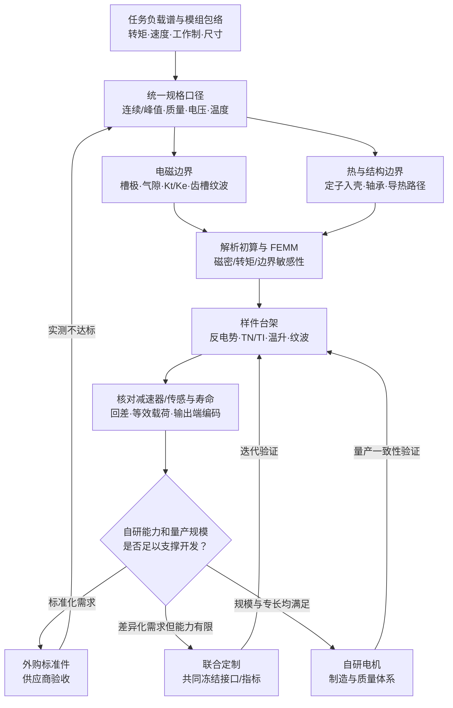

> **Query 产物**：回答「关节模组设计工程师是否需要自学电机设计、学到什么深度，以及如何用所学评估自研、外购和联合定制？」；输出电磁—热—机械协同学习路径、规格书核对要点与供应商决策框架。
>
> **Query 来源：** [Zane Hub，2026-11-22《关节模组设计工程师有没有必要自学电机设计？》](../../sources/blogs/wechat_zanehub_joint_module_engineer_motor_design_2026-11-22.md)。这是对原文论点的工程化编译，并对标准名称、寿命公式与精度口径补充独立核验；不是原文逐字转载。

# 关节模组工程师的电机设计学习边界与自研/外购决策 / Motor Design Literacy for Joint Module Engineers

## 一句话定义

**关节模组机械设计工程师值得自学电机设计，但目标应是「能独立评估与电磁—热—机械耦合有关的供应商方案」而不是「必须独立做出量产级电机」**：能定义工况、读懂 TN/TI、检查气隙与散热、识别齿槽纹波和寿命口径，并用仿真与台架作证。

## 英文缩写速查

| 缩写 | 英文全称 | 简要说明 |
|------|----------|----------|
| PMSM | Permanent Magnet Synchronous Motor | 永磁同步电机，无框力矩电机常用电磁原理 |
| FEA | Finite Element Analysis | 有限元分析，用于气隙磁密、转矩脉动及热/结构验证 |
| FEMM | Finite Element Method Magnetics | 入门级 2D 磁场有限元软件 |
| TN | Torque–Speed (curve) | 转矩—转速曲线，须区分连续与短时区 |
| TI | Torque–Current (curve) | 转矩—电流曲线，检查转矩常数与饱和 |
| FOC | Field-Oriented Control | 磁场定向控制，连接电磁参数与电流闭环 |
| RMS | Root Mean Square | 均方根，用于铜损/热评估；不等同于寿命模型的等效转矩 |
| L10 | 10% Failure Life | 可靠度 90% 的寿命统计口径，需核对厂商定义 |

## 为什么重要

- **电机是关节结构的一部分**：无框电机的定子固定、转子支撑、气隙公差、壳体热阻与中空走线，通常由模组结构设计承担；不懂电磁与热，会在装配时改变电机实际工作条件。
- **电机宣传规格与整机交付不同**：相同「N·m/kg」若一方用峰值/裸定转子、另一方用连续/含轴承壳体，其比值不能横比；关节还有减速器、驱动限流和安装态散热约束。
- **学习目标是判断力而非越界替岗**：能要求供应商用同一母线电压、同一冷却边界和同一负载谱交出可比较的 TN/TI/温升结果，才谈得上有意义的自研或外购评估。

## 流程总览：从结构约束到供应商决策

此图归纳文章的**要求—电磁/机械/热—校验—商业决策**关系；它是工程决策流程图，文章本身不提供可运行代码，故**源码运行时序图不适用**。

## 必须建立的四种技术判断

### 1. 电机不是标准外购黑盒

| 界面 | 机械设计需要能回答的问题 |
|------|--------------------------|
| 定子 → 关节壳体 | 压配/胶接/灌封的接触热阻是多少？装配后是否影响叠片应力与定子内径？ |
| 转子 → 轴承 → 减速器 | 气隙偏心、轴承跳动与热膨胀下的最小间隙是否可控？ |
| 电磁 → 控制 | 反电势常数、极对数、相电感与驱动母线电压/电流限幅是否匹配？ |
| 传动 → 负载 | 齿槽/电磁纹波与减速器传动误差如何影响低速输出扭矩与定位？ |

**内转子/外转子不应仅凭趋势选**：外转子通常能利用较大有效力臂，但也带来转子惯量、散热和径向尺寸链权衡；选择要随关节的惯量/背驱/温升目标变化。

### 2. 统一转矩密度、编码器与纹波口径

- **比转矩**：`ρ_T=T/m`（N·m/kg），每个数必须同时报告 `T` 的**峰值时长或连续热稳态条件**与 `m` 的**裸电机/带引线/含整机**边界；若为输出关节扭矩，应连减速器效率一并说明。
- **齿槽转矩 ≠ 带载电磁转矩纹波**：12 槽 10 极仅是候选槽极组合；真实表现还取决于磁钢极弧、偏心、斜极、绕组、驱动与装配。低速抖动也可能来自摩擦、谐波弹性、编码器噪声与控制环。
- **19 bit 输出编码器**：每转 `2^19=524288` 个离散码，**1 LSB ≈ 2.47 角秒**（理论分辨率）；不是实际绝对精度、整机定位精度或回差。双编全闭环可**观测**部分输出侧偏差，不代表能消除齿隙、迟滞或结构柔顺性。

### 3. 减速器寿命要按工况与数据表算

Harmonic Drive LLC 的特定系列工程资料给出波发生器轴承寿命近似：

`L_h = L_n × (T_r / T_av)^3 × (N_r / N_av)`

- `L_n` 是该系列规定的额定寿命口径，`T_r` 额定输出转矩，`N_r` 额定输入转速，`N_av` 负载循环等效平均输入转速；**`T_av` 必须按原厂负载谱规则计算**，不能直接使用简单算术平均转矩。
- 若速度保持相同、其它条件不变，`T_av` 降为原值的 80% 时，**该模型给出的寿命倍数是 `1/0.8^3 ≈ 1.95`**。这是计算敏感性，不是所有谐波减速器的寿命保证；柔轮疲劳、润滑和温度仍是独立限制。
- **额定转矩、平均负载允许值、重复峰值和瞬时峰值**是不同验收边界；瞬时上限不能拿来当连续工作点。
- GB/T 35089—2018 正式名称是**《机器人用精密齿轮传动装置 试验方法》**，而非《机器人用谐波齿轮减速器》。**回差、背隙、滞回损耗与扭转刚度不是一个量**；文章提到的 ±3% 具体试验定义须以所用标准全文及对应供应商测试方法为准。

### 4. 工具与测试应形成证据闭环

1. **解析初算**：学习磁路、`K_t/K_e`、气隙、绕组系数、极数、铜损 `I²R` 与热阻；先给出可审核的手算量级。
2. **2D 电磁分析**：使用 [FEMM](../entities/femm.md) 从 12 槽 10 极等可复现示例起步，比较网格收敛、气隙磁密、齿槽转矩；复杂端部漏磁与轴向结构不能仅凭 2D 模型判断。
3. **多物理场**：有条件时结合 Motor-CAD/Maxwell/JMAG 或 [电磁工具对比](../comparisons/motor-em-simulation-software.md)，把安装态热边界带入连续输出能力分析。
4. **台架验收**：测空载反电势（含转速与相/线定义）、[TN](../concepts/motor-torque-speed-curve.md)/[TI](../concepts/motor-torque-current-curve.md)、齿槽/低速纹波、在规定散热条件下的温升；堵转试验需限流与热保护，不能以「堵转转矩」代替连续能力。测法见 [测功机](../concepts/motor-dynamometer.md)。
5. **批次/可靠性**：装配气隙、转子动平衡、磁钢退磁裕度、绕组绝缘与温升应另做过程与专项检验。

## 分阶段自学：学习产出比所花时间更重要

| 学习层级 | 文章给出的业余学习时间（估算） | 可提交的工程产出 |
|----------|--------------------------|----------------|
| 电机学 + 永磁机基础 | 3–6 个月 | 用统一模板批注两份电机规格书，手工估算转矩、转速、电流与散热 |
| 解析法 + FEMM | 1–2 个月 | 复现一个槽极算例并记录网格、边界、气隙、齿槽转矩对比 |
| 电磁—热联合 + 台架 | 6–12 个月 | 样机与仿真一致性报告、误差来源、安装态连续 TN 与温升 |
| 深入研发专项 | 取决于职责，原文无固定时长 | 退磁、NVH、高频损耗、量产一致性须与专业电机工程师协作 |

以上时间**是文章建议，不是统一工程能力认证标准**。对模组工程师最早产生价值的是「审规格、做初算、列验证条件」，不需要先掌握完整 Maxwell 场论推导或高性能 FOC 算法研发。

## 自研 / 外购 / 联合定制：六维判据

| 判据 | 必须拿到的证据 |
|------|----------------|
| 年需求量 | 研发、模具、产线、治具与试验平台的摊销 |
| 指标特殊性 | 现成供应商能否覆盖连续 TN、尺寸/中空、热与纹波 |
| 核心 know-how | 电机结构和材料方案是否成为不可替代的差异化资产 |
| 总落地成本 | 工装、制造良率、质检、人力、库存、报废与售后 |
| 迭代与交付 | 供应商交付周期、联合开发修改效率与产能爬坡 |
| 组织能力 | 电磁、热、制造、质量和供应链是否长期具备 |

**决策不是二选一**：现成电机可满足且团队有限时优先外购；接口/工况特殊但缺量产条件时联合定制；当核心技术、规模与全流程质量能力同时成立，才论证自研。结论必须由任务书与报价、风险、台架记录驱动，不能仅凭文章或品牌案例确定。

## 常见误读与证据边界

- **别把「峰值转矩密度高」换成「连续出力强」**，要确认装配热阻及测试时长。
- **别把编码器分辨率当精度**，也别把滞回曲线上的回差当作所有来源的机械背隙。
- **别把谐波寿命三次方经验套用到全部型号**，原厂的等效转矩算法、转速与失效机理才是前提。
- 原文中 **Optimus 电机数量、BHR-6 与商用产品对比、市场向外转子迁移** 等具体说法，此次未获得充分一手核验，故不作为本页确定性依据。
- 本次通读依据用户提供的完整公众号正文；外部微信页面未能直接打开。标准标题与工具可由官方公开入口核对，**标准全文具体条款和厂家寿命手册的逐条验证仍须补证**。

## 关联页面

- [电机设计流程](../overview/motor-design-workflow.md) — 从需求、拓扑到测功和 FOC 的完整技术工序。
- [自研关节模组开发流程](../concepts/joint-module-self-development-workflow.md) — 传动、双编码器、装配、制造与验收接口。
- [关节电机拓扑选型](./humanoid-joint-motor-topology-selection.md) — 对比无框、空心杯与轴向磁通的选型分工。
- [电机测功机](../concepts/motor-dynamometer.md) — 供应商样件如何实测。
- [力矩电机设计纵深路线](../../roadmap/depth-torque-motor-design.md) — 从 Stage 0 到 Stage 6 安排学习练习。

## 参考来源

- [Zane Hub：关节模组设计工程师有没有必要自学电机设计？（2026-11-22 原文归档）](../../sources/blogs/wechat_zanehub_joint_module_engineer_motor_design_2026-11-22.md)
- [GB/T 35089—2018 国家标准信息公开页面](https://openstd.samr.gov.cn/bzgk/std/newGbInfo?hcno=B54CD240AF57EC0DFE2E4970308701D7) — 校正标准名称；未取得全部标准条款。
- [Harmonic Drive LLC：CSG 系列产品规格](https://legacy.harmonicdrive.net/products/gearheads/csg-unit/) — 对照额定、平均负载、重复与瞬时峰值分类。
- [Harmonic Drive LLC：CSG/CSF Engineering Data](https://www.harmonicdrive.net/_hd/content/documents/CSG-CSF_GearUnits.pdf) — 寿命模型进一步查证的原厂入口。
- [FEMM 官方文档](https://www.femm.info/doku/doku.php?id=Documentation)
- [SyR-e 官方开源仓库](https://github.com/SyR-e/syre_public)

## 推荐继续阅读

- [FEMM 官方示例](https://www.femm.info/doku/doku.php?id=Examples) — 动手理解磁场与转矩。
- [SyR-e 官方仓库](https://github.com/SyR-e/syre_public) — 学习基于 FEMM 的电机设计工具。
- [力矩电机设计纵深路线](../../roadmap/depth-torque-motor-design.md) — 把理论、仿真与台架连成长期练习。
