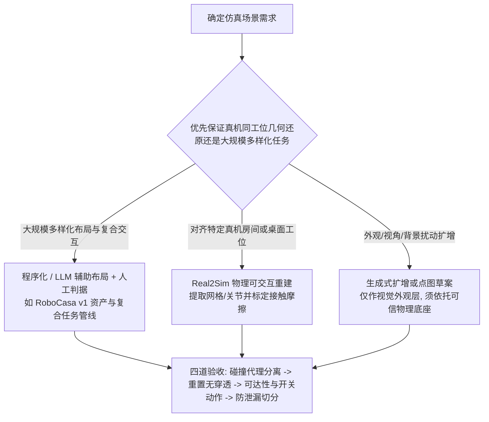

# Query：机器人仿真场景生成有哪些路线？如何验收物理可用性与防泄漏切分？

> **Query 产物**：本页由以下问题触发：「要为操作与移动任务批量构建可扩展的仿真训练/评测场景，程序化/LLM 组合生成、Real2Sim 三维重建与生成式视觉/几何扩增三条路线各适合什么阶段？场景跑起来前必须过哪几道物理与数据防泄漏校验？」
> 综合来源：[机器人仿真场景生成](../methods/robot-simulation-scene-generation.md)、[RoboCasa 实体节点](../entities/paper-notebook-robocasa-large-scale-simulation-of-everyday-task.md)、[生成式数据增强](../methods/generative-data-augmentation.md)、[CRISP vs GS-Playground Real2Sim 对比](../comparisons/crisp-vs-gs-playground-real2sim.md)

## 一句话结论

**程序化/LLM 复合任务生成（如 RoboCasa）擅长可控关节交互与规模化布局多样化，Real2Sim 重建擅长对齐特定真机工位几何，生成式视觉/点图扩增擅长补齐外观与视角变化但本身不提供碰撞与关节动力学**；任何路线进入策略训练或基准评测前都必须通过物理稳定性、判据防提前触发和防泄漏切分验收。

## 英文缩写速查

| 缩写 | 英文全称 | 简要说明 |
|---|---|---|
| MJCF | MuJoCo XML Format | 表达连杆、关节限位、碰撞体与驱动属性的仿真格式 |
| Real2Sim | Real-to-Simulation | 从真实传感器采集重建可供仿真交互的三维资产与环境 |
| 3DGS | 3D Gaussian Splatting | 高保真新视角渲染表征，常需外挂碰撞网格才能做物理交互 |
| LLM | Large Language Model | 大语言模型，可辅助提议场景布局与复合任务结构 |
| SDF / URDF | Simulation Description Format / Unified Robot Description Format | 描述机器人与可交互场景设备的通用模型格式 |

## 三条场景生成路线选型矩阵

| 对比维度 | 程序化 / LLM 组合场景（[Robot Simulation Scene Generation](../methods/robot-simulation-scene-generation.md)） | 物理可交互 Real2Sim 重建 | 生成式视觉 / 3D 世界草案 |
|---|---|---|---|
| **核心能力** | 空间布局、可交互设备（门/抽屉/旋钮）、语义与任务约束分层编译 | 将真实扫描重建为带碰撞、惯量与铰接关系的仿真场景 | 快速补全离散参考间缺失视角或换肤增强外观分布 |
| **物理与关节完备性** | 高（资产带 MJCF/URDF 碰撞代理与关节限位） | 中至高（取决于分割精度、闭合孔洞与参数辨识） | 低（仅视觉像素或点图时缺质量、关节与接触语义） |
| **规模化成本** | 资产库建成后可低成本组合数千布局与风格 | 受限于逐场景实拍采集与人工修复 | 推理生成快，但人工补物理属性成本高 |
| **主要风险** | 成功判据未人工审核易出现初始即满足或不可达 | 薄结构断裂、底层平面穿透与摩擦估计偏差 | 补全区域非实测几何，直接用于碰撞规划易出现幻觉穿模 |

## 场景发布前四道必查关口

1. **视觉网格与碰撞代理分离**：高面数渲染网格不直接用于实时接触求解，须绑定简化凸分解/几何碰撞代理并检查初始穿透与悬浮掉落。
2. **可交互设备与机械臂可达性实测**：逐类验证柜门/抽屉开关限位、阻尼与抓手/机械臂基座工作空间覆盖，避免生成无法触达的目标状态。
3. **固定种子重置与判据防作弊**：用固定随机种子多次复位场景，确认对象不会在步进前自发滑落，且成功判据在未执行动作时不会提前触发。
4. **按布局、物体家族与任务轴切分防泄漏**：不要把同一厨房布局或同一物体实例同时混入训练集与测试集；评测分布必须与训练布局及纹理/实例严格隔离。

## 局限与风险

- **把「视觉像」当成「物理可交互」**：未经过碰撞网格、惯量与关节约束验收的 3DGS 或生成式世界模型输出（参考 [WorldBridge](./../entities/paper-worldbridge-scattered-views.md)）不能直接代替仿真物理环境。
- **LLM 提议任务直接入库不加审核**：自动生成的任务脚本常存在物理不可行前置条件或宽松判据，必须配合人工复核与确定性重置测试。

## 关联页面

- [机器人仿真场景生成](../methods/robot-simulation-scene-generation.md) — 布局/外观/设备/语义分层编译与验证标准方法页
- [机器人仿真三层架构](../concepts/robot-simulation-three-layers.md) — 物理引擎、视觉渲染与任务编排分层基础
- [RoboCasa 实体节点](../entities/paper-notebook-robocasa-large-scale-simulation-of-everyday-task.md) — 大规模日常操作场景生成代表框架
- [生成式数据增强](../methods/generative-data-augmentation.md) — 视觉/轨迹增强与真实样本配比策略
- [CRISP vs GS-Playground Real2Sim 对比](../comparisons/crisp-vs-gs-playground-real2sim.md) — 物理网格 vs 3DGS 场景重建路线对比
- [WorldBridge 离散视图三维世界生成](../entities/paper-worldbridge-scattered-views.md) — 上游点图/RGB 生成草案与仿真资产的边界

## 参考来源

- [RoboCasa 论文与场景生成精读归档](../../sources/papers/robocasa_scene_generation_reading_arxiv_2406_02523.md)

## 推荐继续阅读

- [RoboCasa 官方项目与基准仓](https://robocasa.ai/)
