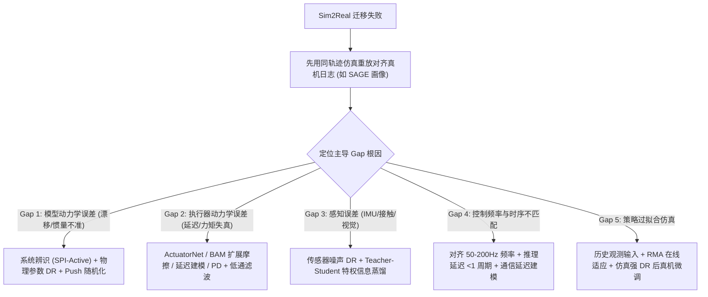

# Sim2Real Gap 缩减实战指南

> **Query 产物**：本页由以下问题触发：「sim2real transfer 失败的根因分类，以及对应的缩减策略？」
> 综合来源：[sim2real](../concepts/sim2real.md)、[domain-randomization](../concepts/domain-randomization.md)、[privileged-training](../concepts/privileged-training.md)、[sim2real-checklist](./sim2real-checklist.md)、[闭环误差分层](./sim2real-closed-loop-engineering.md)

## TL;DR 决策路径

```
sim2real 迁移失败？先定位根因：

1. 动力学模型误差（Model Error）
   └─ 修复：系统辨识 + 物理参数 DR + ActuatorNet

2. 执行器动力学误差（Actuator Dynamics）
   └─ 修复：ActuatorNet / 执行器延迟建模 + 低通滤波

3. 感知误差（Sensing Gap）
   └─ 修复：传感器噪声 DR + 状态估计 + 视觉 sim2real

4. 控制频率不匹配
   └─ 修复：对齐仿真与真机控制频率（通常 50-200Hz）

5. 策略过拟合仿真（Simulation Overfitting）
   └─ 修复：加强 DR 范围 / 特权信息蒸馏 / 在线适应（RMA）
```

## Gap 分类与对应修复策略

### Gap 1：模型动力学误差

**表现**：策略在仿真中稳定行走，但真机出现持续漂移或抖动。

**根因**：惯性参数（质量/质心位置/转动惯量）不准确，关节摩擦系数差异。

**修复工具包**：
| 方法 | 描述 | 复杂度 |
|------|------|--------|
| 物理参数 DR | 随机化质量/摩擦系数/阻尼 ±20-50% | 低 |
| 系统辨识 | 实测物理参数，替换 URDF | 中 |
| SPI-Active（CoRL 2025） | 采样式辨识 base 质量/惯量 + 主动探索最大化 FIM；见 [实体页](../entities/paper-notebook-sampling-based-system-identification-with-active.md) | 中高 |
| Push Randomization | 训练时随机施加外力 | 低 |
| 质心位置偏差 | 随机化 CoM 位置 ±3cm | 低 |

**典型配置**（legged_gym 风格）：
```python
randomize_friction: [0.5, 1.25]    # 地面摩擦系数
randomize_base_mass: [-1, 3]       # 基座质量偏差 (kg)
randomize_com_pos: [-0.05, 0.05]   # CoM 位置偏差 (m)
push_robots: True                   # 随机推力 [0, 150] N
```

### Gap 2：执行器动力学误差

**表现**：策略输出的关节力矩与真机执行有延迟，或力矩响应曲线不符合仿真。

**根因**：仿真中执行器通常是理想力矩/速度源；真机有电机惯性、减速器弹性、控制器延迟（通常 10-30ms）。

**修复工具包**：
| 方法 | 描述 |
|------|------|
| ActuatorNet（Hwangbo 2019） | 用 MLP 学习执行器的输入-输出映射（从真机数据） |
| BAM M1–M6（ICRA 2025） | 摆锤 [CMA-ES](../methods/cma-es.md) 辨识扩展摩擦 + MuJoCo 在线更新；见 [论文实体](../entities/paper-bam-extended-friction-servo-actuators.md) / [Rhoban/bam](https://github.com/Rhoban/bam) |
| Microduck RL（Pollen） | 桌面双足上把 BAM M6 **XL330 电压律**写进 mjlab，再加摩擦/电压/延迟 DR 与编码器侧 ±1° 背隙孪生；训练无动作低通、ONNX 必须烤观测归一化。见 [Microduck RL](../entities/pollen-microduck-rl.md) |
| SPI-Active（CoRL 2025） | 采样式辨识 base 质量/惯量 + 电机模型，并主动优化指令最大化 FIM；见 [实体页](../entities/paper-notebook-sampling-based-system-identification-with-active.md) / [LeCAR-Lab/SPI-Active](https://github.com/LeCAR-Lab/SPI-Active) |
| 延迟建模 | 在仿真中加入随机延迟 1-5 个控制步 |
| PD 控制模式 | 用 PD 目标角度代替直接力矩（更鲁棒） |
| 低通滤波 | 对策略输出的动作做一阶低通滤波 |

在把上述手段「写进训练」之前，可先用 [SAGE](../entities/sage-sim2real-actuator-gap-estimator.md) 等对**同一参考轨迹**做仿真重放与真机日志对齐，得到关节级 RMSE / 相关等 **gap 画像**，避免盲调 DR 范围或 ActuatorNet 结构。

### Gap 3：感知误差

**表现**：IMU 数据有噪声漂移，接触检测不准确，视觉 sim2real 纹理/光照差异。

**修复工具包**：
```python
# 仿真 IMU 噪声配置
imu_noise_vel:  [0.0, 0.1]     # 速度估计噪声 (m/s)
imu_noise_grav: [0.0, 0.05]    # 重力分量噪声
contact_noise:  0.05            # 接触检测误报率
```

**特权信息蒸馏（推荐）**：
- Teacher 用完美状态（地形高度图、精确速度）训练
- Student 用历史观测历史（IMU + 关节编码器）模仿 teacher
- 真机只跑 student → 无需视觉 sim2real

### Gap 4：控制频率与时序

**真机 vs 仿真频率对齐 checklist**：

- [ ] 仿真控制频率 = 真机控制频率（通常 50-200 Hz）
- [ ] 策略推理延迟 < 一个控制周期（1/freq）
- [ ] 通信延迟（ROS2 / EtherCAT）已在仿真中建模
- [ ] 关节位置/速度的读取顺序与仿真一致

### Gap 5：策略过拟合仿真

**表现**：增大 DR 范围后仿真性能下降，减小后真机又失败。

**修复方法**：

1. **在线适应（RMA）**：训练适应模块实时估计环境参数
2. **历史观测作为输入**：用过去 N 步的观测（而非单帧）隐式估计环境参数
3. **domain randomization 双阶段训练**：
   - Phase 1：在仿真（强 DR）训练 base policy
   - Phase 2：在真机（少量数据）fine-tune

## 用留出真机试验定位主导域差 / Diagnosing the Reality Gap on Hardware

[Unidata 的指南](../../sources/blogs/unidata_sim2real_guide_2026_11.md)可作低成本诊断入口。它的四类域差和上面的五项工程根因是两种视角：物理差异可来自接触或执行器，感知又可拆为传感器、渲染和部署分布。先验证故障归因，再决定是否改训练。

| 同一任务下的症状 | 优先看什么 | 合理对照 |
|---|---|---|
| 看得到目标但接触后失败 | 力/速度、摩擦、末端顺应、驱动限幅及控制时序 | 同布局先小范围重复接触，检查测量与估计；再有针对性地校准接触和驱动模型或调整随机范围 |
| 特定灯光、材质或遮挡才失败 | 用目标相机看原始帧、无效深度、外参及时间戳 | 锁定策略，分别改变照明/材质或换观测回放；避免只用训练时同源影像验证 |
| 仿真和真机成功率接近，但节拍或失败类型不同 | 检查重复试探、超时、干预和保护触发；节拍异常也可能来自通信或观测延时 | 固定终止条件与计时起止，以相同预设工况汇报成功数、节拍和失败分布 |
| 少量真机微调后成功率回升 | 先排除调参集合与留出集合重叠、不同控制设置或目标传感器校准改善 | 零样本模型和微调模型跑同一组独立工况，不把观察到的提升当成已证明的原因 |


**最小记录项：** 每个试次记录场景/物体与重置编号、策略和标定版本、动作频率、成功与否、超时/急停/人工接管、失败类别；同时记录节拍的分母（全部尝试还是仅成功）。另外保留硬件不可用等无效试次计数，勿把任务失败当无效删除。优先在预定义的低风险条件验证，并遵守[真机部署 Checklist](./sim2real-checklist.md)。

**样本量不是安全门槛。** 文章的 30–50 个真机试次只适合做初筛。如果试次近似独立，观察到 10/20 和 25/50 成功时，95% Wilson 区间约为 30%–70% 和 37%–63%。同一物体、场景或操作者反复试验时应考虑成簇；需要按独立场景覆盖、测量不确定度和失败代价配置试验，而不是套用文章的差值或样本阈值。

## 完整 Sim2Real Pipeline Checklist

完整五阶段工程清单（建模 → DR → 仿真验证 → SysID → 上机 → Gap 闭环）见 **[Sim2Real 工程 Checklist](./sim2real-checklist.md)**；上机前 3 分钟快速版见该页 **[快速部署检查](./sim2real-checklist.md#快速部署检查)**。

## 流程与架构图



## 英文缩写速查

| 缩写 | 英文全称 | 简要说明 |
|------|----------|----------|
| Sim2Real | Simulation to Real | 把仿真中学到的策略迁移落地真机的工程主线 |
| DR | Domain Randomization | 训练时随机化仿真参数以提升跨域鲁棒迁移 |
| URDF | Unified Robot Description Format | 统一机器人描述格式 |
| CoM | Center of Mass | 质心，平衡与 locomotion 规划的核心状态量 |
| legged_gym | Legged Gym | 足式机器人 RL 训练的常用开源框架 |
| MLP | Multi-Layer Perceptron | 多层感知机，处理本体向量等低维输入 |
| MuJoCo | Multi-Joint dynamics with Contact | 接触丰富的刚体物理仿真引擎 |
| PD | Proportional–Derivative | 关节位置/阻抗底层控制，策略输出常为其 setpoint |
| IMU | Inertial Measurement Unit | 惯性测量单元，提供加速度与角速度 |
| ROS 2 | Robot Operating System 2 | 机器人系统集成与通信的常用中间件 |
| EtherCAT | Ethernet for Control Automation Technology | 高实时性工业以太网总线 |
| RMA | Rapid Motor Adaptation | 从历史轨迹隐式估计环境参数的快速运动自适应 |
| AMP | Adversarial Motion Prior | 用对抗判别约束状态转移接近专家运动分布的先验 |

## 参考来源

- [Unidata Sim2Real 指南与数据、评测口径核对](../../sources/blogs/unidata_sim2real_guide_2026_11.md)

- [sources/papers/sim2real.md](../../sources/papers/sim2real.md) — DR / RMA / InEKF ingest 摘要
- [sources/papers/privileged_training.md](../../sources/papers/privileged_training.md) — teacher-student / RMA 适应模块
- [sources/papers/simulation_tools.md](../../sources/papers/simulation_tools.md) — 仿真平台原论文
- [sources/papers/system_identification.md](../../sources/papers/system_identification.md) — 执行器建模 ActuatorNet
- [Getting Started With Isaac Lab 课程归档](../../sources/courses/nvidia_getting_started_isaac_lab.md) — 官方课：仿真增强 / Real2Sim / 策略鲁棒三类桥接

## 关联页面

- [Sim2Real](../concepts/sim2real.md) — sim2real 概念综述
- [Domain Randomization](../concepts/domain-randomization.md) — DR 方法详解
- [Privileged Training](../concepts/privileged-training.md) — teacher-student 蒸馏
- [NVIDIA Getting Started With Isaac Lab](../entities/nvidia-getting-started-isaac-lab.md) — 课内三类桥接与「最小必要 DR」建议
- [Sim2Real Checklist](./sim2real-checklist.md) — 部署前完整检查清单（含快速部署检查）
- [Sim2Real 闭环误差分层工程](./sim2real-closed-loop-engineering.md) — 误差类型 → 校准/DR/适应/安全的时序闭环
- [RL 策略真机调试 Playbook](./robot-policy-debug-playbook.md) — 已上机后的症状排查
- [Microduck RL](../entities/pollen-microduck-rl.md) — 小舵机双足上 BAM + 背隙 + 滤波/归一化踩坑

## 一句话记忆

> Sim2Real Gap = 模型误差 + 执行器延迟 + 感知噪声；对症下药：系统辨识 + ActuatorNet + DR + 特权信息蒸馏。
