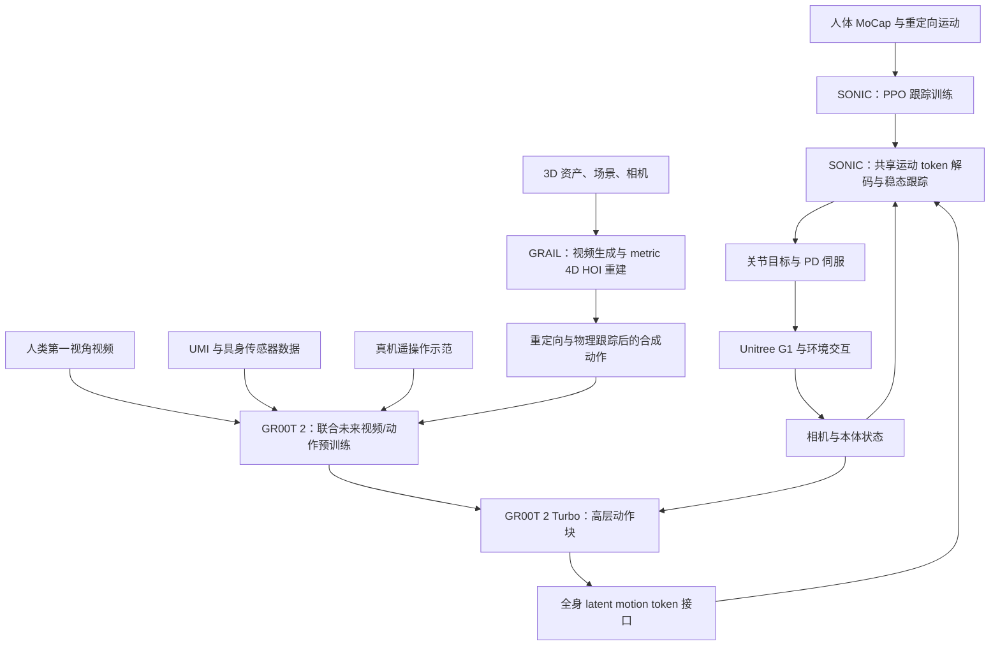
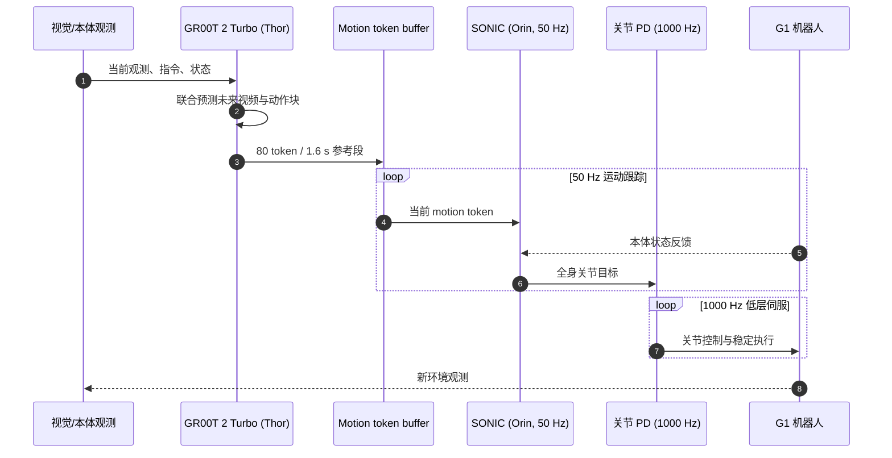

# 从 Motion Tracking 到 World Action Model：SONIC × GR00T 2 Turbo 的人形全身闭环

> **Query 产物：** 本页回答「如何把 SONIC 运动追踪控制器、GRAIL 合成/遥操作数据与 GR00T 2 Turbo 世界动作模型连成可板载运行的人形 loco-manipulation 闭环，并正确解释异频控制与延迟？」综合 SONIC、GR00T 2 与 GRAIL 的官方论文，以及 2026-11-18 GRASP 演讲的一手活动信息；演讲的中文转述仍单独标注未独立核验之处。

## 一句话定义

**SONIC 学习「身体如何稳定地跟踪动作」，GR00T 2 学习「根据视觉、语言与本体状态，预测未来世界和动作」；两者通过共享全身运动 token 接口连接，让慢速世界动作模型驱动快速人形控制器。** 本页是跨论文技术编译，不是第四篇新论文。

## 英文缩写速查

| 缩写 | 英文全称 | 简要说明 |
|---|---|---|
| WAM | World-Action Model | 联合预测未来观察/视频与机器人动作 |
| WBC | Whole-Body Control | 满足全身动力学与接触平衡的控制 |
| RL | Reinforcement Learning | SONIC 的大规模运动跟踪策略学习 |
| HOI | Human-Object Interaction | GRAIL 合成和重建的人–物交互 |
| UMI | Universal Manipulation Interface | 手持设备的人类操作数据接口 |
| PD | Proportional-Derivative | 低层关节反馈执行器控制 |
| FSQ | Finite Scalar Quantization | SONIC 运动潜表示的标量量化方法 |

## 为什么重要

**Motion tracking 是「如何动」的通用预训练目标，不是「想做什么」的任务规划器。** 若把参考关节角直接下发给漂浮基座人形机器人，平衡与接触约束未被处理。SONIC 在仿真中学习跟踪误差、动力学扰动和恢复动作；其运动潜接口承接人类视频、VR 遥操作和上层任务策略。[SONIC](../entities/nvidia-sonic.md) 已有独立论文详情，不在本页重复登记实体。

GR00T 2 通过 **joint future video/action modeling** 把视频中的物理交互先验与机器人动作预测连起来；GRAIL 提供条件生成的可重建合成全身交互数据。它们分别对应 **「动作执行基座 / 任务动作生成 / 数据制造」** 三个互补层次。

## 系统主干：三个训练来源、两层策略和低层伺服

**边界：** GRAIL 为独立的数据合成路径；上图的「合成数据→训练」表示可用于下游训练的**方法衔接**，不是声称 GR00T 2 的每条正式训练样本都来自 GRAIL。SONIC 的运动潜指令也不能直接视为电机扭矩命令，其公开部署代码以关节目标 / PD 为主。

## 板载异频控制：不要把推理延迟等同控制周期

| 模块 | 公开口径 | 正确理解 |
|---|---|---|
| GR00T 2 Turbo / Jetson Thor | 单次模型预测中位约 **123.97 ms**；约 **1 Hz** 高层动作更新 | 生成动作块而非每 20 ms 重新生成一次全部视频 |
| GR00T 2 Turbo 输出 | **80 个 token / 1.6 秒** | 与 50 Hz 的 token 使用速率相匹配 |
| SONIC / Jetson Orin | **50 Hz（20 ms）** | 接收新的参考/token，输出稳定全身关节目标 |
| 关节 PD 执行 | **1000 Hz（1 ms）** | 更高频硬件伺服环，不能等同 SONIC 神经网络频率 |

这个时序图描述**白皮书公开的系统级接口**；GR00T 2 代码尚未发布，不能当成未公开部署程序的实际函数调用栈。SONIC 的可复现入口另见 [GR00T-WholeBodyControl](../entities/gr00t-wholebodycontrol.md)。

## 数据路径：从遥操作到合成全身示范

| 数据/途径 | 作用 | 一手可核验规模或状态 |
|---|---|---|
| SONIC：MoCap | 学习多类动作的动力学可执行先验 | 论文给出 **100M+ 帧 / 约 700 h**、42M 最大策略与 21k GPUh 量级 |
| GR00T 2：人类第一视角视频 | 学到视觉变化、多场景交互和物体先验 | **402,730 h** |
| GR00T 2：UMI | 提供动作相关手持示范 | **10,184 h**，**2,897** 任务 |
| GR00T 2：机器人演示 | 对齐实际执行器与动作接口 | **23,500 h**，含 G1 等平台 |
| GRAIL：合成 HOI | 以资产/相机/尺度条件生成视频，再重建 metric 4D 与 retarget | [论文](../entities/paper-grail.md) 与 [开源代码](https://github.com/NVlabs/GRAIL) |

**GRAIL 不等于「视频直接变真机动作」。** 它要经过已知 3D 场景几何约束、人体/物体姿态重建、优化、重定向、跟踪验证，再做视觉策略训练；物理一致性与 sim2real 仍是风险。

## 真实机器人结果与口径

下述均为 **NVIDIA 作者报告的指定测试协议**，不可推为开放环境通用可靠性：

- **爆米花：** 48/48（100%）；**桌面清理：** 28/30（93.3%）；**地面拾取：** 25/30（83.3%）；**洒漏清洁：** 14/30（46.7%）；来自 GR00T 2 白皮书 §3.5 / 附录 H。
- **少样本迁移：** Dexter-50 的 40% 零样本、95% 五次演示来自按 5-shot 成功率筛选的 50 任务，不可当作随机新任务平均成功率。
- **合成数据泛化：** 白皮书附录 H.3 的 OOD 消融，含仿真数据的 Turbo 为 63.3%，另一个含仿真训练的 N1.7 为 40%；30 次试验且统计差异不显著（Fisher p≈0.12）。

## 演讲转述与已验证事实的界限

2026-11-18 的 [Penn GRASP 演讲](../../sources/talks/zhengyi-luo-motion-tracking-world-action-models-2026-11-18.md) 在 [human five 中文整理](../../sources/blogs/human-five-zhengyi-luo-sonic-gr00t-wam-2026-11-22.md) 中提出「motion tracking 如 next-word prediction」、System 0 暂不需强视觉、未来高低层可能融合等**研究观点**。这些观点值得记录，但不能与论文实验数字等同。

- 转述写「Sonic 每 5 ms 消费一个 token」与官方 50 Hz 冲突；**按 20 ms/token** 作为经核对的部署口径。
- 转述的「round-trip 170 ms」「SONIC state-to-action 2–3 ms」「洒漏清理仅用 3 h 示范」暂未从活动官方录像核对；不作为独立实测指标写入工程预算。
- 视频/动作 **联合**预测并非严格两阶段串行「先生成视频，再生成动作」；对比 [WAM](../concepts/world-action-models.md) 中 Joint / Cascaded 术语。
- 公开视频演示与定量成功率之间需对齐具体任务、测试次数、环境和长程成功条件；特别注意 System 0 控制延迟与 System 1 任务闭环延迟分别记录。

## 工程落地检查点

1. 先用 SONIC 开源部署栈验证 **本体观测、关节目标、50 Hz 运动接口与 PD 伺服**；不要将参考动作当成直接可安全执行的 PD setpoint。
2. 用相同 task / scene / object 口径区分 **BC 数据质量**、**运动追踪可达性** 和 **高层任务决策失败**，避免把任务失败都归因于控制器。
3. 为 WAM 额外记录 **observation-to-first-applied-action latency、chunk 消耗/补齐、丢帧与状态陈旧**，模型计算 124 ms 并不等于所有链路耗时。
4. 检查开放边界：截至 2026-11-22，**SONIC 的训练和部署代码已公开**；**GRAIL 的生成管线和数据公开**；**GR00T 2 作者官网提示代码将于 12 月开放**，不可用 N1.7 旧仓替代验证 Turbo 内部推理入口。

## 关联页面

- [Zhengyi Luo（罗正宜）](../entities/zhengyi-luo.md)
- [SONIC：规模化运动跟踪](../entities/nvidia-sonic.md)
- [GR00T 2：联合未来视频与动作](../entities/paper-gr00t-2.md)
- [GRAIL：合成 Loco-Manip 数据](../entities/paper-grail.md)
- [Whole-Body Control](../concepts/whole-body-control.md)
- [WAM 纵深路线](../../roadmap/depth-wam.md)
- [BFM 纵深路线](../../roadmap/depth-bfm.md)

## 参考来源

- [GRASP 演讲资料与事实核对范围](../../sources/talks/zhengyi-luo-motion-tracking-world-action-models-2026-11-18.md)
- [human five 中文长文整理](../../sources/blogs/human-five-zhengyi-luo-sonic-gr00t-wam-2026-11-22.md)（二手资料，非讲者校订）
- [SONIC 论文原文通读归档](../../sources/papers/sonic_reading_arxiv_2511_07820.md)
- [GR00T 2 白皮书原文通读归档](../../sources/papers/gr00t2_whitepaper_2026.md)
- [GRAIL 论文原文通读归档](../../sources/papers/grail_arxiv_2606_05160.md)

## 推荐继续阅读

- [SONIC 官方项目](https://nvlabs.github.io/GEAR-SONIC/)
- [GR00T 2 官方项目与白皮书](https://research.nvidia.com/labs/gear/gr00t-2/)
- [GRAIL 官方项目与可运行代码](https://research.nvidia.com/labs/dair/grail/)
- [SONIC 全身控制开源仓](https://github.com/NVlabs/GR00T-WholeBodyControl)
