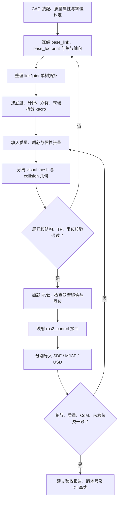

> **Query 产物**：本页由以下问题触发：「输出轮式双臂人形机器人的 URDF 的基本流程与工具链是什么？」
> 综合来源：[Zane Hub 原文 PDF 归档](../../sources/blogs/zane-hub-wheeled-dual-arm-urdf-workflow-2026-11-14.md)、[URDF 概念](../concepts/urdf-robot-description.md)、[URDF 惯量真机核查](./urdf-link-inertia-real-robot-check.md) 与下列 ROS 规范。

# 轮式双臂人形机器人 URDF 建模与工具链（Wheeled Dual-Arm Humanoid URDF Workflow）

## 一句话定义

> 按“CAD 统一坐标与零位 → 单树关节拓扑 → xacro 参数化 → 刚体惯量 → visual/collision 几何 → 运动学校验 → ROS 2 控制及仿真器回归”交付一份可用于可视化、规划、控制和物理仿真的机器人描述包。

## 英文缩写速查

| 缩写 | 英文全称 | 简要说明 |
|---|---|---|
| URDF | Unified Robot Description Format | ROS 生态的连杆、关节与惯量描述 |
| CAD | Computer-Aided Design | 机械设计/装配模型与零位的来源 |
| TF | Transform / Transform Frames | 坐标系之间的实时变换关系 |
| CoM | Center of Mass | 连杆与整机质心 |
| SDF | Simulation Description Format | Gazebo 的模型与场景格式 |
| MJCF | MuJoCo XML Format | MuJoCo 的原生模型格式 |
| USD | Universal Scene Description | Isaac Sim 模型/场景交换载体 |
| SRDF | Semantic Robot Description Format | MoveIt 的规划组与碰撞语义描述 |

## TL;DR：七个关口

| 阶段 | 核心问题 | 必交付物与验证 |
|---|---|---|
| 1 坐标系冻结 | CAD 装配零位、运动学零位、关节轴向是否一致 | 机械/电控/算法共用的 frame 与零位偏置表 |
| 2 拓扑清点 | 底盘、升降柱、腰、双臂、夹爪、传感器是否构成单树 | link/joint 父子表，闭环简化方案 |
| 3 xacro 骨架 | 先不挂 mesh 能否正确展开 | xacro 模块包 + check_urdf |
| 4 质量属性 | 每个刚体质量、质心和惯量是否可信 | CAD/称重数据，惯量正定/三角条件 |
| 5 mesh | 显示模型是否跟碰撞模型分离 | package:// 可解析，RViz 中无错位 |
| 6 模型校验 | 关节零位、方向、限位、TF、碰撞是否正确 | 逐关节极限与末端位姿对照报告 |
| 7 控制/转换 | ROS 2 关节接口与 SDF/MJCF/USD 是否一致 | 控制器配置及转换回归报告 |

## 流程总览



图中是**工程数据/交付流**，不是源码运行时序图；本资料是工程教程，没有对应的官方可运行项目仓库，故源码时序图不适用。

## 拓扑决策：先定树，再写 XML

典型结构是 base_footprint → base_link，底盘下挂驱动轮、从动轮和 torso_base_link；其上是 lift_joint（prismatic）、torso_link、head、left/right shoulder-to-wrist、gripper。不同底盘在关节层的差别如下：

| 方案 | 关节建模 | 控制器需要额外负责 |
|---|---|---|
| 两轮差速 | 左右驱动轮 continuous，万向轮按实际机构固定或转动 | 轮半径、轮距和差速正逆运动学 |
| 麦克纳姆/全向轮 | 四个独立旋转驱动关节，必要时近似辊子碰撞形状 | 全向运动学矩阵与实际轮向、摩擦 |
| 四舵轮 | 每个模组含 steering revolute 与 drive continuous，共 8 个关节 | 最短转向、角度回绕与驱动速度分配 |
| 双指夹爪 | 主动关节 + mimic 或两独立关节 | 按真实硬件/仿真插件决定如何映射控制接口 |
| 升降立柱 | prismatic；多节同步可用 mimic 或拆分 | 行程限位、碰撞与整机高度变化 |

URDF 的 link-joint 结构不能直接表达一般闭环机械约束；不要以 mimic 代替真实接触/闭环动力学。需要闭环力学时，按目标仿真器的 SDF/MJCF 或插件能力另建约束。

## 核心原理与工程实践

### 1. 坐标系、零位和镜像

- 约定 x 前、y 左、z 上；长度米、质量千克、角度弧度。
- 区分 map → odom（定位系统/导航提供）→ base_footprint → base_link（描述包/里程计约定）；不要把这些动态 frame 全部误写成 URDF fixed joints。
- 将 CAD 的装配姿态、算法零位、驱动器零点和关节正方向形成冻结表，分清“编码器角度”和“URDF 关节角”。
- 左右臂 xacro 可以共用宏、用侧别参数翻转安装位置；但 axis 的正负必须按实物验证，不能机械地随 mirror 一起取反。

### 2. xacro 的可维护分层

顶层 `robot.urdf.xacro` 只负责 include 与全局参数，子模块分别为 chassis/、torso/、arms/、gripper/、sensors/；mesh 分 visual/collision，config 另存控制器与限位。完成骨架后执行：

```bash
xacro robot.urdf.xacro > /tmp/robot.urdf
check_urdf /tmp/robot.urdf
urdf_to_graphiz /tmp/robot.urdf
gz sdf -p /tmp/robot.urdf > /tmp/robot.sdf
```

这里的 launch 文件需要项目自己提供，不能把 `ros2 launch robot_description display.launch.py` 视为 ROS 2 自动提供的命令。

### 3. 惯量与几何不能只求“能显示”

- `visual` 关注外观；`collision` 推荐基本体/凸包；`inertial` 则需要真实的 mass、CoM 和关于 CoM 的惯性张量。
- 验证惯性矩阵对称、正定，主惯量满足三角条件；合并零件用平行轴定理，不能把不同参考原点的惯量直接相加。
- **惯性坐标系 `<inertial><origin rpy="..."/>` 可以旋转**，不要求它与 link 坐标轴对齐；若不为零，应在惯性坐标系表达对应的 6 个张量分量。
- **单位换算：** 1 g·mm² = 10⁻⁹ kg·m²；1 kg·mm² = 10⁻⁶ kg·m²。分清 CAD 导出的具体质量单位，原文 p.13 的六个数量级不能无条件套用。
- 轮子几何绕 y 轴而内置 cylinder 默认沿 z 轴；旋转 visual/collision 不会自动旋转 link 的惯性张量，需独立确认惯性主轴与轮轴是否对应。
- 两节升降结构使用两个实际移动 link 时，**整机 CoM 能随关节位置变化**，各刚体固有惯量仍保持常数。不要把“各 link 的惯量恒定”误读为“整机质心不能变化”。

更严格的实机验收与辨识路径见 [URDF 连杆惯量对照真机检查](./urdf-link-inertia-real-robot-check.md)。

### 4. ROS 2 与转换适配

- `ros2_control` 的 joint 名称应与 URDF 精确匹配；常见约定是底盘速度接口、机械臂位置/力矩接口，最终以电机驱动和控制器支持为准。
- mimic 在 `robot_state_publisher`、硬件插件和不同版本的 `gz_ros2_control` 中职责并不相同，**不能一概声称 ros2_control 完全不处理 mimic**。优先查目标发行版的插件文档。
- ROS 2 的传动接口仍存在，且需由具体硬件组件加载；不能简单写成“ROS 2 已不需要任何 transmission”。
- Gazebo 转 SDF 时固定关节通常可能被合并；针对传感器等场景可用 `preserveFixedJoint`，再核查变换与传感器 frame。
- MuJoCo/Isaac Sim 导入会对原 URDF 做解析/转换处理；关注固定连杆合并、mesh 可见性、惯量合法性、名字规范化、mimic 与驱动器接口差异。

## 交付验收清单

| 检查项 | 验证手段 | 不合格典型表现 |
|---|---|---|
| xacro 与树结构 | xacro、check_urdf、urdf_to_graphiz | 环/孤立连杆、父子颠倒、同名关节 |
| 运动学零位与限位 | joint_state_publisher_gui + RViz、FK | 双臂镜像反向、末端位置偏、关节越限 |
| 质量与惯量 | CAD/台秤/CoM 对照、正定与主惯量检查 | 假惯量、单位错、漏掉电池及末端 |
| visual/collision | RViz + Gazebo 接触可视化 | 模型缩放 1000 倍、穿模、过慢 |
| 控制接口 | controller_manager + 真实/模拟硬件 | 缺 joint 接口、插件加载失败 |
| 跨格式回归 | SDF/MJCF/USD 分别加载 | 关节数量、总质量、CoM、零位 FK、限位变化 |
| 版本与持续集成 | 描述包 tag + CI / TF 快照 | 机械改版后标定或控制器未同步 |

原文的 5% 质量差、1 mm 末端误差等阈值是文章建议值，最终验收阈值应按硬件精度、任务安全裕量和项目测试规范确定。

## 与原文不同的技术校正与局限

原文是 2026-11-14 的工程文章（PDF 第 1–19 页），不是 URDF/ROS 官方规范。以下逐项以规范与单位定义为准：

1. **p.5**：“URDF 无法旋转惯性主轴”不正确；`inertial/origin` 明确有 `rpy`。
2. **p.13**：g·mm² 与 kg·m² 的换算相差九个数量级，不是六个。
3. **p.17**：fixed joint 合并不是无条件、不可配置；Gazebo 存在 `preserveFixedJoint`。
4. **p.10、18**：mimic/传动映射由 ROS 2 发行版和硬件插件具体实现决定，不能推论为所有平台的统一自动行为。
5. **p.9**：刚体惯量常数不妨碍多连杆机器人随升降行程改变整机 CoM。
6. 所有轮半径、阻尼、mesh 面数、接触刚度等示例值须按真实硬件辨识和仿真器版本复测。

## 关联页面

- [URDF（统一机器人描述格式）](../concepts/urdf-robot-description.md)
- [URDF 连杆惯量对照真机检查](./urdf-link-inertia-real-robot-check.md)
- [连杆惯量与转子惯量](../concepts/robot-link-and-rotor-inertia.md)
- [URDF-Studio](../entities/urdf-studio.md)
- [Pinocchio](../entities/pinocchio.md)
- [MuJoCo](../entities/mujoco.md)
- [机器人描述目录选型](../comparisons/robot-description-catalogs.md)

## 参考来源

- [Zane Zhang / Zane Hub《输出轮式双臂人形机器人的 URDF 的基本流程与工具链是什么？》原文 PDF 归档](../../sources/blogs/zane-hub-wheeled-dual-arm-urdf-workflow-2026-11-14.md)（文章：2026-11-14；逐页通读）
- [URDF link 规范（ROS Wiki 镜像：inertial/origin/rpy）](https://mirrors.nju.edu.cn/ros-wiki/urdf%282f%29XML%282f%29link.html)
- [ros2_control Joint Kinematics 与 Transmission Interface](https://control.ros.org/master/doc/ros2_control/hardware_interface/doc/joints_userdoc.html)
- [gz_ros2_control 官方文档（mimic、preserveFixedJoint）](https://control.ros.org/rolling/doc/gz_ros2_control/doc/index.html)

## 推荐继续阅读

- [ROS 2 URDF 教程](https://docs.ros.org/en/jazzy/Tutorials/Intermediate/URDF/URDF-Main.html)
- [ROS 2 ros2_control Getting Started](https://control.ros.org/master/doc/getting_started/getting_started.html)
- [仿真物理保真度链路](./simulation-physics-fidelity.md)
