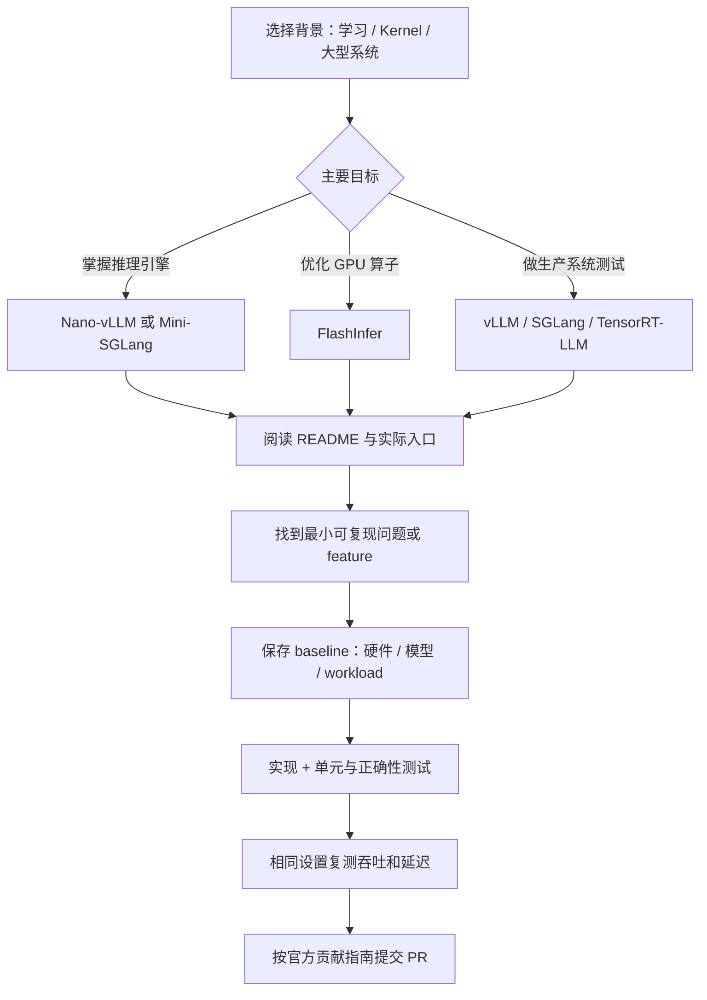
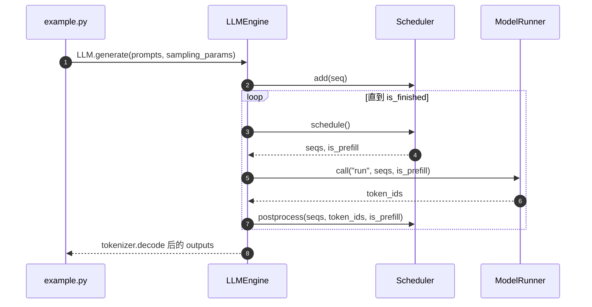
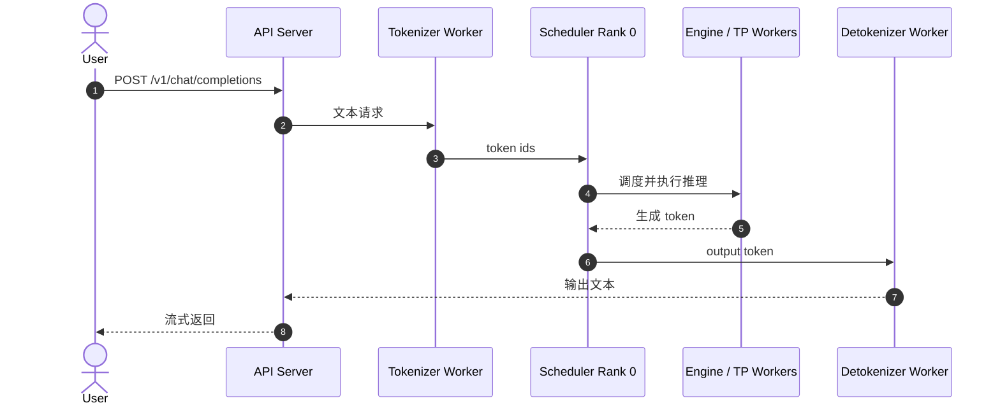

# LLM Inference Open-Source Contribution Roadmap｜LLM 推理开源贡献分阶段路线

## 一句话定义

**LLM 推理开源贡献路线**：根据已有工程能力选择 **可读小引擎 → GPU kernel 公共层 → 大型生产推理框架** 中最适合的切口，用完整特性、正确性测试、复现实验与可审查的 PR 证明工作，而不是只在简历中写“参与 vLLM”。

## 英文缩写速查

| 缩写 | 英文全称 | 简要说明 |
|---|---|---|
| LLM | Large Language Model | 本页优化服务和推理的模型类别 |
| GPU | Graphics Processing Unit | 推理 kernel 与性能测试的主要算力设备 |
| KV | Key-Value Cache | 解码过程中复用 attention 历史状态 |
| TP | Tensor Parallelism | 将模型计算分布到多个 GPU |
| CI | Continuous Integration | 自动化测试与静态检查 |
| PR | Pull Request | 向上游提交的代码、测试、性能证据与评审记录 |
| TTFT | Time to First Token | 在线请求从到达到首 token 的耗时 |
| TPOT | Time Per Output Token | 输出阶段相邻 token 的平均耗时，需说明统计口径 |

## 为什么重要

- **小仓适合理解闭环，大仓适合理解协作规范**：Nano-vLLM 官方约 1200 行 Python，Mini-SGLang 官方约 5000 行；vLLM、SGLang、TensorRT-LLM 有更复杂的 CI、模型兼容、平台和贡献流程。
- **跨引擎的复用节点**：FlashInfer 官方明确列出 vLLM、SGLang、TensorRT-LLM 等采用方；关注它适合 kernel / CUDA 能力者，但不能由此推断任意 kernel 都能在消费卡测试。
- **可量化证据比仅列仓库名更有说服力**：PR 最好提供 baseline、patch 后结果、相同 workload 与正确性保障。对 GPU 显存预算的前置判断参见 [LLM 推理显存估算](../concepts/llm-inference-vram-estimation.md)。

## 核心原理：按经验与交付物选型

| 阶段 / 背景 | 推荐第一站 | 适合的首项交付 | 注意 |
|---|---|---|---|
| 学生、初学推理服务 | [Nano-vLLM](../entities/nano-vllm.md) 或 [Mini-SGLang](../entities/mini-sglang.md) | 从文档到调用链实现一个可运行特性；增加回归测试，展示复现命令和 tokens/s | Nano 以离线生成入口为主；Mini 支持在线服务，选题复杂度不同 |
| 有 1–2 年工程经验、想做 GPU 优化 | [FlashInfer](../entities/flashinfer.md) | 小范围 kernel 优化或覆盖边界 case，附数值一致性 + kernel benchmark | 需要 CUDA/算子基础；硬件支持按具体后端核验 |
| 资深工程师跨入推理基础设施 | [vLLM](../entities/painode-103-vllm.md)、[SGLang](../entities/sglang.md)、[TensorRT-LLM](../entities/tensorrt-llm.md) | 先围绕已存在 issue 写 regression / accuracy / performance test，再提交小功能或修复 | 项目大小不等于个人代码能力；测试入口可能需要特定硬件 |

上述**职业分层是用户提供的视频转述和本页工程建议**，不是这些项目官方制定的招聘或贡献者等级标准。没有证据表明测试 PR 一定比功能 PR 更容易合并。

### 独立项目详情与去重关系

以下 **6 个官方独立仓库**对应 **6 个非重复详情节点**，而非仅为一张职业推荐清单：

| 子项目 | 本站详情节点 | 项目身份 / 区别 |
|---|---|---|
| Nano-vLLM | [Nano-vLLM](../entities/nano-vllm.md) | `GeeeekExplorer/nano-vllm`；教学型轻量离线引擎 |
| Mini-SGLang | [Mini-SGLang](../entities/mini-sglang.md) | `sgl-project/mini-sglang`；精简但具在线 API 的多进程系统 |
| FlashInfer | [FlashInfer](../entities/flashinfer.md) | `flashinfer-ai/flashinfer`；GPU kernel/算子层，而非 serving 引擎 |
| vLLM | [vLLM](../entities/painode-103-vllm.md) | `vllm-project/vllm`；升级已有编号 103 清单节点，不重复新建 |
| SGLang | [SGLang](../entities/sglang.md) | `sgl-project/sglang`；完整生产型服务框架，与 Mini-SGLang 独立 |
| TensorRT-LLM | [TensorRT-LLM](../entities/tensorrt-llm.md) | `NVIDIA/TensorRT-LLM`；区别于通用 [TensorRT SDK](../entities/tensorrt.md) 和 [TensorRT-LLM for Edge](../entities/painode-102-tensorrtllmforedge.md) 文章索引 |

每个实体页都有单独的官方原始资料归档、Mermaid 项目流程图、源码运行时序图和可复现贡献切口；**此处没有把学生/年限标签写成项目本身的官方定位**。

### 项目流程总览：从选仓到可复现 PR

### Nano-vLLM：已核对源码运行时序图

依据 [`example.py`](https://github.com/GeeeekExplorer/nano-vllm/blob/main/example.py)、[`llm_engine.py`](https://github.com/GeeeekExplorer/nano-vllm/blob/main/nanovllm/engine/llm_engine.py)、[`scheduler.py`](https://github.com/GeeeekExplorer/nano-vllm/blob/main/nanovllm/engine/scheduler.py)，不是抽象推测：

### Mini-SGLang：官方结构文档的数据流

依据官方 [`docs/structures.md`](https://github.com/sgl-project/mini-sglang/blob/main/docs/structures.md)：API、Tokenize / Detokenize、Scheduler / Engine 是明确模块；跨进程控制消息用 ZeroMQ，TP 工作者之间使用 NCCL。

两张图分别覆盖离线简化引擎和分进程在线 serving；没有将二者误写成同一种执行架构。

## 工程实践

### 1. 学生：先走一个完整 feature

- **Nano-vLLM**：复现 `example.py`，阅读 `LLMEngine.step`、`Scheduler.schedule`、`ModelRunner.call`；做一个边界用例或小特性，给出前后行为和测试。官方 `bench.py` 以 `sum(max_tokens) / elapsed` 计算离线吞吐。
- **Mini-SGLang**：根据官方 `docs/structures.md` 理解 Tokenizer、Scheduler、KV Cache 与 Engine；围绕 `--cache` / `--attn` / chunked prefill 做带正确性约束的消融或回归。
- **示例，不是本站实测**：Nano-vLLM README 报告 RTX 4070 Laptop 8GB + Qwen3-0.6B + 256 请求条件下 **1434.13 tokens/s**，同表 vLLM **1361.84 tokens/s**。这只是特定离线测试，不能证明 Nano 在所有场景更快。

### 2. 1–2 年工程师：FlashInfer 贡献闭环

先读 [官方贡献指南](https://github.com/flashinfer-ai/flashinfer/blob/main/CONTRIBUTING.md)：CUDA kernel 放 `include/`，框架注册放 `csrc/`，Python API 放 `python/`，测试放 `tests/`，基准放 `benchmarks/`。优先选自己 GPU 可运行的既有算子与输入形状，先复现数值正确性，再改变一个性能变量。**有 RTX 30 系列支持不等于所有 FlashInfer 新后端都支持 RTX 30**。

### 3. 资深工程师：大型框架从 CI / correctness 切入

- **vLLM**：官方文档给出 [Good first issues](https://github.com/vllm-project/vllm/issues?q=is%3Aissue%20state%3Aopen%20label%3A%22good%20first%20issue%22)、`pytest tests/`、单文件测试和模型加载必需测试。选择一个可复现的 regression case，提交测试加最小修复。
- **SGLang**：官方 README 的 Development and Contributing 部分建议 `dev` Docker 镜像、editable install、相关回归测试及 `pre-commit`；大功能先 issue 讨论。
- **TensorRT-LLM**：官方 `CONTRIBUTING.md` 要求先建 Issue、遵循 pre-commit、PR code review、CI 与 DCO 签署；从可独立 review 的测试差异入手。

### 4. 性能记录模板（任何阶段通用）

| 必填记录 | 推荐内容 |
|---|---|
| 环境 | GPU 型号、显存、驱动/CUDA、依赖和引擎 commit SHA |
| Workload | 模型与权重版本、输入/输出长度分布、batch / 并发、cache / attention 后端 |
| 正确性 | 数值容差、对比参考实现或 golden case、失败输入 |
| 性能 | tokens/s；在线服务再报 TTFT、TPOT/ITL 与分位数 |
| 可复现性 | 安装/运行命令、预热、重复轮次、结果统计方式 |

不要只报告最高 tokens/s：离线 throughput、在线 TTFT 和 TPOT 的目标不同，且测试硬件差异大。

## 局限与风险

1. **原视频仍未找到一手链接**：用户转述的“10 月 24 日开 Discord 组队”没有核验发布作者、年份、邀请链接及是否仍有效；这条仅作待核实线索，不作为加入渠道。
2. **性能可复现性有限**：Nano-vLLM 官方 README 的数值属于单一测例；没有在本站重跑，也没有统一比较六项目的 benchmark。
3. **硬件条件并非绝对**：FlashInfer 支持多代 NVIDIA GPU，但不同算子/数据类型/优化后端硬件要求各异；Mini-SGLang 的部分依赖也需要 Linux 与对应 CUDA 环境。
4. **贡献过程无法保证结果**：维护者是否愿意接受 PR、测试所需 GPU、CI 能否运行、后续 review 周期，均随项目和选题变化。

## 关联页面

- [Agentic Coding 时代的软件工程基础](../concepts/agentic-coding-software-fundamentals.md) — 代码审查、测试、工程取舍与 CI
- [LLM 推理显存估算](../concepts/llm-inference-vram-estimation.md) — 选模型、batch 与显卡前的容量计算
- [vLLM 资源节点](../entities/painode-103-vllm.md) — 既有项目索引
- [TensorRT](../entities/tensorrt.md) — NVIDIA 推理生态入口

## 参考来源

- [六项目官方 README、贡献指南和源码的核验归档](../../sources/repos/llm-inference-open-source-contribution-primary-docs-2026-11.md) — 含实际阅读范围、源码开放判定和原视频证据缺口
- [Nano-vLLM 官方仓库](https://github.com/GeeeekExplorer/nano-vllm)
- [Mini-SGLang 官方架构](https://github.com/sgl-project/mini-sglang/blob/main/docs/structures.md)
- [FlashInfer 官方贡献指南](https://github.com/flashinfer-ai/flashinfer/blob/main/CONTRIBUTING.md)
- [vLLM 官方贡献指南](https://github.com/vllm-project/vllm/blob/main/docs/contributing/README.md)
- [SGLang 官方仓库](https://github.com/sgl-project/sglang)
- [TensorRT-LLM 官方贡献规范](https://github.com/NVIDIA/TensorRT-LLM/blob/main/CONTRIBUTING.md)

## 推荐继续阅读

- [LMSYS：Mini-SGLang: Efficient Inference Engine in a Nutshell](https://lmsys.org/blog/2025-12-17-minisgl/)
- [FlashInfer: Efficient and Customizable Attention Engine for LLM Inference Serving（arXiv:2501.01005）](https://arxiv.org/abs/2501.01005)
- [vLLM 官方贡献与测试](https://docs.vllm.ai/en/stable/contributing/README/)
