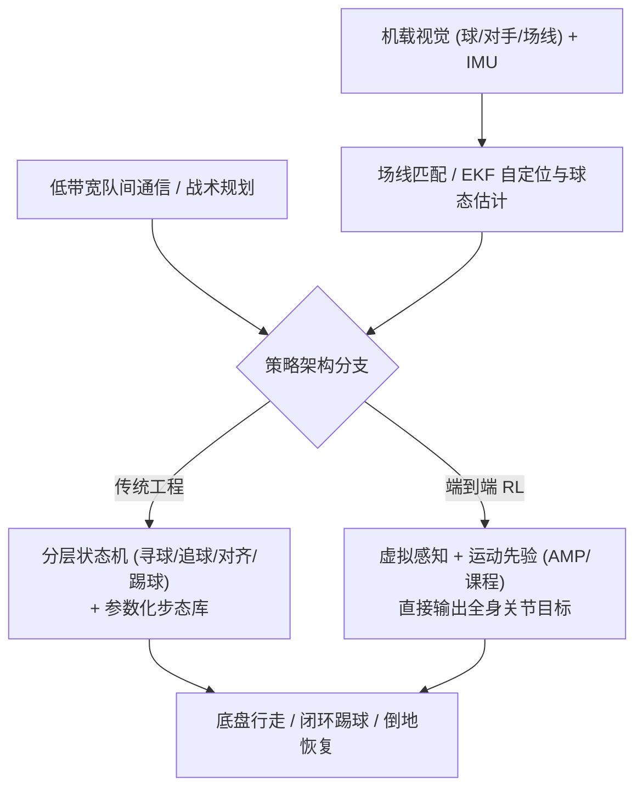

# Humanoid Soccer

**人形机器人足球**：人形机器人在动态、竞争性环境下的综合表现。作为 RoboCup 的核心项目，它被认为是衡量人形机器人自主能力的重要基准。

## 一句话定义

让两队人形机器人在足球场上像人类一样踢球，不摔倒、能进球、懂配合。

## 英文缩写速查

| 缩写 | 英文全称 | 简要说明 |
|------|----------|----------|
| RL | Reinforcement Learning | 通过与环境交互最大化长期回报来学习策略的范式 |
| Isaac Gym | NVIDIA Isaac Gym | GPU 并行刚体仿真训练环境 |
| ZMP | Zero Moment Point | 足式平衡判据，地面反力合力矩为零的点 |
| G1 | Unitree G1 Humanoid | 宇树入门级教育科研人形平台 |
| ACO | Ant Colony Optimization | 蚁群优化；人形足球 swarm 角色分配常用机制 |
| SPL | Standard Platform League | RoboCup NAO 人形联赛；通信配额极严 |
| Locomotion | Robot Locomotion | 足式/人形等无轮移动能力的总称 |

## 为什么重要

- **人形全栈自主能力的集中试金石**：与单一实验室演示动作不同，RoboCup 人形足球在对抗性、非结构草坪与严格通信限制下同时考察全向敏捷移动、视觉主动感知、高冲量单脚踢球与多机角色战术协作。
- **从单机技能到团队涌现的演进主线**：梳理了从基于 HTWK-Gym / Booster RoboCup Demo 的模块化分层状态机，向 PAiD / RoboNaldo / Joga 感知–动作端到端技能以及 ARTEMIS / Swarm 去中心化多机协调迁移的系统全景。

## 核心机制与核心挑战

### 1. 动态感知与定位
机器人必须在快速移动中识别高速滚动的足球、对手机器人、场地边线和球门，并实时更新自身位姿。广播/第三人称侧的检测–跟踪–俯视投影可参考 [Roboflow Sports](../entities/roboflow-sports.md)；网球广播对照见 [Tennis-Vision](../entities/tennis-vision.md)（地板单应失效与拒报）。机载场线定位见 [视觉场线定位流水线](../queries/soccer-visual-field-localization-pipeline.md)。

### 2. 闭环踢球 (Closed-loop Kicking)
不同于预设轨迹的踢球，竞技环境要求：
- **实时修正**：在接近球的过程中根据球的微小移动动态调整步态与出脚位置。
- **力度控制**：根据目标距离与角度调整踢球强度。

### 3. 参数化全向行走 (Omni-directional Walking)
需要具备在任意时刻改变速度、频率和航向的能力，以便进行防守、截球和过人。

### 4. 复杂环境稳定性
真实的草地（或人工草坪）往往不平整，且存在碰撞干扰，对 locomotion 的鲁棒性要求极高。

### 5. 多机协作与群控
竞技足球要求 **角色分配、站位/编队、传球线路与防守补位**，且 RoboCup 联赛 **通信带宽持续收紧**（SPL 队均 WiFi 包量近年大幅下降）。群控与单机「追球射门」技能正交：前者回答 **谁去踢、谁留守、如何避开工友扎堆**。详见 [人形多机协调](../concepts/humanoid-multi-robot-coordination.md)。

## 主要技术路线

### 强化学习 (RL) 驱动
通过在大规模并行仿真（如 Isaac Gym/Lab）中训练，直接获取端到端的运动与技能。
- **HTWK-Gym**：针对 Booster T1/K1 平台的足球任务优化框架。
- **[booster_mjlab](../entities/booster-mjlab.md)**：whIRLwind（RoboCup 2026 Humanoid Soccer 第 4 名）的 **Booster K1 × mjlab + AMP** 训练栈；真机 AMP 行走与浏览器 WASM demo 见[项目页](https://intelligentroboticslab.github.io/booster_mjlab/)。
- **PAiD (Perception-Action Integrated Decision-making)**：将感知与动作解耦并渐进式融合，实现更稳健的踢球。
- **[RoboNaldo](../entities/paper-robonaldo-humanoid-soccer-shooting.md)**：以单条人类踢球参考为 scaffold 的 **三阶段 motion-guided curriculum RL**，在 G1 上实现 **亚米级点瞄准射门**、**13 m/s 级触球球速** 与 **来球 one-touch** 室外真机演示；**已开源** [训练](https://github.com/OpenDriveLab/RoboNaldo) / [部署](https://github.com/OpenDriveLab/RoboNaldo_Deploy)。
- **[SkillX](../entities/paper-skillx-humanoid-soccer.md)**（arXiv:2609.06718，**CoRL 2026**）：松延动力×清华；命令条件 **统一多技能** actor + 技能专属 AMP/critic + 物体感知时序编码；E1 真机 MoCap/机载 ZED2i+YOLOv8；Hard 组合仿真 **81.7%**（[项目页](https://yzc0731.github.io/SkillX/)）；**代码待发布**。
- **[视觉特权表征运球](../entities/paper-vision-dribbling-humanoid-soccer-privileged-representation.md)**（arXiv:2607.12702）：**RMA 式两阶段** — 特权编码器学对手感知运球，再蒸馏 **CNN+GRU 深度 latent**；Booster T1 仿真下无障碍 **100%**、静态障碍 **96%**、动态抢球 **46%** SR。
- **[Vision-Driven Reactive Soccer](../entities/paper-hrl-stack-26-learning-vision-driven-reactive-socc.md)**（Science Robotics 2026 / arXiv:2511.03996）：**虚拟感知 + encoder-decoder** 把机载视觉误差写进统一 RL 环；AMP 运动先验；前场约 **90%** 踢球 SR；Zenodo **部分开源** 仿真训练与 checkpoint。
- **[Joga](../entities/paper-joga-humanoid-soccer.md)**（MIT CSAIL，2026 preprint）：把 2-DoF 主动相机颈部并入全身策略，以 PAM 对齐球检测误差、WB-UAN 对齐整机位置执行，再从运球状态分布微调传球与射门；Unitree G1 持续运球约 **1.71 m/s**、接住最高 **5.2 m/s** 来球；宽角接球漏接率主动颈部 31.4%、锁颈 60.6%。真机由手柄操作者给出球速方向与技能切换指令，并非完全自主比赛。公开仓库仅覆盖相机颈部硬件，策略代码未见公开。

### 分层状态机 + 技能库
将比赛逻辑划分为多个状态（寻球、追球、对齐、踢球），每个状态对应一个底层控制器。
- 代表项目：[Booster RoboCup Demo](../entities/booster-robocup-demo.md)

### 多机战术 / 群控
| 范式 | 代表一手资料 | 要点 |
|------|--------------|------|
| **集中式行为管理** | [ARTEMIS](../entities/paper-notebook-a-hierarchical-model-based-system-for-high-perfo.md)（arXiv:2512.09431） | 立体视觉检测队友/对手 + behavior planner 角色与射门；**2024 Adult-Size 冠军** |
| **Swarm 去中心化** | [Swarm Intelligence 人形足球](../entities/paper-humanoid-soccer-swarm-intelligence.md)（Sensors 2025） | UDP + ACO 角色 + flocking 编队；Webots 4v4 相对集中式 **进球 +25–40%** |
| **极低带宽拍卖（SPL）** | [arXiv:2401.15026](../../sources/papers/robocup_spl_limited_communication_coordination_arxiv_2401_15026.md) | DWM 预测 + 市场拍卖 + Voronoi；**NAO 真机 RoboCup** |

## 关键技能 (Skills)

| 技能 | 技术难点 | 典型实现 |
|------|----------|---------|
| **寻球 (Search)** | 广域视觉扫描、头部关节协同 | YOLOv8 + 分级搜索策略 |
| **接近与对齐 (Chase & Align)** | 全向步态、动态 ZMP 调节 | 参数化行走 (htwk-gym) |
| **运球 (Dribble)** | 移动中控球、遮挡下球态估计、动态对手规避 | [视觉特权表征运球](../entities/paper-vision-dribbling-humanoid-soccer-privileged-representation.md)（深度+RMA 蒸馏，仿真） |
| **踢球 (Kick)** | 单脚支撑平衡、摆腿轨迹规划、高冲量触球时机 | RLVisionKick / PAiD / RoboNaldo / Vision-Driven Reactive Soccer |
| **跌倒恢复 (Get up)** | 接触力反馈、全身协同规划 | 预设 Keyframe / RL Getup |

## 工程实践

- **感知–决策–底层控制分频落地**：工程队伍常见做法是在 Jetson Orin / AGX 跑高频轻量检测与 GameController 裁判协议对接（如 ROS 2 分层树），将底层双足行走、踢球与倒地起身封装为由 RL（Isaac Gym/Lab 或 mjlab + JIT/ONNX）导出的参数化技能库。
- **严格核算机载通信与感知噪声预算**：受 RoboCup 严苛的队均 WiFi 带宽和单播限制约束，训练环境需显式注入检测时延、丢帧与草地接触摩擦随机化，避免理想仿真高成功率在实场大幅退化。

## 局限与风险

- **模块化延后与端到端长时程冲突**：规则状态机配合技能库易出现“看到但出脚迟滞”，而纯端到端扩散/RL 策略在长时程球队角色换防和通信极度受限场上仍面临样本覆盖与可控性边界。
- **部分课程资料受限于登录墙**：大纲关联的深蓝学院视频讲义受会员登录墙保护未全面核对细节，任务系统选型仍以开源论文（RoboNaldo / PAiD / ARTEMIS / Sensors 2025）及代码仓为实证基准。

## 参考来源

- [NaoHTWK/htwk-gym 源码仓库](../../sources/repos/htwk_gym.md) — 针对 Booster T1/K1 的足球 RL 框架
- [TeleHuman/HumanoidSoccer (PAiD) 源码仓库](../../sources/repos/humanoid_soccer.md) — 针对 Unitree G1 的渐进式足球学习
- [robonaldo_arxiv_2606_11092.md](../../sources/papers/robonaldo_arxiv_2606_11092.md) — RoboNaldo 人形射门课程 RL 与 G1 机载感知摘录
- [robonaldo.md](../../sources/repos/robonaldo.md) / [robonaldo-deploy.md](../../sources/repos/robonaldo-deploy.md) — RoboNaldo 训练与部署开源仓
- [humanoid_rl_stack_26_learning_vision_driven_reactive_soccer_skills_fo.md](../../sources/papers/humanoid_rl_stack_26_learning_vision_driven_reactive_soccer_skills_fo.md) — Vision-Driven Reactive Soccer（Science Robotics 2026）摘录
- [humanoid-kick-vision-driven-soccer.md](../../sources/repos/humanoid-kick-vision-driven-soccer.md) — Zenodo 仿真训练/推理代码包
- [opendrivelab-robonaldo.md](../../sources/sites/opendrivelab-robonaldo.md) — 项目页与开源核查
- [Booster Robotics RoboCup Demo](../../wiki/entities/booster-robocup-demo.md) — 完整的足球比赛软件方案
- [booster_mjlab 源码仓库](../../sources/repos/booster_mjlab.md) — whIRLwind K1 mjlab AMP 训练与 motion 管线
- [roboflow_sports.md](../../sources/repos/roboflow_sports.md) — 广播视角检测/跟踪/俯视雷达开源对照
- [humanoid_soccer_swarm_intelligence_sensors_2025.md](../../sources/papers/humanoid_soccer_swarm_intelligence_sensors_2025.md) — 人形足球 swarm 群控（Sensors 2025）
- [artemis_humanoid_soccer_team_coordination_arxiv_2512_09431.md](../../sources/papers/artemis_humanoid_soccer_team_coordination_arxiv_2512_09431.md) — ARTEMIS 冠军系统群控摘录

## 推荐继续阅读

- 技能选型指南：[人形足球技能学习方法选型指南](../queries/humanoid-soccer-skill-learning-method-selection.md)
- 纵深主线：[人形机器人足球纵深路线](../../roadmap/depth-humanoid-soccer.md)

## 关联页面

- [404 Possession Not Found](../entities/project-404-possession-not-found.md)：人类比赛的离线控球标注；对照缺球观测与时序解码，不是机器人足球策略。

- [人形系统课程策展](../entities/humanoid-system-curriculum.md) — Ch6–7 感知定位与 RoboCup 实践地图
- [足球场仿真环境](../concepts/soccer-field-simulation.md) / [场地线检测](../methods/soccer-field-line-detection.md) / [线匹配](../methods/visual-line-matching-localization.md) / [线特征 EKF](../methods/visual-line-ekf-fusion.md)
- [Roboflow Sports](../entities/roboflow-sports.md) — 第三人称体育 CV 与俯视雷达 demo
- [Tennis-Vision](../entities/tennis-vision.md) — 网球广播：事件门与「空中球勿投地板单应」
- [Locomotion](./locomotion.md) — 足球任务的基础
- [PAiD Framework](../methods/paid-framework.md) — 渐进式感知动作学习
- [人形足球技能学习方法选型指南](../queries/humanoid-soccer-skill-learning-method-selection.md) — PAiD vs RoboNaldo 选型
- [ZEST vs SONIC vs 视觉足球](../comparisons/zest-vs-sonic-vs-vision-soccer.md) — 视觉足球在 SciRob 同期三层里是感知任务环，不是跟踪底座
- [RoboNaldo](../entities/paper-robonaldo-humanoid-soccer-shooting.md) — 点级瞄准与高冲量射门课程 RL
- [HTWK-Gym](../methods/htwk-gym.md) — 足球专项 RL 训练环境
- [Reinforcement Learning](../methods/reinforcement-learning.md)
- [Imitation Learning](../methods/imitation-learning.md)
- [人形多机协调](../concepts/humanoid-multi-robot-coordination.md) — 群控范式总览
- [Swarm Intelligence 人形足球](../entities/paper-humanoid-soccer-swarm-intelligence.md) — ACO+flocking 去中心化
- [ARTEMIS 人形足球系统](../entities/paper-notebook-a-hierarchical-model-based-system-for-high-perfo.md) — 集中式战术层真机冠军
- [MARL](../methods/marl.md) — 学习式多体协调
